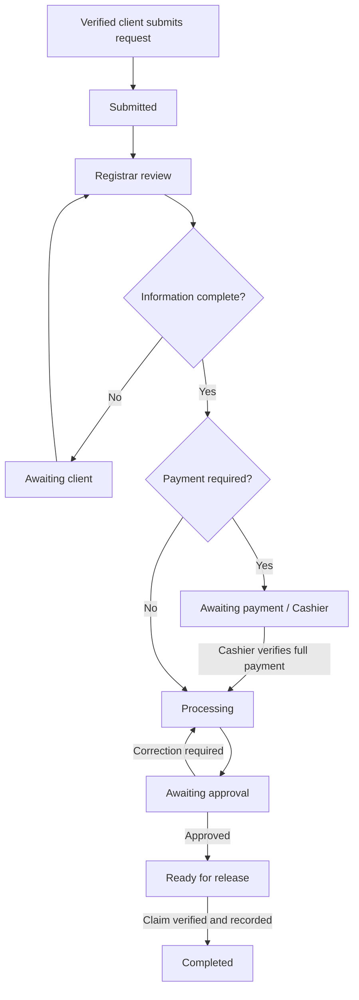
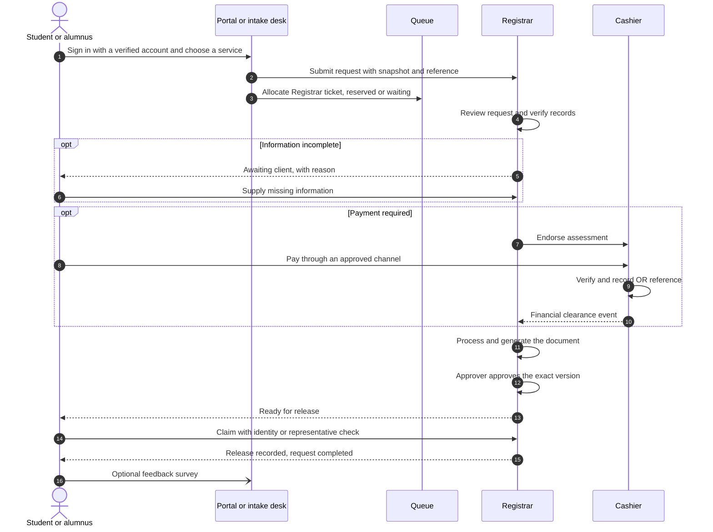

# Part 01 — Requirements, scope and workflow rules

[Back to index](index.md) | [Previous](00-current-baseline.md) | [Next](02-architecture-and-data-model.md)

| Tracking field | Value |
|---|---|
| Plan status | Draft; confirmed choices listed below |
| Implementation | Not started |
| Validation | Not started |
| Deployment | Not deployed |
| Owner | Developer with Registrar, Cashier and MIS representatives; names pending |
| Dependencies | Part 00 |
| Updated | 2026-10-17 |

## Objective and scope

Build **BISU Registrar**, the Integrated Registrar–Cashier Document Request, Queuing, and Transaction Management System for Bohol Island State University – Balilihan Campus.

Cover identification, requests, queuing, record verification, payment recording/verification, document preparation, approval, release, tracking, reports, permissions and audit trails. Source: [original concept brief](project-concept-brief.md). This plan is a proposed implementation breakdown, not institutional approval of operating policies.

## Confirmed by the project owner on 2026-10-15

- Support both online and on-campus initiation, delivered in phases.
- “Online” means access through BISU's local campus network. Host the system on campus infrastructure; public Internet hosting and off-campus access are outside the initial scope.
- Initially maintain/import a verified student/alumni list through authorized staff.
- Use the existing Laravel/Vue/shadcn-vue application and Docker foundation.
- Keep navigation and progress/deployment tracking in this folder's `index.md`.

## Proposed delivery boundary

First deliver an authenticated portal accessible on approved BISU LAN/Wi-Fi and a staff-assisted on-campus intake using the same request workflow. Add a self-service kiosk and privacy-safe queue display after shared identity and queue handling are tested. All concept-brief modules remain in the full release scope. In this plan, an online/remote submission means a client using the campus network away from the service counter, not an off-campus Internet connection.

Online payment gateways, automatic integration with the university's master student system, automatic digital signatures, SMS, academic-record editing and multi-campus support are future candidates unless explicitly added. The initial cashier module records/verifies payments made through campus-approved channels; it does not itself charge a card or issue an official fiscal receipt.

## Shared workflow contract

Request status, payment status and queue status are separate fields with separate histories. Queue service completion does not complete a document request, and an uploaded payment claim does not mean payment has been verified.

| Request state | Allowed next state / guard | Responsible office |
|---|---|---|
| `draft` | `submitted` after client and request validation | Client / intake staff |
| `submitted` | `under_review` | Registrar |
| `under_review` | `awaiting_client`, `awaiting_payment`, `processing`, `rejected` | Registrar; reason for rejection |
| `awaiting_client` | `under_review` after response | Client supplies information; Registrar reviews |
| `awaiting_payment` | `processing` only when verified balance is zero | Cashier records payment; shared workflow applies transition |
| `processing` | `awaiting_approval` with completed required outputs | Registrar processor |
| `awaiting_approval` | `ready_for_release` if approved; `processing` for corrections | Authorized approver |
| `ready_for_release` | `completed` after claimant validation and release record; `processing` for an authorized correction that invalidates prior approval | Release staff / Registrar approver |
| `completed` | Terminal; corrections use a linked reissue/amendment record | Authorized Registrar |
| `cancelled`, `rejected` | Terminal; resubmission creates a linked new request | Authorized staff / client where permitted |

### Who does what, end to end

Cancellation is a dedicated action with stage, payment and document checks, not a freely editable status. Initially permit client cancellation only before review; later-stage cancellation requires an authorized office reason. Paid requests must resolve the approved financial cancellation/refund policy before final cancellation. Any changed rule must be recorded in [the decision register](90-decisions-and-open-questions.md).

Use a separate operational hold with reason, owner and timestamps for disputed payment or record issues. It blocks approval/release until resolved without silently rewriting historical progress. Payment voids must re-evaluate financial clearance; after release they create an exception for investigation instead of undoing the completed release.

### Stalled requests and unclaimed documents (proposed, D18)

Without a rule, requests waiting on the client or on payment, and documents nobody claims, pile up indefinitely and distort pending counts.

- `awaiting_client` and `awaiting_payment` past a configurable number of working days: send reminders, then place the request on a staff review list. A staff member may close it as cancelled with reason "lapsed". Requests with recorded or verified payments are never closed automatically.
- `ready_for_release` past the office's unclaimed period: send reminders, then list it on an unclaimed-documents report for the office's own procedure. It is never marked completed without an actual release.
- Periods, reminder count and wording are decided under [D18](90-decisions-and-open-questions.md).

### Government service standards to confirm (added 2026-10-17)

These apply to Philippine government offices. Confirm how BISU applies them during the office interviews; the plan makes no legal-compliance claim.

| Standard | Effect on this system | Plan location |
|---|---|---|
| Citizen's Charter (RA 11032, Ease of Doing Business Act) | Starting source for services, steps, requirements, fees and processing times in working days | [05](05-services-requirements-and-fees.md), [12](12-reporting-and-analytics.md) |
| ARTA Client Satisfaction Measurement (CSM) | Optional feedback after completion, and results reporting | [11](11-release-tracking-and-notifications.md), [12](12-reporting-and-analytics.md), D19 |
| Priority/express lanes for senior citizens (RA 9994) and PWDs (RA 10754) | Queue lanes beyond plain FIFO | [07](07-queues-counters-and-kiosk.md), D06 |
| Data Privacy Act (RA 10173) and NPC guidance | DPO involvement, PIA, privacy notice, retention, breach response | [03](03-accounts-permissions-and-audit.md), D09 |
| COA collection reporting | Cashier reconciliation against the official collection report | [09](09-cashier-and-payment-control.md), D07 |

## Work items

- [ ] Walk through current procedures with both offices and document exceptions.
- [ ] Confirm initial service list, requirements, fee authority and signatories.
- [ ] Agree on payment timing, cancellation/refund handling and release rules.
- [ ] Confirm how campus portal submissions made away from the counter receive a ticket and when they join an active queue.
- [ ] Confirm who approves requests, payments, documents and production rollout.
- [ ] Review the state transitions above with sample free, paid and returned requests.
- [ ] Agree reminder, lapse and unclaimed-document periods (D18).
- [ ] Confirm how the Citizen's Charter, CSM and priority-lane rules apply to these offices, using the [office interview checklist](95-office-interview-checklist.md).

## Acceptance criteria

- Each action has an authorized actor, required input, result and audit event.
- Offices agree on normal and exception workflows before affected implementation.
- Unresolved rules remain named decisions, never silently treated as approved.
- The traceability table covers every module and expected output in the brief.

## Validation / evidence

Pending workflow review notes, office representatives, approval date and sample transaction walkthroughs. No estimates or delivery dates are commitments until scope and staffing are confirmed.
