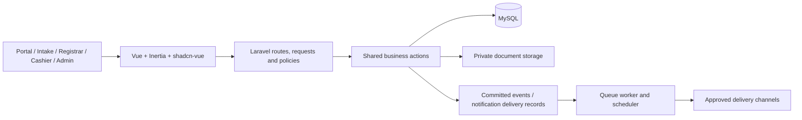
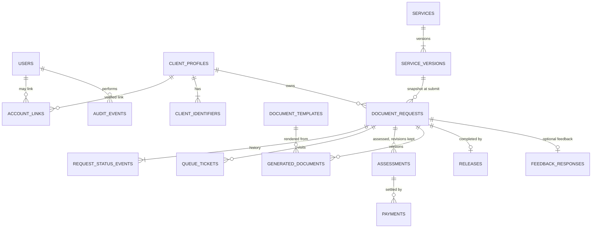

# Part 02 — Application architecture and data model

[Back to index](index.md) | [Previous](01-requirements-and-workflow.md) | [Next](03-accounts-permissions-and-audit.md)

| Tracking field | Value |
|---|---|
| Plan status | Draft |
| Implementation | Incremental; Part 03 users/offices/roles/audit implemented; remaining module models planned |
| Validation | Part 03 checks passed; proposed models require their own migration/concurrency checks |
| Deployment | Not deployed |
| Owner | Lead developer; assignment pending |
| Dependencies | Parts 00–01; build incrementally with each module |
| Updated | 2026-10-17 |

## Architecture

Extend the existing Laravel monolith. Laravel owns authorization, validation and transaction rules; Inertia connects controllers to Vue pages; shadcn-vue supplies consistent controls. MySQL is the source of truth. Redis is available for an explicitly configured cache/queue use case, not a second authoritative transaction store.

Deploy to a campus-managed host reachable on approved BISU LAN/Wi-Fi. Use an internal hostname and trusted HTTPS. Bundle fonts and frontend assets for local serving; core requests, queues, payment recording and document generation must function without Internet access. Package downloads and optional external messaging are operational dependencies to manage separately.

## Proposed code boundaries

- `src/routes/web.php` plus module route files: authenticated routes with policies; stable names for Wayfinder-generated frontend routes.
- `src/app/Http/Controllers/{Portal,Registrar,Cashier,Admin}`: HTTP coordination.
- `src/app/Http/Requests/...`: input validation, including uploaded files.
- `src/app/Policies/`: role, office and record ownership authorization.
- `src/app/Actions/{Requests,Queues,Payments,Documents,Releases}`: reusable state-changing operations, transactions and audit writes.
- `src/app/Enums/`, `Models/`, `Jobs/`, `Notifications/`: typed states, persistence and retryable background work as needed.
- `src/resources/js/pages/{portal,registrar,cashier,admin,queue}`: role-specific screens; shared status badges, tables, filters, forms and history components.
- `src/tests/Feature/...`: workflow and authorization tests; MySQL integration tests for locking and concurrency.

These are proposed additions, not existing folders or classes. Avoid a separate SPA/API service unless a concrete external integration requires it.

## Proposed entities and relationships

| Entity / table group | Purpose and important rules |
|---|---|
| Existing `users`; `offices`, `user_roles`, `audit_events` | Accounts separated from client records; server controls privileges; field-level design in [Part 03 slice 1](03-accounts-permissions-and-audit.md#slice-1-data-model-additive-migrations) |
| `client_profiles`, `client_identifiers`, profile revisions; later current account links + link events | Stable person ID, identifier history and reviewed one-to-one verified links; [Part 04 field/constraint design](04-client-records-and-imports.md#proposed-records-and-constraints) |
| `client_imports`, `client_import_rows` | Private staging, immutable reviewed manifest, create-only commits, durable per-row outcomes/retries and source provenance; [Part 04 lifecycle](04-client-records-and-imports.md#import-lifecycle-consistency-and-recovery) |
| `services`, service versions/requirements/fee versions | Effective dates; deactivate instead of removing referenced definitions |
| `document_requests`, `request_items` | Client, source channel, reference, workflow state, optimistic version and submitted snapshots |
| `request_status_events`, comments, attachments, holds | Ordered history; internal notes separated from client-visible updates |
| `offices`, `service_counters`, `queue_sequences`, `queue_tickets`, ticket events | Ticket per office visit; unique office/day/number; durable sequence allocation |
| `assessments`, assessment lines, `payments`, adjustments | Exact fee snapshot, currency, verified amount, cashier, receipt reference and reversals |
| `document_templates`, template versions, `generated_documents`, approval records | Immutable issued versions, source snapshot, checksum, file location and signatory decision |
| `releases` | Claimant, authority evidence where required, release actor, time and released document version |
| `academic_periods` | Campus-approved semester / academic-year boundaries, independent from report calendar filters |
| `audit_events`, notification deliveries, export jobs | Accountability and retryable outputs; access-controlled payloads |
| `suppliers`, supplier deliveries/ratings, versioned rating criteria, compliance documents | Registrar supplier list and performance points ([Part 16](16-supplier.md)); office-scoped; rating snapshots keep weights used; no money columns |
| `service_calendar_days` | Per-office working days, holidays and suspensions (for example weather-related); drives queue service days and working-day turnaround |
| `feedback_responses` | Optional post-completion feedback (CSM-aligned if adopted, D19); anonymous or linked per DPO decision |
| `privacy_notice_versions`, notice acknowledgements | Which privacy notice version a client saw and when (D09); not a substitute for the lawful basis the DPO determines |

### Core relationships (simplified)

Supplier tables are shown in [Part 16](16-supplier.md). Status-event, hold and attachment tables are omitted for readability.

Proposed first-release transaction unit: one service type per request with quantity/copies as allowed. `request_items` leaves room for later expansion, but mixed-service carts and partial release are deferred until their workflow is approved. Assessment revisions and corrections preserve original values.

## Data invariants

- Use foreign keys and uniqueness constraints, not only frontend validation.
- Store money as integer minor units with a currency field; do not use floating-point calculations.
- Snapshot service names, approved fees and document inputs at the appropriate transaction stage.
- Store timestamps consistently in UTC; propose `Asia/Manila` for campus display/service-day boundaries, pending confirmation. Count working days from `service_calendar_days`, never from weekdays alone.
- Use non-enumerable public references; a reference alone never grants access to personal records.
- Use transactions and row locks for payment verification, queue calling and release. Use idempotency keys for retried submissions and financial operations.
- Add state changes and audit events in the same database transaction; dispatch external work only after commit. Persist delivery intent so retries do not silently lose notifications.
- Private attachments and generated documents require authorized downloads. Database rows and file storage must be covered by coordinated backup/restore procedures.
- Preserve retained financial and academic transaction history when accounts are deactivated. Define deletion/retention rules before destructive actions.

## Work items

- [x] Produce field-level schema and ER diagram for the first development slice. Done for slice 1 (accounts, roles, audit) in [Part 03](03-accounts-permissions-and-audit.md#slice-1-data-model-additive-migrations) and implemented.
- [ ] Review indexes for client ID lookup, office/state/date worklists, request references and reporting.
- [ ] Define response shapes and shared TypeScript types for each screen.
- [ ] Define database constraints and transaction boundaries before controllers.
- [ ] Add synthetic factories/seeders and safe migration/rollback plans.
- [ ] Document each migration and any required backfill in its module plan.

## Acceptance and validation

Review representative free and paid requests through the model before coding. Prove duplicate submissions, simultaneous queue calls and simultaneous payment actions cannot create conflicting records. Migration checks must cover MySQL; SQLite starter tests alone cannot prove MySQL locking behavior.

## Optimization note

Paginate worklists and use bounded queries with eager loading. Add indexes from actual query plans. Defer summary tables, WebSockets and separate services until measured usage justifies them.
