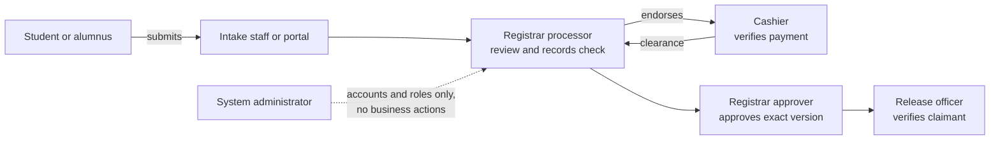
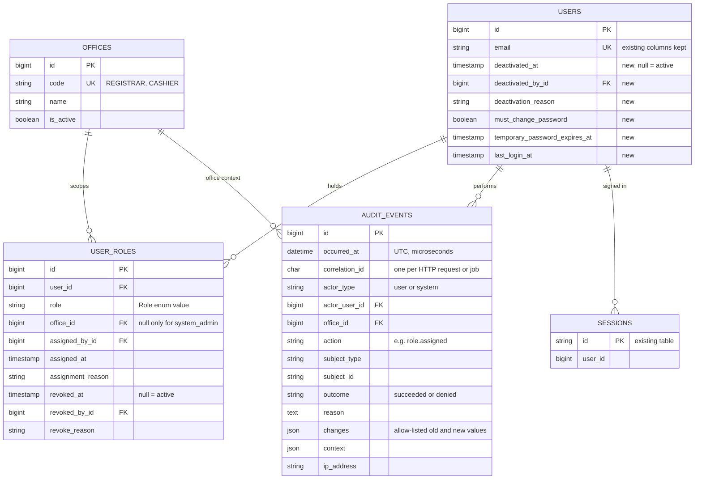
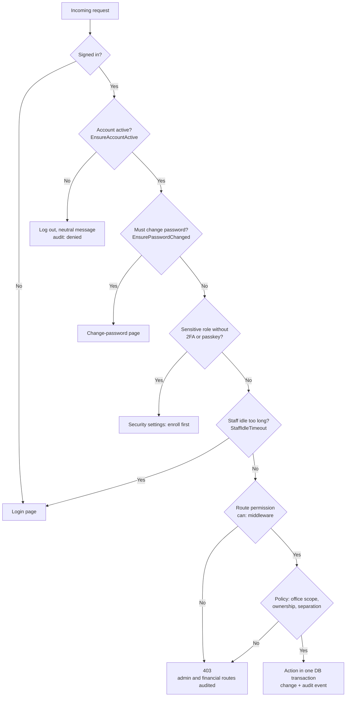
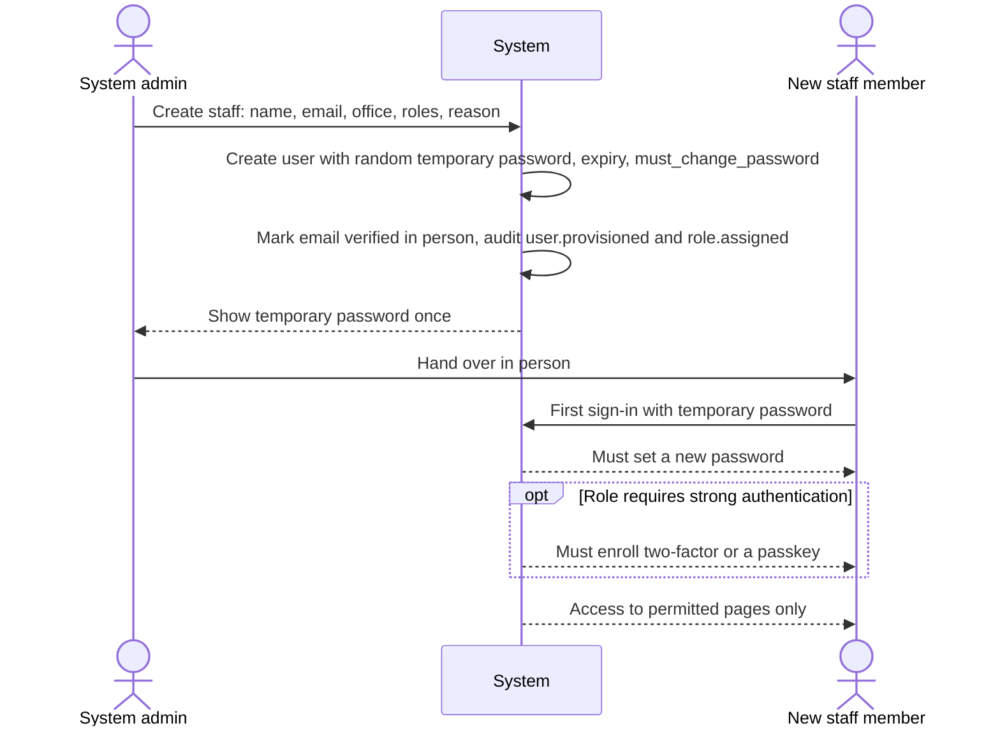
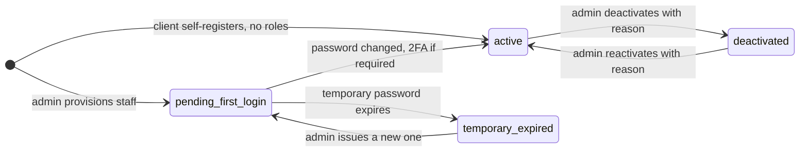
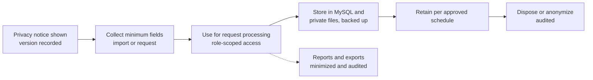

# Part 03 — Accounts, permissions, privacy and audit

[Back to index](index.md) | [Previous](02-architecture-and-data-model.md) | [Next](04-client-records-and-imports.md)

| Tracking field | Value |
|---|---|
| Plan status | Draft; [slice 1 design](#slice-1-design-staff-accounts-roles-and-audit) ready for team review (2026-10-17) |
| Implementation | Not started beyond starter authentication |
| Validation | Not started for business permissions |
| Deployment | Not deployed |
| Owner | Backend lead with MIS and authorized office reviewers; names pending |
| Dependencies | Parts 01–02; slice 1 needs D22 and the team answers listed in [handoff.md](handoff.md) |
| Updated | 2026-10-17 |

## Features and screens

- User list, invitations/provisioning, activation/deactivation and role assignments.
- Client account verification/linkage status and controlled recovery support.
- Office-specific navigation and server-enforced access policies.
- Audit viewer with actor, action, record, office, time, reason and outcome filters.
- Session/security settings using the existing Fortify foundation.

## Proposed permission matrix

All roles are proposed pending office review. Multiple roles require explicit assignment. An administrator account does not automatically confer cashier verification or document signatory authority.

| Role | Intended permissions | Boundaries |
|---|---|---|
| Student / alumni | Own verified profile, requests, allowed attachments, tracking and history | No access to another client's records or office-only notes |
| Intake staff | Assisted requests, identity verification within assigned scope, queue assistance | Cannot record payment or approve documents solely through intake role |
| Registrar processor | Review records, process requests, prepare document drafts | Cannot invent payment clearance or approve outside assigned authority |
| Registrar approver | Review and approve assigned document types; return for correction | Signature/approval authority must be configured explicitly |
| Release officer | View clearance and record verified handover | Cannot bypass required approval or payment |
| Cashier | Assigned assessments, payment verification, payment history and scoped collections | No academic record editing or general document approval |
| Supervisor / report viewer | Authorized office reports and exception review | Office-scoped access; full exports separately permissioned |
| Registrar supplier staff | Maintain the supplier list, record deliveries and submit ratings ([Part 16](16-supplier.md)) | Cannot confirm own ratings or change supplier status |
| Registrar supplier supervisor | Confirm/return/void ratings, review decisions, rating settings | Every status decision needs a reason; no automatic suspension |
| System administrator | Accounts, roles, configuration and operational access | Business actions need explicit additional permissions |

### Separation of duties on one paid request

No single role can move a paid request from submission to release alone:

### Staff session security (proposed)

- Require two-factor authentication (already available through Fortify) for Cashier, approver, release, supervisor and administrator roles.
- Idle session timeout on staff accounts, shorter on shared office PCs; signing out clears the session completely.
- Keep Fortify login throttling. Add rate limits on Student/Alumni ID lookup, account linking and kiosk actions ([Part 04](04-client-records-and-imports.md)).
- Deactivate staff accounts promptly when people change roles or leave; review active roles each semester.

## Implementation steps

1. Agree on permission names and assignment ownership. The slice 1 design below recommends a small native model (D22) and drafts the full permission catalogue for office review.
2. Enforce policies on every read, write, download, report and export; frontend visibility is only a usability aid.
3. Adjust starter registration: client self-registration may create an unlinked account, never a staff role. Require a verified client link before requests or personal-record access.
4. Review starter profile deletion. Once retained transactions exist, use a reviewed deactivation/retention flow instead of deleting their owner or required audit history.
5. Add account/permission change auditing, and reusable audit writing for later modules.
6. Record actor, target, action, allowed changed fields, reason, timestamp and correlation reference. Exclude passwords, tokens, document contents and unnecessary personal data.
7. Restrict audit modification/deletion through the application and database privileges; document administrator/database access limits rather than claiming absolute tamper-proof storage.
8. Review privacy notices, access requests, retention and incident responsibilities with campus-authorized personnel. This plan does not assert legal compliance or define institutional retention periods.
9. Implement the privacy program items below with the DPO, and the staff session security rules above.

## Slice 1 design: staff accounts, roles and audit

Design only, written 2026-10-17 for team review. No code exists for it yet. Everything here is a proposal until the team answers the questions at the end and records D22.

### Scope

| In slice 1 | Not in slice 1 |
|---|---|
| Offices, roles, permission catalogue, role assignment with history | Client account linking to Student/Alumni IDs (Part 04, needs D03) |
| Staff provisioning without email, forced password change | Privacy notice screens (need DPO text, D09) |
| Deactivation and reactivation, forced logout | Any request, queue, payment, document or supplier screens |
| Two-factor/passkey requirement for sensitive roles, staff idle timeout | Real email delivery (D11) |
| Reusable audit writer and audit viewer | Audit exports (follow Part 12 export rules later) |
| Starter changes: registration creates role-less accounts; self-deletion replaced | |

The permission catalogue below covers every part, so offices review it once. Slice 1 only implements the account and audit permissions; each later part implements its own rows.

### Starting point in the code (checked 2026-10-17)

- Fortify features on: registration, password reset, email verification, two-factor (with confirmation). Passkeys are available.
- `users` has name, email, password, verification and two-factor columns only. There is no status, so nobody can be deactivated.
- Any signed-in user can delete their own account (`DELETE settings/profile`, `profile.destroy`).
- `HandleInertiaRequests` shares the whole `auth.user` model with every page. New user columns would be exposed automatically.
- Sessions use the database driver, so a user's sessions can be ended server-side.
- The dashboard requires a verified email, but no mail relay exists yet (D11).
- No roles, permissions, policies or RBAC package exist.

### RBAC approach (D22)

| Criterion | Native, enum-based (recommended) | spatie/laravel-permission |
|---|---|---|
| Who changes the role → permission map | Code change through a PR, CI and change log, so every change is reviewed and recorded | Editable at runtime in the database; needs its own audit and cache resets |
| Office scope | `office_id` on each role assignment | "Teams" feature, with the team set per request |
| Assignment history | Built in: assignments are revoked, never deleted | Not built in: removing a role deletes the pivot row |
| Type safety | PHP enums; a test keeps the TypeScript list in sync | String names |
| Effort | Enum, map, one table, a trait, middleware and tests the team writes | Install and configure; less custom code |
| Fit | A fixed, office-approved matrix with ~10 roles | Better if offices want admins to invent new roles at runtime |

Recommendation: native. The matrix must be approved by the offices, and changes should go through review, not a settings screen. Reconsider spatie if the offices ask for admin-editable roles.

### Roles

Clients are not a role. A person acts as a client only through a verified account link (Part 04). Staff roles are assigned explicitly, and each assignment is scoped to an office.

| Role code | Office scope | Requires 2FA or passkey |
|---|---|---|
| `system_admin` | Campus-wide | Yes |
| `intake_staff` | Registrar | No |
| `registrar_processor` | Registrar | No |
| `registrar_approver` | Registrar | Yes |
| `release_officer` | Registrar | Yes |
| `cashier` | Cashier | Yes |
| `office_supervisor` | Registrar or Cashier, per assignment | Yes |
| `report_exporter` | Registrar or Cashier, per assignment | Yes |
| `supplier_staff` | Registrar | No |
| `supplier_supervisor` | Registrar | Yes |

One person can hold several roles. Nobody can assign a role to themselves. `report_exporter` exists so that exports are granted separately from viewing (Part 12).

### Permission catalogue (draft for office review)

| Permission | Part | Held by | Built in |
|---|---|---|---|
| `users.view` | 03 | system_admin | Slice 1 |
| `users.manage` (create staff, edit, temporary password, reset 2FA) | 03 | system_admin | Slice 1 |
| `users.deactivate` | 03 | system_admin | Slice 1 |
| `roles.assign` | 03 | system_admin | Slice 1 |
| `audit.view` | 03 | system_admin (all offices), office_supervisor (own office) | Slice 1 |
| `clients.view` | 04 | intake_staff, registrar_processor, registrar_approver, release_officer | Part 04 |
| `clients.manage`, `clients.import`, `client_links.review` | 04 | registrar_processor (import also office_supervisor, per D04) | Part 04 |
| `services.manage`, `waivers.approve` | 05 | office_supervisor (Registrar) | Part 05 |
| `fees.manage` | 05 | office_supervisor (office per D05) | Part 05 |
| `requests.intake` | 06 | intake_staff, registrar_processor | Part 06 |
| `queue.operate` | 07 | intake_staff, registrar_processor, release_officer, cashier | Part 07 |
| `queue.configure` | 07 | office_supervisor | Part 07 |
| `requests.view` | 08 | all Registrar roles; cashier (payment-related fields only) | Part 08 |
| `requests.review`, `requests.process`, `assessments.endorse` | 08 | registrar_processor | Part 08 |
| `requests.assign`, `holds.manage` | 08 | office_supervisor (Registrar); holds also registrar_processor | Part 08 |
| `payments.record`, `payments.verify` | 09 | cashier (record/verify by different people per D07) | Part 09 |
| `payments.adjust`, `collections.view` | 09 | office_supervisor (Cashier); collections also cashier | Part 09 |
| `templates.manage` | 10 | office_supervisor (Registrar) | Part 10 |
| `documents.generate` | 10 | registrar_processor | Part 10 |
| `documents.approve` | 10 | registrar_approver | Part 10 |
| `releases.record` | 11 | release_officer | Part 11 |
| `reports.view` | 12 | office_supervisor (own office) | Part 12 |
| `reports.export` | 12 | report_exporter (own office) | Part 12 |
| `suppliers.view`, `suppliers.manage`, `supplier_deliveries.record`, `supplier_ratings.submit` | 16 | supplier_staff | Part 16 |
| `supplier_ratings.confirm`, `suppliers.change_status`, `supplier_settings.manage`, `supplier_reports.view` | 16 | supplier_supervisor | Part 16 |
| `supplier_reports.export` | 16 | report_exporter (Registrar) | Part 16 |

`system_admin` holds no business permissions. Policies add the rules a permission alone can't express: office scope, ownership, and separation of duties. Two examples are "cannot confirm your own rating" and "staff never act on their own client request".

### Slice 1 data model (additive migrations)

- One active assignment per user, role and office, enforced in the database. Use stored generated columns (office key = `COALESCE(office_id, 0)`, active flag = 1 when `revoked_at` is null, else null) in a unique index, since MySQL has no partial indexes.
- Assignments and audit events are never deleted or updated by the application. `AuditEvent` has no `updated_at`; its model refuses updates and deletes. In production, MIS grants the application database user no `UPDATE`/`DELETE` on `audit_events` (Part 14).
- Audit indexes: `occurred_at`; (`actor_user_id`, `occurred_at`); (`subject_type`, `subject_id`); (`action`, `occurred_at`); (`office_id`, `occurred_at`).
- Seed `REGISTRAR` and `CASHIER` offices. Later parts reuse `offices` (Part 07 counters, Part 16 suppliers).

### How every request is authorized

Permissions are read from `user_roles` on each request (memoized for that request only). A revoked role therefore stops working on the user's next request, with no cache to clear.

### Staff provisioning without email

There is no mail relay yet (D11), so staff accounts are created by an administrator and handed over in person.

- Temporary passwords expire (proposed 72 hours) and stop working once changed.
- Forgotten staff password or lost 2FA device: an administrator verifies the person in person, then issues a new temporary password or resets 2FA. Both are audited with a reason.
- The first administrator is created by MIS with an artisan command (`bisu:create-admin`), audited as a system action. After that, administrators are created only through the admin screens.

### Account lifecycle

These states are derived from `must_change_password`, `temporary_password_expires_at` and `deactivated_at`; there is no separate status column.

- **Deactivation** ends all of the user's sessions (delete their `sessions` rows), rotates the remember token, and blocks password, two-factor and passkey sign-in. `EnsureAccountActive` also catches an existing session on its next request.
- **Safety rules:** administrators cannot deactivate themselves or revoke their own `system_admin` role. At least one active administrator must always remain, checked under a row lock. Nobody can assign roles to their own account.
- Deactivation never deletes the user, their role history or their audit events.

### Audit trail

- One writer, `AuditRecorder::record(action, subject, reason, changes, context)`, used by every action inside the same database transaction as the change (Part 02 invariant).
- `changes` holds only allow-listed fields. Passwords, tokens, two-factor secrets, recovery codes and session ids are never written, enforced by a test.
- Each HTTP request or queued job gets a `correlation_id` (middleware), so all events from one action can be grouped.
- Denied attempts are recorded for admin and financial routes only, to keep the log useful.
- Slice 1 events: `user.provisioned`, `user.updated`, `user.deactivated`, `user.reactivated`, `user.temporary_password_issued`, `user.two_factor_reset`, `user.password_changed`, `role.assigned`, `role.revoked`, `auth.denied`.
- Audit viewer: administrators see all offices; office supervisors see their own office. Filters: date range, actor, action, office, subject and outcome. Paginated. A row opens a detail panel showing old → new values.

### Changes to the starter app (proposed)

| Starter behavior | Proposed change | Connected effect |
|---|---|---|
| Self-registration on | Keep for clients. New accounts get no roles and see a "link your Student/Alumni ID" empty state until Part 04. Turn it off in production until D03 and D11 are decided (config flag). | `RegistrationTest` gains a no-roles assertion |
| Anyone can delete their own account | Remove self-deletion (route and `DeleteUser.vue`). Clients ask the office to close their account; erasure follows the D09 retention rules | Settings deletion tests are rewritten for deactivation |
| `auth.user` shares the whole model | Share an explicit allow-list (id, name, email, verified, two-factor enabled), plus `auth.permissions` and `auth.roles` for showing and hiding UI only | Frontend `auth` types updated |
| Dashboard requires verified email | Staff are marked verified at in-person provisioning; clients still verify by email or the assisted process (D11) | None for staff |
| Session lifetime 120 minutes for everyone | Staff idle timeout (proposed 30 minutes, configurable); clients unchanged | New middleware |

### Screens

- **Users list:** search by name or email; filter by role, office and status. Columns: roles (badges), status, two-factor status, last sign-in.
- **Create staff:** name, email, office, roles valid for that office, reason. On save, the temporary password is shown once, ready to print.
- **User detail:** profile, status, and role history (who assigned or revoked, when, why). Actions: assign or revoke role, deactivate or reactivate, issue a temporary password, reset 2FA. Each action opens a dialog that requires a reason.
- **Audit viewer:** as described above.
- **Forced change-password page,** and empty-state dashboards for unlinked clients and for staff.
- The sidebar shows an Admin section only to users holding `users.view` or `audit.view`. This is UI only; the server still enforces every rule.

### Proposed code layout

- `app/Enums/Role.php`, `app/Enums/Permission.php` (role → permission map in code)
- `app/Models/Office.php`, `UserRole.php`, `AuditEvent.php`; `User` gains `roles()`, `hasPermission()`, `isActive()`
- `app/Actions/Accounts/` — ProvisionStaffUser, AssignRole, RevokeRole, DeactivateUser, ReactivateUser, IssueTemporaryPassword, ResetTwoFactor
- `app/Support/Audit/AuditRecorder.php`
- `app/Http/Middleware/` — AssignCorrelationId, EnsureAccountActive, EnsurePasswordChanged, EnsureStrongAuthentication, StaffIdleTimeout
- `app/Policies/UserPolicy.php`, `AuditEventPolicy.php`
- `app/Http/Controllers/Admin/` — UserController, UserRoleController, UserStatusController, AuditEventController
- `routes/admin.php` with route names `admin.users.*` and `admin.audit.*` (Wayfinder generates the frontend helpers)
- `resources/js/pages/admin/users/{Index,Create,Show}.vue`, `admin/audit/Index.vue`, `auth/ChangePassword.vue`
- `app/Console/Commands/CreateFirstAdmin.php`
- Migrations: create offices; add account columns to users; create user_roles; create audit_events. Seeder: offices. Factories for roles.

### Slice 1 tests

- [ ] Each role holds exactly the approved permissions (a matrix test the offices' approval is checked against).
- [ ] `system_admin` cannot perform any business action; there is no "super admin" bypass.
- [ ] Non-admins get 403 on every admin route by direct URL; denials are audited.
- [ ] Role assign/revoke requires a reason, writes an audit event and keeps history; a duplicate active assignment is rejected by the database.
- [ ] Nobody can assign roles to themselves; the last active administrator cannot be removed or deactivated.
- [ ] A deactivated user cannot sign in by password, two-factor or passkey; an open session ends on its next request; remember-me no longer works.
- [ ] A temporary password forces a change, expires, and stops working after the change.
- [ ] Sensitive roles without two-factor or a passkey are sent to enroll before anything else.
- [ ] A revoked role stops working on the next request.
- [ ] Audit rows cannot be updated or deleted through the model; secrets never appear in `changes`.
- [ ] Events from one request share a correlation id.
- [ ] Self-registered accounts have no roles; self-deletion is gone.
- [ ] Staff idle timeout ends staff sessions; client sessions are unaffected.
- [ ] The TypeScript permission list matches the PHP enum.

### Questions to settle before coding

These are also listed in [handoff.md](handoff.md).

1. **D22:** native enum-based roles (recommended) or spatie/laravel-permission?
2. Remove self-service account deletion now (recommended), with clients asking the office to close their account?
3. A staff member who is also an alumnus: one account with the rule "never act on your own request" (recommended), or separate staff and personal accounts?
4. Staff idle timeout: 30 minutes? Which roles must use two-factor or a passkey (table above)?
5. Temporary password expiry: 72 hours? Or a printed one-time activation code instead?
6. Who will be the first system administrator (an MIS person is recommended)?
7. Take the role and permission catalogue to the Registrar and Cashier meeting for approval of names and holders (D03, D07, D08).

## Privacy program items (added 2026-10-17; confirm with the BISU Data Protection Officer)

- The university DPO is the owner of [D09](90-decisions-and-open-questions.md).
- Complete a Privacy Impact Assessment (NPC guidance) before real student/alumni data enters staging or production.
- Show the DPO-approved privacy notice at first portal sign-in, at account linking, at the kiosk and at assisted intake. Record which notice version was shown and when. The DPO decides the lawful basis; this is not assumed to be consent.
- Give data subject requests (access, correction) an office procedure. Corrections follow the Part 04 rules and never silently overwrite verified fields.
- Name breach-response contacts. NPC requires breach notification within set deadlines (72 hours under NPC Circular 16-03); confirm current rules with the DPO and link the response steps to Part 14.
- Minimize personal data in logs, exports, displays and feedback (rules already listed in Parts 07, 12 and 13).

## Required audit events

Account activation/deactivation; role changes; client linkage/verification; imports; request submission and transitions; queue actions; assessments and fee changes; payment recording/verification/reversal; document generation/approval/download where required; release; sensitive exports; configuration changes; supplier records, delivery ratings, rating settings and supplier status changes ([Part 16](16-supplier.md)).

## Acceptance criteria / checks

- [ ] Direct URLs and modified HTTP requests cannot bypass role or ownership rules.
- [ ] Client A cannot access Client B's requests, files, notifications or exports.
- [ ] Disabled users lose access, and role changes invalidate stale permission state.
- [ ] Public queue responses and logs contain no student IDs or full client details.
- [ ] Every business-changing action writes its audit event atomically.
- [ ] Staff provisioning and recovery have an accountable operator and documented process.
- [ ] Tests cover role escalation, unauthorized downloads and account deletion with retained records.
- [ ] Two-factor is enforced for the roles listed above; idle sessions expire on shared office PCs.
- [ ] The privacy notice version shown to each client is recorded; the PIA is completed before real data.

## Dependencies / open decisions

Resolve identity proof, staff provisioning, role separation, retention and audit access in [D03, D08 and D09](90-decisions-and-open-questions.md), and the RBAC approach in [D22](90-decisions-and-open-questions.md). Later modules must add permissions and audits as they are built; security is not a final-stage add-on.

## Completion evidence

Pending permission matrix approval, policy tests, reviewed audit samples and implementation revision.
