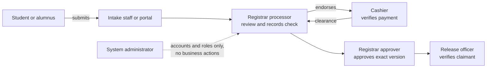
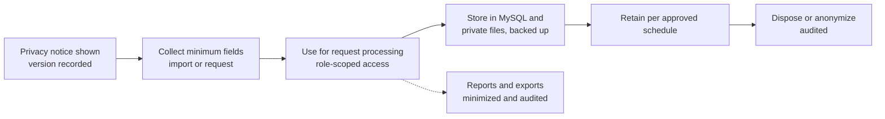

# Part 03 — Accounts, permissions, privacy and audit

[Back to index](index.md) | [Previous](02-architecture-and-data-model.md) | [Next](04-client-records-and-imports.md)

| Tracking field | Value |
|---|---|
| Plan status | Draft |
| Implementation | Not started beyond starter authentication |
| Validation | Not started for business permissions |
| Deployment | Not deployed |
| Owner | Developer with MIS and authorized office reviewers; names pending |
| Dependencies | Parts 01–02 |
| Updated | 2026-10-17 |

## Features and screens

- User list, invitations/provisioning, activation/deactivation and role assignments.
- Client account verification/linkage status and controlled recovery support.
- Office-specific navigation and server-enforced access policies.
- Audit viewer with actor, action, record, office, time, reason and outcome filters.
- Session/security settings using the existing Fortify foundation.

## Proposed permission matrix

All roles are proposed pending office review. Multiple roles require explicit assignment. An administrator account does not automatically confer cashier verification or document signatory authority.

| Role | Intended permissions | Boundaries |
|---|---|---|
| Student / alumni | Own verified profile, requests, allowed attachments, tracking and history | No access to another client's records or office-only notes |
| Intake staff | Assisted requests, identity verification within assigned scope, queue assistance | Cannot record payment or approve documents solely through intake role |
| Registrar processor | Review records, process requests, prepare document drafts | Cannot invent payment clearance or approve outside assigned authority |
| Registrar approver | Review and approve assigned document types; return for correction | Signature/approval authority must be configured explicitly |
| Release officer | View clearance and record verified handover | Cannot bypass required approval or payment |
| Cashier | Assigned assessments, payment verification, payment history and scoped collections | No academic record editing or general document approval |
| Supervisor / report viewer | Authorized office reports and exception review | Office-scoped access; full exports separately permissioned |
| Registrar supplier staff | Maintain the supplier list, record deliveries and submit ratings ([Part 16](16-supplier.md)) | Cannot confirm own ratings or change supplier status |
| Registrar supplier supervisor | Confirm/return/void ratings, review decisions, rating settings | Every status decision needs a reason; no automatic suspension |
| System administrator | Accounts, roles, configuration and operational access | Business actions need explicit additional permissions |

### Separation of duties on one paid request

No single role can move a paid request from submission to release alone:

### Staff session security (proposed)

- Require two-factor authentication (already available through Fortify) for Cashier, approver, release, supervisor and administrator roles.
- Idle session timeout on staff accounts, shorter on shared office PCs; signing out clears the session completely.
- Keep Fortify login throttling. Add rate limits on Student/Alumni ID lookup, account linking and kiosk actions ([Part 04](04-client-records-and-imports.md)).
- Deactivate staff accounts promptly when people change roles or leave; review active roles each semester.

## Implementation steps

1. Agree on permission names and assignment ownership. Choose a small native model or a maintained RBAC package only after requirements review.
2. Enforce policies on every read, write, download, report and export; frontend visibility is only a usability aid.
3. Adjust starter registration: client self-registration may create an unlinked account, never a staff role. Require a verified client link before requests or personal-record access.
4. Review starter profile deletion. Once retained transactions exist, use a reviewed deactivation/retention flow instead of deleting their owner or required audit history.
5. Add account/permission change auditing, and reusable audit writing for later modules.
6. Record actor, target, action, allowed changed fields, reason, timestamp and correlation reference. Exclude passwords, tokens, document contents and unnecessary personal data.
7. Restrict audit modification/deletion through the application and database privileges; document administrator/database access limits rather than claiming absolute tamper-proof storage.
8. Review privacy notices, access requests, retention and incident responsibilities with campus-authorized personnel. This plan does not assert legal compliance or define institutional retention periods.
9. Implement the privacy program items below with the DPO, and the staff session security rules above.

## Privacy program items (added 2026-10-17; confirm with the BISU Data Protection Officer)

- The university DPO is the owner of [D09](90-decisions-and-open-questions.md).
- Complete a Privacy Impact Assessment (NPC guidance) before real student/alumni data enters staging or production.
- Show the DPO-approved privacy notice at first portal sign-in, at account linking, at the kiosk and at assisted intake. Record which notice version was shown and when. The DPO decides the lawful basis; this is not assumed to be consent.
- Give data subject requests (access, correction) an office procedure. Corrections follow the Part 04 rules and never silently overwrite verified fields.
- Name breach-response contacts. NPC requires breach notification within set deadlines (72 hours under NPC Circular 16-03); confirm current rules with the DPO and link the response steps to Part 14.
- Minimize personal data in logs, exports, displays and feedback (rules already listed in Parts 07, 12 and 13).

## Required audit events

Account activation/deactivation; role changes; client linkage/verification; imports; request submission and transitions; queue actions; assessments and fee changes; payment recording/verification/reversal; document generation/approval/download where required; release; sensitive exports; configuration changes; supplier records, delivery ratings, rating settings and supplier status changes ([Part 16](16-supplier.md)).

## Acceptance criteria / checks

- [ ] Direct URLs and modified HTTP requests cannot bypass role or ownership rules.
- [ ] Client A cannot access Client B's requests, files, notifications or exports.
- [ ] Disabled users lose access, and role changes invalidate stale permission state.
- [ ] Public queue responses and logs contain no student IDs or full client details.
- [ ] Every business-changing action writes its audit event atomically.
- [ ] Staff provisioning and recovery have an accountable operator and documented process.
- [ ] Tests cover role escalation, unauthorized downloads and account deletion with retained records.
- [ ] Two-factor is enforced for the roles listed above; idle sessions expire on shared office PCs.
- [ ] The privacy notice version shown to each client is recorded; the PIA is completed before real data.

## Dependencies / open decisions

Resolve identity proof, staff provisioning, role separation, retention and audit access in [D03, D08 and D09](90-decisions-and-open-questions.md). Later modules must add permissions and audits as they are built; security is not a final-stage add-on.

## Completion evidence

Pending permission matrix approval, policy tests, reviewed audit samples and implementation revision.
