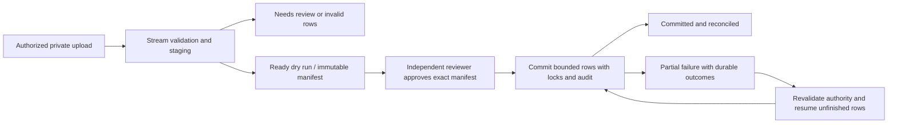
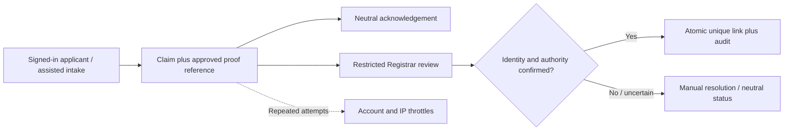

# Part 04 — Verified student/alumni records and imports

[Back to index](index.md) | [Previous](03-accounts-permissions-and-audit.md) | [Next](05-services-requirements-and-fees.md) | [Current handoff](handoff.md)

| Tracking field | Value |
|---|---|
| Plan status | Detailed design draft; owner requested preparation, office approval pending |
| Implementation | Not started; no Part 04 tables, routes or screens added |
| Validation | Design checked against Part 03; implementation and records-custodian acceptance pending |
| Deployment | Not deployed |
| Owner | Registrar records custodian + developer; named custodian pending |
| Dependencies | Parts 02–03; D03/D04/D09 gate real identity data and linkage |
| Updated | 2026-10-17 |

## Confirmed direction and scope

Authorized staff will maintain/import a verified client list initially (C03). Both campus-network self-service and assisted intake are planned in phases (C02/C04). The owner requested this design because no office documents are available yet. This draft proposes implementation details; it does not approve a CSV format, identity proof or institutional policy.

Client profiles identify requesters. They do not replace academic records, establish enrolment, authorize issuance or create login privileges. Student/Alumni IDs are identifiers, never passwords. Email verification and campus LAN access do not establish official client identity. One person may have several identifiers and one account, including a staff account (C09); staff must never process their own requests when Part 06 is built.

Build profiles and safe imports first. Account linking follows only after Registrar/MIS agree proof and recovery under D03. Part 05 remains separate and waits for approved services/fees; no amounts or documents are invented here.

## Delivery slices and gates

| Slice | Deliverable | Gate before implementation / real use | Exit evidence |
|---|---|---|---|
| 1 — Client records | Additive profile/identifier model, authorized search/detail, manual create/correction, verification provenance, audit | Team reviews this design and proposed permissions; use synthetic records until D04/D09 approve fields/source/corrections | Permission matrix, identifier conflicts, correction history, MySQL migration checks, browser review |
| 2 — Reviewed imports | Private CSV staging, fixed template, validation/dry run, independent review, create-only commit, resumable outcomes | D04-approved source/template and reviewer duties; D09 retention/access; worker/operations checks before large batches | Synthetic valid/invalid/conflicting/replayed/concurrent batches; reconciliation and restore/cleanup checks |
| 3 — Account linking | Neutral client claim submission, staff proof review, verified link/revocation and recovery | D03 proof/recovery/one-person rules, D09 notice/evidence retention, named office approvers | Impersonation/rate-limit/ownership/race tests and assisted-intake demonstration |

**Suggested first implementation task:** slice 1 only, on a feature branch with synthetic fixtures. Keep import commit and client linking unavailable until their own gates pass. Completing this document does not authorize silently enabling real-data import or linking.

## Proposed records and constraints

All names below are proposed additions inside `src/`. Keep Laravel users as authentication accounts; never create passwords or staff roles from an import. Use UTC timestamps and the application's existing campus display timezone.

| Table / model | Proposed fields and relationships | Invariants |
|---|---|---|
| `client_profiles` / `ClientProfile` | Internal ID, `office_id` (Registrar), display name, category `student/alumni/both/unknown`, verification state `unverified/verified/needs_review`, provenance reference, verified-by/at, optimistic `version`, timestamps | Stable person ID; no automatic name-based merging. Category is descriptive, not an eligibility decision. Verified state requires a controlled action and provenance; imported text cannot set verifier/approval fields |
| `client_identifiers` / `ClientIdentifier` | Profile FK, identifier type `student/alumni`, original display value, canonical value, normalization-rule version, current/historical state, effective/retired dates, source/import-row FK where applicable | DB unique `(type, canonical_value)` including historical identifiers; retain aliases on correction. Conflicting historical IDs require review; never silently reassign or recycle them |
| `client_profile_revisions` | Profile FK, revision number, structured approved-field changes, reason, actor, source/import-row reference, timestamp | Immutable correction/verification history in the same transaction as the profile change; no hard delete of referenced clients |
| `client_imports` / `ClientImport` | Opaque batch ID, Registrar office/source reference, private file key, content SHA-256, schema/mapping/normalization versions, mode, uploader, reviewer, review/commit times, status, summary counts, lease/checkpoint | Immutable reviewed manifest; unique replay key across source, checksum, schema, mapping and mode. Same-file retry returns existing batch/results; explicit reviewed reconciliation is needed for a changed source |
| `client_import_rows` | Batch FK + row number, normalized allow-listed input, row digest, validation codes, proposed outcome, expected existing-profile version, commit outcome, resulting profile FK | Unique batch/row; no unbounded JSON/raw file duplication. Row input/outcome cannot be edited after review; errors never leave a half-created profile/identifier |
| Later: `client_link_claims` | Claim ID, applicant user, claimed identifier reference in protected storage, neutral public state, internal decision, reviewer/reason, approved proof reference, expiry | No public profile data from a claim; no ID-only automatic approval; no raw identity-document uploads in slice 1/2 |
| Later: `client_account_links` + `client_link_events` | Current verified link keyed by user with unique profile FK; immutable approval/revocation/relink events, actor and evidence reference | DB enforces one current account per profile and one current profile per account. Revoke/relink atomically with history; no deletion of old requests or event history |

Identifiers remain strings, preserving leading zeroes. D04 must settle namespaces, case, punctuation, whitespace and any ID reuse. Until then, synthetic fixtures use an explicitly labelled demo rule; do not infer BISU's ID pattern from an example. Store a canonical value with an explicit comparison/collation strategy and test it in MySQL; do not rely on its default case-insensitive collation. Approval is required before changing canonicalization rules or backfilling existing identifiers.

Student → alumni adds an identifier to the same profile after authorized matching; it does not generate a second person. Two similar names, a name change, a conflicting ID, or uncertain matching go to manual review. Automatic person merges, reassignment of identifiers, bulk overwrites and deletion are outside the first two slices. Later request rows reference the stable profile and a submitted snapshot (Parts 06/08), so correcting a name does not rewrite an issued transaction.

### Draft field dictionary / CSV contract

| Input | Draft requirement | Handling |
|---|---|---|
| `identifier_type` | Required: `student` or `alumni` | Technical enum; exact official ID formats await D04 |
| `identifier_value` | Required string | Preserve zeroes; reject invalid/ambiguous values under the versioned approved rule |
| `display_name` | Required | Unicode text; do not invent Western first/middle/last-name splitting |
| `client_category` | Optional approved enum | Default `unknown`; cannot establish enrolment or graduation |
| Source/custodian/reference | Required batch metadata, not a client-editable column | Select from the approved source register / controlled entry; record uploader and attestation |
| Program/course | Deferred until the custodian shows its purpose and official reference | Exclude from initial template rather than copying arbitrary source text |
| Email, phone, date of birth, address, grades, government IDs, ID images | Excluded from the draft initial import | Add only with an approved need and D09 field review |

Use a downloadable **versioned fixed-column UTF-8 CSV template** first. Optional UTF-8 BOM is accepted. Reject duplicate/missing/unknown headers, invalid encoding, NUL bytes and malformed CSV. Parse quoted commas and embedded newlines using a CSV parser; report logical record number. Arbitrary column mapping and XLSX are deferred until a real source justifies them. Never infer Excel numeric/scientific notation as an ID.

Suggested development limits: 5 MiB, 10,000 logical rows, bounded field lengths and 100-row processing chunks; configurable and subject to measured workload/MIS review. These are technical proposals, not a campus capacity promise. Reject excess input before staging it all in memory. Show an actionable error and accept a corrected upload as a new batch.

## Authorization connected to Part 03

The four existing permission values are `clients.view`, `clients.manage`, `clients.import`, `client_links.review`. Reuse the PHP/TypeScript catalogue and `AuditDeniedAccess`; hiding Vue buttons is never authorization. Every query and mutation enforces the **Registrar office scope**, record scope, active account and session/TOTP middleware.

| Action | Existing catalogue / proposed guard | Proposed actor |
|---|---|---|
| Search and read profiles | `clients.view` in Registrar | Intake staff, Registrar processor/approver, release officer |
| Create/correct profiles and add/retire identifiers | `clients.manage` in Registrar + valid source/reason + optimistic version | Registrar processor; named custodian confirms who may verify |
| Upload, dry run, inspect own permitted batches | `clients.import` in Registrar | Registrar processor or Registrar office supervisor |
| Independently review/commit imports | `clients.import` in Registrar **and** Registrar office-supervisor assignment; reviewer differs from uploader | Proposed reviewer rule, awaiting Registrar confirmation; scope this precisely before slice 2 |
| Review account claims / approve links | `client_links.review` in Registrar, approved evidence and no self-review | Registrar processor under the current catalogue; D03 must confirm actual holders |
| Audit review | Existing `audit.view` office restrictions | Registrar supervisor; system administrator retains its existing audit access |

**Catalogue mismatch to handle explicitly:** the shared Office supervisor role currently includes `clients.import` for both Registrar and Cashier offices, and does not include `clients.view` or `clients.manage`. A Cashier-only supervisor must still be denied every client/import route by Registrar scope. A Registrar supervisor may inspect an import for review without receiving general client maintenance/search access. System administrators manage accounts; they do not automatically gain client-record powers. Any broader duties or a separate import-approval permission require a reviewed Part 03 map/matrix update, not an undocumented shortcut.

## Screens and proposed Laravel boundaries

| Screen / route names (proposed) | Behavior and server boundary |
|---|---|
| `registrar.clients.index/show` | Paginated, authorized search and minimal summaries; detail shows identifier history, source, verification and revisions. No public lookup endpoint |
| `registrar.clients.create/store/update` | Explicit allow-listed fields; conflicts and stale edits shown clearly; reason/source required. Adding/retiring identifiers and verification are separate audited actions |
| `registrar.imports.index/create/store/show` | Upload, status/progress, server-computed dry run, row errors and reconciliation counts; private permission-checked result downloads |
| `registrar.imports.review/commit/cancel` | Explicit reviewer confirmation of source, exact manifest and counts; state-changing POST actions with CSRF/policies. No commit from a GET or upload alone |
| Later: `portal.identity.show/claims.store` | Authenticated applicant sees only their own neutral claim state; no names, profile matches, conflicting owners or internal rejection details |
| Later: `registrar.client-links.index/approve/reject/revoke` | Restricted review queue; reason, identity proof reference and fresh conflict checks; never link oneself |

Proposed code: `routes/registrar.php`; `Http/Controllers/Registrar/{Client,ClientIdentifier,ClientVerification,ClientImport,ClientLink}Controller`; dedicated Form Requests and `ClientProfilePolicy`/`ClientImportPolicy`; `Actions/Clients/` and `Actions/ClientImports/`; `resources/js/pages/registrar/{clients,imports,client-links}`. Use Inertia and generated Wayfinder routes, existing forms, shadcn tables/dialogs and shared pagination. Never hand-write a parallel API or hard-code frontend URLs.

Use command actions such as `CreateClientProfile`, `CorrectClientProfile`, `VerifyClientProfile`, `StageClientImport`, `ValidateClientImport`, `ReviewClientImport`, `CommitClientImportRow` and `ResumeClientImport`. Controllers coordinate authorization, responses and safe errors; actions own database transactions. Names are proposals, not currently implemented classes.

Each screen needs loading/processing, empty, validation/conflict, unauthorized, expired/cancelled and retry states. Display row errors as codes with plain explanations, never exception stacks. Check keyboard operation, narrow screens and light/dark themes; constrain long identifiers/names and keep table scrolling inside its container.

## Import lifecycle, consistency and recovery

1. **Stage:** authorize uploader and Registrar source; store under a random key on a private disk outside `public/`/`storage:link`. Calculate checksum from file bytes; cap bytes/rows/fields while streaming. MIME/extension checks supplement content parsing. Record schema/source/mode and creation event; uploading changes no live client record.
2. **Dry run:** each row becomes `new`, `unchanged`, `conflict` or `invalid`. Same-ID/same-approved-values existing records are no-op candidates. Changed existing data, repeated/conflicting IDs within the file and ambiguous multi-ID identities are conflicts; do not guess a merge. Slice 2 is **create-only plus unchanged skips**. Correct existing clients through slice 1, then upload a fresh batch.
3. **Review:** blocking invalid/conflict rows prevent approval/commit of the batch. Reviewer sees counts, source and enough protected details to assess the result, confirms authority to use that source, and approves the exact file/mapping/row digests and expected versions. Changing input, source or rules invalidates approval. A one-row import is subject to the same controls.
4. **Commit:** only one job owns a batch lease; a DB state transition/lock prevents duplicate starts. Recheck current uploader/reviewer account authority and source approval before starting and each chunk; stop on revoked/deactivated access. Revalidate expected versions and identifier uniqueness inside each row transaction; insert profile + identifier + provenance + audit + success outcome together. Competing rows that claim the same identifier cannot both succeed because of DB uniqueness.
5. **Partial failure:** a bounded import is not globally atomic. Earlier committed rows remain and are reported; the failing row rolls back entirely. Persist row outcomes/checkpoint, classify recoverable infrastructure failure separately from data conflicts, release/expire the lease and expose `partial_failed`. Counts reconcile input = created + unchanged + conflict + invalid + pending; mark `committed` only when no unfinished/blocking rows remain.
6. **Retry:** resume only pending/retryable rows after reauthorizing/revalidating; never repeat a successful row or duplicate its audit entry. A data conflict discovered at commit requires renewed review and a new manifest/batch; do not mutate an already approved row. Repeated requests for a completed replay key return its result without new writes. An edited file is a new batch, still subject to existing-ID checks.
7. **Cancel/cleanup:** before commit, cancellation prevents live writes. During commit, stop at a transaction boundary and retain honest partial outcomes. No “undo import” that deletes clients possibly referenced by requests; use a separately reviewed correction/reconciliation procedure. Scheduler removes raw/staged payloads/error reports only under the approved D09 retention policy, preserving approved minimal provenance/audit. Until retention is approved, use synthetic files only.

Background jobs for slice 2 require a configured durable queue, worker, retry/timeout/lease settings, failed-job handling and monitored cleanup scheduler. The current dev Compose does **not** run a dedicated worker; document/start it as part of slice 2 and Part 14. Do not silently depend on Redis merely because a container exists. Use per-row transactions with database constraints; add locks in a consistent order and bounded deadlock retries with idempotent outcomes.

## Account linking design (later slice)

No automatic match from ID, name, email, birth date or LAN presence. D03 must specify approved in-person/other proof and who may approve; D09 specifies permitted evidence references and retention. Return the same public acknowledgement for unknown IDs, conflicts and existing links; never reveal another person's name/account. Enforce per-account and per-IP rate limits; shared kiosks need a scoped policy and complete session clearing before their rollout. Avoid placing identifiers/proof in URLs, analytics, ordinary logs or notifications.

Approval locks the claim, applicant and target profile, rechecks permissions/identity/unique current-link constraints, then writes current link and immutable event/audit together. Existing links, staff self-review, deactivated applicants, stale claims and competing approvals fail safely. Rejection/revocation needs a reason and controlled recovery path; never orphan past requests. Assisted intake later records both authenticated operator and represented client; linking does not grant the operator ownership of that client's account.

## Privacy and audit design

- Use existing `AuditRecorder` inside each mutation transaction; extend its action enum and explicit field allow-list. Planned events: client created/corrected/verified; identifier added/retired; import staged/reviewed/started/completed/failed/cancelled; link claim decided/linked/revoked. Existing denied-access auditing covers protected route failures.
- Audit actor, office, internal subject/batch IDs, reason, outcome, correlation and approved change metadata. Do not put full CSV rows, full identifiers, proof, passwords, recovery codes or session tokens into general audit context. Profile revision/private batch data is separately authorized. Reconcile this with D09's approved retention and audit access before real use.
- Private uploads/results have no public URLs. Download controllers reauthorize every request, use attachment/no-store headers and expire generated reports. Escape formula-triggering text in exported CSV reports so opening an error file in a spreadsheet cannot execute a formula; preserve original identifiers only in protected storage.
- Never use real records in Git, plan files, screenshots, logs, fixtures or public CI. No third-party identity service or Internet dependency is introduced. Technical design does not establish legal compliance.

## Validation and acceptance plan

| Group | Meaningful cases / expected evidence |
|---|---|
| Permissions | Every role/office against read/write/import/review/link endpoints; Cashier supervisor denied despite shared catalogue; administrator without Registrar duties denied client maintenance; deactivated/stale sessions and unauthorized downloads denied |
| Profiles | Leading zeroes, Unicode names, student+alumni same person, identical names kept separate, historical-ID collision, approved correction preserves references, stale concurrent edits rejected, every successful mutation has exactly one complete audit/revision |
| Parsing | UTF-8/BOM, quoted commas/newlines, duplicate/unknown/missing headers, NUL/invalid encoding, file/row/field limits, numeric-looking IDs retained as strings, duplicate and contradictory rows, formula-safe error export |
| Dry run/review | No live writes before commit; exact manifest reviewed; uploader cannot self-approve under proposed rule; altered source/schema/rows invalidate review; revoked reviewer cannot commit; source attestation cannot be imported as client data |
| Commit/retry | Valid create-only batch; unchanged no-ops; cross-batch duplicate races; interrupted worker/expired lease; double-click/duplicate delivery; transactional audit failure rolls back row; resume creates no duplicate clients/audits; count reconciliation and honest partial outcomes |
| MySQL | Unique keys/collation, simultaneous identifier creation/link approval, consistent lock ordering/deadlock handling, migration apply/rollback on disposable DB; do not rely on SQLite for these assertions |
| Linking (slice 3) | Known ID without proof grants no access; neutral lookup/claim responses; one-to-one current links; no self-review; rate limits; recovery/revocation retains history; assisted operator and client distinct |
| Browser/operations | Desktop/mobile, keyboard, themes, long values, loading/empty/error states; worker health/retries, private downloads, retention cleanup, backup/restore of profiles + provenance; records-custodian review with synthetic files |

Run the existing `check.ps1` (PHP tests, Larastan, formatting, lint, Vue TypeScript and build) after each code slice. Add feature tests around authorization and state transitions and MySQL integration cases for real concurrency. Do not declare these tests passed before implementing and running them.

### Implementation checklist

- [x] Prepare field/model/permission/route/import/link design against Part 03.
- [x] Identify office gates and catalogue mismatch without changing approved roles.
- [ ] Team review and scope approval for slice 1; record reviewer/date/evidence.
- [ ] D04/D09-approved source/columns/normalization/correction and retention decisions.
- [ ] Slice 1 implementation, tests, MySQL checks and browser review.
- [ ] Slice 2 source/reviewer approvals, private import workflow and worker/cleanup operations.
- [ ] D03/D09-approved identity proof/recovery, then slice 3 implementation/acceptance.
- [ ] Registrar records-custodian UAT with synthetic demonstration; real-data/campus rollout evidence in Part 14.

## Decisions to bring to Registrar / MIS / DPO

| Decision | Concrete question / document requested | Proposed safe position until answered |
|---|---|---|
| D04 | Who owns/attests the source? Supply a blank or synthetic approved sample and field dictionary | Synthetic fixed-template development only; no production import |
| D04 | Official ID types/namespaces, punctuation/case/zeroes/reuse and duplicate-person correction authority? | No inferred format, automatic merging, ID recycling or bulk overwrites |
| D04 / D03 | Who maintains/verifies profiles, and who independently reviews/commits an import? May supervisors need full record view? | Keep existing catalogue; require explicit Registrar scope; proposed independent supervisor approval needs review |
| D03 | What proves a Student/Alumni identity; how are conflicts, recovery and staff-as-clients handled? | Linking unavailable; IDs and email verification are insufficient |
| D09 | Which fields/evidence may be stored, notice/lawful basis, access/retention, correction/deletion and incident owners? | No extra personal fields or proof uploads; no real files in development |
| D13 / D20 | Typical/maximum import volume, worker resources, supported browsers and operational recovery targets? | Configurable technical limits; measure using synthetic batches before setting campus targets |

**Design review record:** prepared on 2026-10-17 at the owner's request; checked against the current Part 03 permission enum/role map and Laravel/Inertia/Docker structure. Local Markdown links checked during this session. Named institutional approval, implementation, tests, UAT and deployment remain pending. Update this record, the index, handoff and change log after each delivered slice.
