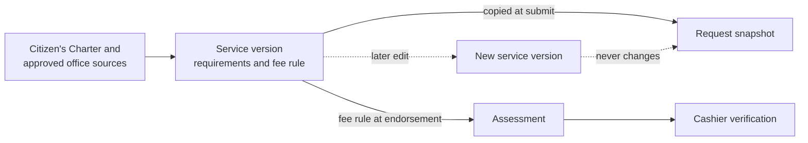
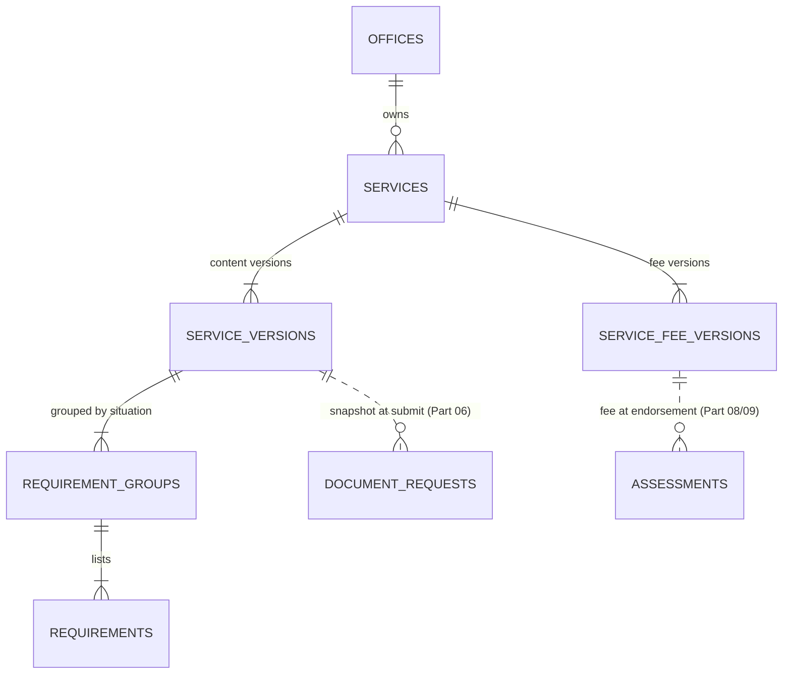
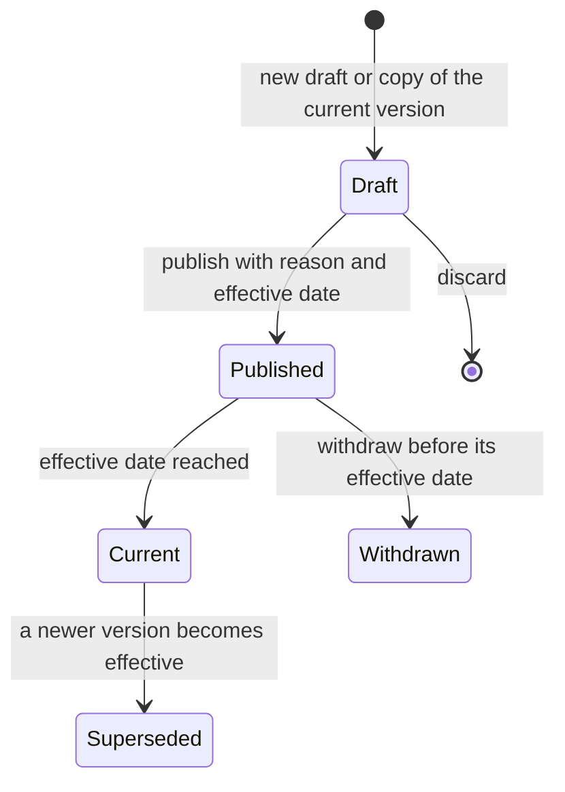

# Part 05 — Service catalog, requirements and fees

[Back to index](index.md) | [Previous](04-client-records-and-imports.md) | [Next](06-portal-and-request-intake.md)

| Tracking field | Value |
|---|---|
| Plan status | Draft; slice 1 design drafted 2026-10-18 (DEV-5), awaiting owner approval |
| Implementation | Not started |
| Validation | Not started |
| Deployment | Not deployed |
| Owner | Registrar service owner and Cashier fee reviewer; names pending |
| Dependencies | Parts 02–03; workflow rules in Part 01 |
| Updated | 2026-10-18 |

## Features and screens

- Searchable catalog of approved documents/services with active/inactive status.
- Eligibility, required information, required attachments, allowed copy counts and delivery/claim instructions.
- Service requirement versions and effective-dated fee schedules.
- Free service support and explicitly authorized waiver/exemption rules, if approved.
- Service-to-template mapping and authorized approving office/signatory references.
- Staff administration and client-readable service details.

Examples from the brief are standardized certifications, request forms, authentication-related forms and CAV-related processing documents. Exact titles, availability, charges and processing targets must come from approved campus sources; this plan supplies no invented fee amounts or issuance promises.

### Source: the Citizen's Charter (added 2026-10-17)

Government offices must publish a Citizen's Charter under RA 11032, listing each service's steps, requirements, fees, responsible person and processing time. Use BISU's current charter entries for the Registrar and Cashier as the starting service inventory, confirm them with the offices, and record the charter edition in each service version. Store each service's processing-time classification and working days (simple, complex or highly technical) so Part 12 can report turnaround against the charter.

### Requirement types

| Type | Example | Checked by |
|---|---|---|
| Information field | Purpose of request, number of copies | Client or intake staff; server validation |
| Attachment | Request letter, authorization letter | Client upload; staff review |
| Staff-verified check | Accounting or library clearance, ID presented, SPA for a representative | Registrar staff records outcome, verifier, time and reference |

Clearances from other offices are recorded as staff-verified checks; the system does not connect to those offices' systems initially.

Requirements are grouped by the client's situation, as in the charter page received so far. The [slice 1 design](#slice-1-design-catalog-core-dev-5-2026-10-18) below defines the groups.

## Implementation steps

1. Collect a signed-off service inventory and requirements checklist from the Registrar.
2. Collect fee authority, effective dates, currency and permitted adjustments from Cashier.
3. Add catalog/version tables and authorized editing actions with audit records.
4. Build staff service management and a read-only client catalog.
5. Snapshot selected service/requirements on submission. Create the authoritative assessment at Registrar endorsement using the approved fee rule.
6. Present any difference from a submission estimate before payment; preserve both estimate and assessed amount with their source versions.
7. Deactivate outdated services and versions without changing existing transactions.

## Shared rules

- One service type per request is the proposed initial unit; copies use validated quantities.
- Fee amounts are integer minor units with currency; totals are computed on the server.
- Client-entered totals never determine what is owed.
- Fee edits do not retroactively alter assessments or paid requests.
- Waivers require explicit permission, reason and approval evidence; zero-price services are distinct from an exceptional waiver.
- Required record checks may remain staff tasks even when the form is complete.

## Acceptance criteria / checks

- [ ] Clients see only currently available services and accurate requirements.
- [ ] A changed catalog version cannot silently change a submitted request.
- [ ] Free and paid services reach the correct workflow branches.
- [ ] Only authorized staff can change fees or approve exceptions.
- [ ] Negative fees, invalid quantities and inconsistent totals are rejected.
- [ ] Existing requests still render after a service is deactivated.

## Slice 1 design: catalog core (DEV-5, 2026-10-18)

**Status: design draft, awaiting owner approval. Nothing here is built.** On approval, record it as a decision (proposed C15) and start DEV-6. It follows the pattern used for Parts 03 and 04: a design first, then a slice on synthetic data. No real service, requirement wording or fee appears in it; the demo examples are labelled "(Demo)" with obviously fake amounts.

### What page 115 of the Citizen's Charter shows (checked 2026-10-18)

Only page 115 has arrived (Citizen's Charter 2024, 1st Edition, section 5.2.1 Enrollment). The layout it shows decides the shape of the catalog:

| On the page | What it means for the catalog |
|---|---|
| A header table: Office / Division, Classification (here "Complex"), Type of Transaction (here "G2C"), Who may avail (free text) | Each service has these four fields. Classification and transaction type are fixed lists; "who may avail" stays free text |
| Requirements are **grouped by the client's situation** ("A. For First Year College Students", "B. For Transferees", "C. For Continuing and Returning Students"), numbered inside each group | Requirements belong to a **group**, and the client picks the group that applies. The same item (a 2x2 picture, a health form) is repeated in more than one group, so groups hold their own items instead of sharing them |
| A second column, "How to Avail", gives where to secure each item ("Claim it at…", "Request it from…", "Downloadable at…") | Each requirement has a "where to get it" text. It says how to obtain the item, not how to submit it |
| Most items are papers brought to the office ("Original Copy of…", "Photocopy of…") | The default check is a **staff check** at the counter. Uploads and typed answers are separate kinds, and the office must say which items may be uploaded (D05) |
| The footer names the edition and page; the heading carries the section number (5.2.1) | Each service version records the charter edition, section and pages |
| The office is called "Registration Office" | The plan says "Registrar". Which name clients see is a question for the office (D05) |

**Not on this page:** the client steps, agency actions, fees to be paid, processing time and person responsible. They are probably on the following pages, which the [requirements checklist](requirements.pdf) asks for (item 1). Slice 1 therefore stores processing time and fees as their own fields and leaves the step table to slice 2, after the full pages arrive. An earlier note in [97](97-work-while-waiting.md) wrongly said page 115 already shows those columns; it has been corrected.

Enrollment itself is probably outside this system (D01 asks the Registrar). It remains a useful worked example of the hardest shape: several requirement groups with repeated items.

### Slices and gates

| Slice | Deliverable | Gate | Exit evidence |
|---|---|---|---|
| 1 (DEV-6) | Staff service catalog: services, content versions, requirement groups and items, fee versions, publish/withdraw, audit, staff read-only views, demo data, and the code Part 06 and Part 09 will call (current-version lookup, fee calculator, snapshot) | **Owner approves this design.** Real services and fees stay blocked on D05 and D07; synthetic data only | Permission matrix, version/effective-date rules, fee arithmetic, concurrency on MySQL, browser cases in the saved suite |
| 2 | Client and agency step table; steps shown with the service | The complete charter pages (requirements item 1) | Steps match the charter for the first approved services |
| 3 | Client-readable catalog | Client accounts exist (Part 04 slice 3 and Part 06 portal) | Clients see only available services and the current requirements |
| Later | Waivers, discounts, structured eligibility rules | D05 and D07 answers, and `waivers.approve` authority | Per approved rule |

### Concepts

A **service** is a stable identity (an internal code, an owning office, an "available to clients" switch). Its **content** (name, classification, requirement groups, processing time, charter reference) and its **fee** are separate versioned records because they change for different reasons: a fee follows a board decision, while requirements follow the Registrar. Each can be republished without touching the other. Requests keep their snapshot of the content; assessments take the fee in force when the Registrar endorses the request (see the diagram under "Requirement types").

### Proposed records

All are proposed additions inside `src/`. Names follow the existing `client_*` tables. Timestamps are UTC; dates such as "effective from" are campus-calendar dates.

| Table | Main fields | Rules |
|---|---|---|
| `services` | Office (Registrar), unique internal `code` (lower-case slug), `is_available`, sort position, optimistic `version`, timestamps | The code never changes and is never reused. A service referenced by any version or request is never deleted. A request is only offered while `is_available` is on **and** a content version is current |
| `service_versions` | Service, `version_number` (unique per service), status `draft/published/withdrawn`, name, description, classification `simple/complex/highly_technical`, transaction type `g2c/g2b/g2g`, who may avail (text), processing time amount + unit (`minutes/hours/working_days`), minimum and maximum quantity with a label ("copies"), charter edition, charter section, charter pages (all text), `effective_from` (date, empty for drafts and withdrawn), publisher and time, reason | A published row and its groups and items are **immutable**: no update action exists and the model refuses updates. Drafts are editable under the optimistic version. Unique `(service, effective_from)` over live rows; withdrawing moves the date to a history column so the key only covers live versions |
| `service_requirement_groups` | Content version, position, label (empty for a single "everyone" group) | Groups are alternatives: the client picks the one that describes them. A service with no groups is not publishable |
| `service_requirements` | Group, position, kind `information_field/attachment/staff_check`, label, "where to get it" text, mandatory flag, and for information fields an input type (`text/long_text/number/date/yes_no`) | Labels are text; no code or HTML is stored. Selection lists and upload rules wait for D05 |
| `service_fee_versions` | Service, `version_number`, status, fee model `free/fixed/per_unit`, currency (`PHP`), amount in minor units (empty only for `free`), unit label (required for `per_unit`), **authority reference** (text: the charter page, resolution or schedule that supports it), `effective_from`, publisher, time, reason | Same lifecycle and immutability as content versions. A `free` service is a deliberate fee model, not a waiver. Publishing requires an authority reference |

**Fee models.** Slice 1 supports only `free`, `fixed` (one amount per request) and `per_unit` (an amount per copy or page). The charter's fee column has not been seen; a new model is an additive enum value plus a calculator rule, so unusual rules (tiers, per-group fees) wait for the evidence instead of guessing. Waivers and discounts are not built (see the last row of the slices table).

**Money.** Whole minor units (centavos) in an unsigned integer, with the currency stored beside every amount. Totals are computed on the server as integer arithmetic; no floats; negative amounts, quantities outside the version's bounds and totals above a fixed ceiling are rejected.

### Rules

- **Choosing the version.** The current content or fee version is the published, non-withdrawn row with the latest `effective_from` that is not after today's campus date. A version has only a start date, and the next version's start ends it, so ranges cannot overlap or leave gaps.
- **Publishing.** Needs a reason; `effective_from` must be today or later (campus calendar) and later than every live version's date. Backdating would silently change history, so it is refused. The action locks the service row, so two publishers cannot pick the same date.
- **Withdrawing** is possible only before the effective date. After that, the fix is a newer version. One consequence to accept: a version published with today's date and found wrong cannot be replaced until tomorrow. A supervisor can switch the service to unavailable in the meantime. Services change rarely, so slice 1 keeps the strict rule.
- **Editing the current version** means copying it into a new draft, changing the draft and publishing it. The old version stays exactly as issued.
- **Campus time.** Storage stays UTC. Slice 1 adds one setting for the campus timezone (proposed `Asia/Manila`, already the proposed default in the decision register), so "today" is computed in one place.
- **Snapshots.** `ServiceSnapshot` is a value object holding the service code, content version id, chosen requirement group and its items, charter reference, the fee version id and the fee estimate, plus a hash. Part 06 stores it on a request; later edits never change a stored snapshot. Slice 1 builds the class and its tests but creates no requests.
- **Fee at endorsement.** `FeeResolver` returns the fee version in force at a given moment. Part 08 calls it when the Registrar endorses; a difference from the submission estimate is shown before payment, as the earlier steps in this part require.
- **Everything changes with a reason** and rejects a stale screen, as in Part 04.

### Authorization

The Part 03 catalogue already lists `services.manage`, `waivers.approve` and `fees.manage`, all held by the shared `office_supervisor` role. Granted by role alone, a Cashier supervisor would hold them for Registrar services, the same mismatch already noted for `clients.import`. A `ServicePolicy` therefore checks the permission **in a named office**.

| Action | Permission | Office the check requires |
|---|---|---|
| View the catalog, including current fees | **`services.view` (new, needs approval)** | Any office: Registrar staff, Cashier staff and both supervisors can read |
| Create a service, draft/publish/withdraw content, change availability | `services.manage` | Registrar |
| Draft/publish/withdraw fee versions | `fees.manage` | Registrar for now, through one method that D05 can change to the Cashier or to a two-key rule |
| Waivers | `waivers.approve` | Not used in slice 1 |

System administrators hold none of these (accounts only, as in Part 04). Report exporter and supplier roles hold none. `services.view` is the one catalogue change: the existing list has no read-only permission, and borrowing `requests.view` would tie the catalogue to a part that doesn't exist yet. It would be held by Intake staff, Registrar processor, approver, release officer, Cashier and both supervisors. PHP and TypeScript permission lists must be updated together.

**Audit.** New actions record who, when, the service code, version numbers, dates and the reason: `service.created`, `service.availability_changed`, `service.version_drafted`, `service.version_published`, `service.version_withdrawn`, `service.draft_discarded`, and the matching `service.fee_*` events. The version rows themselves hold names and amounts, so the audit trail needs only identifiers. Nothing here is personal data.

### Screens (staff only)

Under the existing Registrar navigation as **Services and fees**, using the same list, detail and dialog patterns as client records:

- **List:** search by name or code, filter by available or unavailable, and show current content version, classification, current fee and any scheduled change.
- **Detail:** current content, requirements by group (each item with its kind, mandatory flag and where to get it), current fee, scheduled changes, and the history of content and fee versions.
- **Draft editor:** content fields; a requirement-group editor with add, remove and reorder by buttons (no drag-and-drop, so it works by keyboard and on phones); a fee form with a live example total for a few quantities.
- **Publish dialog:** effective date, reason, and a summary of what differs from the current version.
- **Read-only mode** for people with `services.view` only: no buttons, direct URLs to editing return 403.
- Phone width, both themes and keyboard use must pass, as for Part 04.

### Demo data

Five fictional services, all marked "(Demo)", with fake amounts that cannot be mistaken for real ones (11.11, 22.22, 33.33, 44.44):

| Demo service | What it exercises |
|---|---|
| Sample Certification (Demo) | `per_unit` fee, single group, one of each requirement kind |
| Sample Free Service (Demo) | `free` fee model |
| Sample Grouped Requirements (Demo) | Two groups with a repeated item and "where to get it" text, the page 115 shape, with invented wording |
| Sample Scheduled Fee Change (Demo) | A current fee and a published fee that takes effect in 30 days |
| Sample Unavailable Service (Demo) | `is_available` off, with an unpublished draft |

### Validation plan

| Group | Cases |
|---|---|
| Permissions | Every role and office against view, manage, fees and publish; Cashier supervisor can read but not manage; administrator denied; direct URLs; deactivated accounts |
| Versions | Published rows cannot change; copy-to-draft; stale draft rejected; discard; unique version numbers; withdraw only before the effective date; no backdating; service with no group or no available version is not offered |
| Effective dates | Boundary at campus midnight (UTC date differs from campus date for 8 hours a day), a future-dated version, two versions, withdrawal of a future one |
| Fees | Free, fixed and per-unit totals; zero and maximum quantity; negative and overflow rejected; free is not a waiver; fee publishing needs an authority reference |
| Snapshots | A stored snapshot is unchanged after the service and fee are republished; hash is stable and changes when content changes |
| MySQL | Two supervisors publishing the same date (one winner), stale draft saves, concurrent copy-to-draft, migration apply and rollback on a disposable database; explicit short index names (the 64-character limit failed in Part 04); compare JSON with `assertEquals` |
| Browser | New cases in the saved suite: list/search, detail by group, draft edit, publish, read-only view, 403 on direct URLs, phone and dark mode, keyboard order of the group editor |

Run `./check.ps1` and the saved browser suite after the build, then write the validation record, as for Part 04.

### Implementation checklist

- [x] Verify the charter page and design the catalog around it (this section).
- [ ] Owner approves the design (proposed C15) and the one catalogue addition, `services.view`.
- [ ] Slice 1 build (DEV-6): migrations, models and enums, policy, actions, `FeeCalculator`, `FeeResolver`, `ServiceSnapshot`, screens, seeder, tests, MySQL checks, browser cases, validation record.
- [ ] Complete charter pages received, then slice 2 (steps).
- [ ] D05 and D07 answered, then real services and fees entered as data by the Registrar, never by developers.

### Decisions to approve now (proposed C15)

| # | Proposal | Recommendation |
|---|---|---|
| 1 | Slices as in the table above, with slice 1 covering the staff catalog only | Approve |
| 2 | Content and fee are separate versioned records, with only `effective_from` and immutable published versions | Approve |
| 3 | Requirements grouped by client situation, with three kinds (information field, attachment, staff check) | Approve |
| 4 | Fee models `free`, `fixed`, `per_unit` only; integer minor units with a currency; authority reference required | Approve |
| 5 | Add `services.view`; services and fees managed in the Registrar office until D05 says otherwise; Cashier supervisors read-only | Approve |
| 6 | No waivers, discounts, structured eligibility or step table in slice 1 | Approve |
| 7 | Five labelled demo services with fake amounts | Approve |

### Questions for the offices

| Question | Office | Decision |
|---|---|---|
| Which charter edition is current, and when does a new edition take effect? | Registrar | D05 |
| Does clients' "Registration Office" mean the same office as "Registrar" in this project? Which name should clients see? | Registrar | D05 |
| Is Enrollment a service of this system, or handled outside it? | Registrar | D01 |
| For each requirement: is it brought to the counter, uploaded or typed? Who checks it? | Registrar | D05 |
| Are the requirement groups alternatives the client chooses between, and who chooses? | Registrar | D05 |
| The charter's steps, fees, processing times and persons responsible (pages after 115, and the Cashier section) | Registrar + Cashier | D05 |
| Do fees differ by group, by copy, by page or by document? Who sets the amounts, and from which date? | Cashier | D05, D07 |
| Are waivers or discounts allowed, and who approves them? | Registrar + Cashier | D05, D07 |

## Open decisions / evidence

[D05](90-decisions-and-open-questions.md): approved services, fees, waiver authority, processing targets and the Citizen's Charter edition used. Completion evidence: approved inventory, fee source references, service-policy tests and reviewed catalog screens. The slice 1 design above is the first deliverable; page 115 of the charter (Enrollment) has been reviewed, and the rest of the charter is still awaited.
