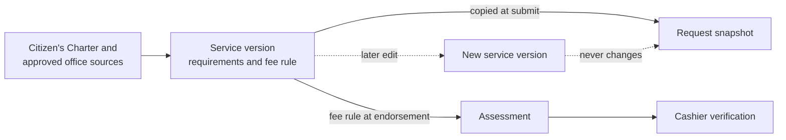

# Part 05 — Service catalog, requirements and fees

[Back to index](index.md) | [Previous](04-client-records-and-imports.md) | [Next](06-portal-and-request-intake.md)

| Tracking field | Value |
|---|---|
| Plan status | Draft |
| Implementation | Not started |
| Validation | Not started |
| Deployment | Not deployed |
| Owner | Registrar service owner and Cashier fee reviewer; names pending |
| Dependencies | Parts 02–03; workflow rules in Part 01 |
| Updated | 2026-10-17 |

## Features and screens

- Searchable catalog of approved documents/services with active/inactive status.
- Eligibility, required information, required attachments, allowed copy counts and delivery/claim instructions.
- Service requirement versions and effective-dated fee schedules.
- Free service support and explicitly authorized waiver/exemption rules, if approved.
- Service-to-template mapping and authorized approving office/signatory references.
- Staff administration and client-readable service details.

Examples from the brief are standardized certifications, request forms, authentication-related forms and CAV-related processing documents. Exact titles, availability, charges and processing targets must come from approved campus sources; this plan supplies no invented fee amounts or issuance promises.

### Source: the Citizen's Charter (added 2026-10-17)

Government offices must publish a Citizen's Charter under RA 11032, listing each service's steps, requirements, fees, responsible person and processing time. Use BISU's current charter entries for the Registrar and Cashier as the starting service inventory, confirm them with the offices, and record the charter edition in each service version. Store each service's processing-time classification and working days (simple, complex or highly technical) so Part 12 can report turnaround against the charter.

### Requirement types

| Type | Example | Checked by |
|---|---|---|
| Information field | Purpose of request, number of copies | Client or intake staff; server validation |
| Attachment | Request letter, authorization letter | Client upload; staff review |
| Staff-verified check | Accounting or library clearance, ID presented, SPA for a representative | Registrar staff records outcome, verifier, time and reference |

Clearances from other offices are recorded as staff-verified checks; the system does not connect to those offices' systems initially.

## Implementation steps

1. Collect a signed-off service inventory and requirements checklist from the Registrar.
2. Collect fee authority, effective dates, currency and permitted adjustments from Cashier.
3. Add catalog/version tables and authorized editing actions with audit records.
4. Build staff service management and a read-only client catalog.
5. Snapshot selected service/requirements on submission. Create the authoritative assessment at Registrar endorsement using the approved fee rule.
6. Present any difference from a submission estimate before payment; preserve both estimate and assessed amount with their source versions.
7. Deactivate outdated services and versions without changing existing transactions.

## Shared rules

- One service type per request is the proposed initial unit; copies use validated quantities.
- Fee amounts are integer minor units with currency; totals are computed on the server.
- Client-entered totals never determine what is owed.
- Fee edits do not retroactively alter assessments or paid requests.
- Waivers require explicit permission, reason and approval evidence; zero-price services are distinct from an exceptional waiver.
- Required record checks may remain staff tasks even when the form is complete.

## Acceptance criteria / checks

- [ ] Clients see only currently available services and accurate requirements.
- [ ] A changed catalog version cannot silently change a submitted request.
- [ ] Free and paid services reach the correct workflow branches.
- [ ] Only authorized staff can change fees or approve exceptions.
- [ ] Negative fees, invalid quantities and inconsistent totals are rejected.
- [ ] Existing requests still render after a service is deactivated.

## Open decisions / evidence

[D05](90-decisions-and-open-questions.md): approved services, fees, waiver authority, processing targets and the Citizen's Charter edition used. Completion evidence: approved inventory, fee source references, service-policy tests and reviewed catalog screens.
