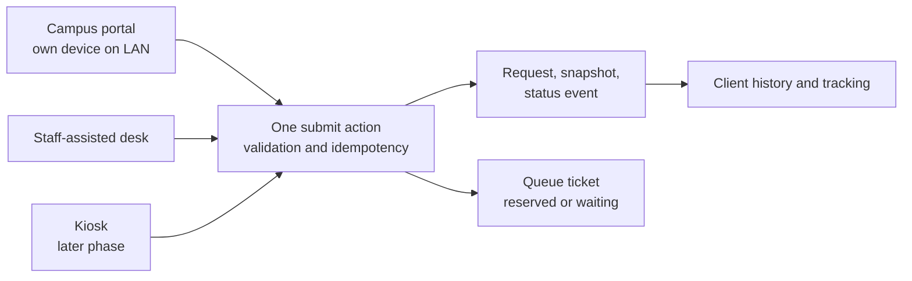

# Part 06 — Online portal and on-campus request intake

**Online = BISU local campus network access.** Clients use a browser on approved campus LAN/Wi-Fi; staff-assisted intake and kiosks use the same campus-hosted application. Public Internet access is outside the confirmed initial scope.

[Back to index](index.md) | [Previous](05-services-requirements-and-fees.md) | [Next](07-queues-counters-and-kiosk.md)

| Tracking field | Value |
|---|---|
| Plan status | Draft; both entry channels confirmed |
| Implementation | Not started |
| Validation | Not started |
| Deployment | Not deployed |
| Owner | Developer with Registrar intake representative; names pending |
| Dependencies | Parts 03–05; Part 07 completes ticket allocation |
| Updated | 2026-10-17 |

## Features and screens

- Verified client home, service catalog, request form/review, submission receipt and request history.
- Profile verification/linking state and clear instructions for unresolved identity issues.
- Required information/attachment collection with validation and accessible error messages.
- Request detail with public reference, queue ticket, fees, next action and progress timeline.
- Staff-assisted request form using the same validation and business action as online intake.
- Draft editing, submission retry protection, allowed cancellation and response to returned requirements.
- Privacy notice at first use and at account linking, with the version recorded ([Part 03](03-accounts-permissions-and-audit.md)).
- Help page: office hours, location, how to claim, FAQ and contact; usable before sign-in.
- Interface language: English by default; Filipino or Cebuano labels for portal and kiosk if the offices ask for them (D01).
- Upload limits per service (types, size, count); malware scanning of uploads is an MIS decision (D02).

## Intake channels

## Phased channels

1. Deliver campus-network self-service and staff-assisted on-campus intake on the shared request model.
2. Add kiosk mode through [Part 07](07-queues-counters-and-kiosk.md), after verification, queue rules and shared-device session clearing are tested.

Each request records `online`, `staff_assisted` or `kiosk` as its source channel. An operator submitting for a client is recorded separately from the client owner. Channel differences never bypass service eligibility, record verification or payment rules.

## Implementation steps

1. Add requests, items, attachment metadata and status history using [Part 02](02-architecture-and-data-model.md).
2. Build a single submit action that validates identity linkage, active service, required inputs and idempotency key.
3. Save the request snapshot and submission audit event atomically; allocate the initial ticket through the queue action once Part 07 is available.
4. Return the same reference/ticket after a duplicate click, browser retry or connection timeout.
5. Build reusable Vue forms with shadcn-vue controls, loading/error/empty states, keyboard navigation and mobile layout.
6. Add owned request list/detail, attachment authorization and a controlled response flow for `awaiting_client` requests.
7. Add staff-assisted intake and client-visible confirmation suitable for printing or copying the reference.

## Queue contract

The brief requires a queue number after submission. Proposed approach: generate the initial Registrar ticket with the request; assisted-desk/kiosk submissions may activate it immediately after check-in. Portal tickets submitted elsewhere on the campus network remain reserved until the approved check-in/service-day rule activates them. Display an explicit reserved/waiting label; do not imply that a client is already present at the counter. Finalize ticket validity and day rollover in [D06](90-decisions-and-open-questions.md).

## Acceptance criteria / checks

- [ ] A verified student and a verified alumnus can submit through each enabled channel.
- [ ] Unlinked accounts cannot act as verified clients.
- [ ] Valid submission produces one durable request, reference, history event and initial ticket.
- [ ] Repeated submits and lost responses do not create duplicate transactions.
- [ ] Invalid or unauthorized attachments are rejected; valid files remain private.
- [ ] Request owners can see public progress but never internal record-check notes.
- [ ] Cancellation and requirement responses obey the approved state rules.
- [ ] A clean mobile/keyboard walkthrough reaches confirmation without losing input.

## Dependencies / completion evidence

Complete ticket acceptance only after Part 07 integration. Pending evidence: online and staff-assisted walkthroughs, ownership tests, upload validation tests, duplicate-submit tests and approved identity/queue rules.
