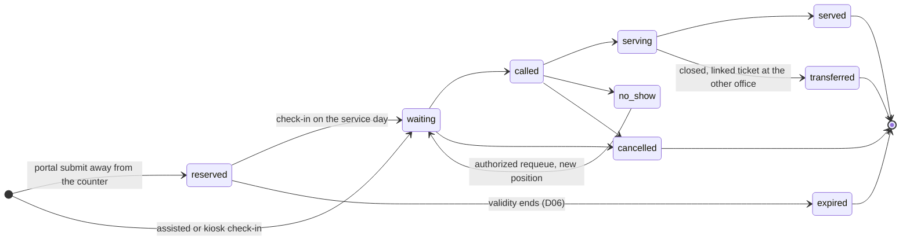

# Part 07 — Office queues, counters, display and kiosk

[Back to index](index.md) | [Previous](06-portal-and-request-intake.md) | [Next](08-registrar-workspace.md)

| Tracking field | Value |
|---|---|
| Plan status | Draft |
| Implementation | Not started |
| Validation | Not started |
| Deployment | Not deployed |
| Owner | Registrar/Cashier service supervisors with developer; names pending |
| Dependencies | Parts 03–06; Cashier handoff integrates with Part 09 |
| Updated | 2026-10-17 |

## Features and screens

- Registrar and Cashier queues with configured service counters and active staff.
- Initial ticket creation, campus-network check-in, and later office/claim visits.
- Counter controls: call next, recall, start service, finish visit, skip/no-show and authorized transfer/requeue.
- Privacy-safe campus display showing ticket number and counter, with optional announcement after accessibility review.
- Ticket receipt with request reference, office, service date and instructions.
- Self-service kiosk mode added after portal and assisted intake are validated.

## Proposed ticket lifecycle

`reserved → waiting → called → serving → served`

Permitted exceptions: `called → no_show`; `waiting/called → cancelled`; authorized requeue from a no-show creates a history event and a new queue position. A visit transfer closes the original ticket with a transfer reason and creates a linked ticket for the receiving office. A later visit receives a new ticket linked to the same request.

The public request reference is stable across visits. Queue numbers are office/day-specific display identifiers. A ticket may be served while the request continues through payment, preparation or approval.

`expired` and `transferred` are proposed names for closed tickets; `transferred` closes the original ticket with a reason while the receiving office gets a linked new ticket.

### Priority lanes (added 2026-10-17)

Philippine law requires express or priority lanes in government offices for senior citizens (RA 9994) and persons with disabilities (RA 10754); offices commonly extend them to pregnant women. Many alumni requesters are senior citizens, so plain FIFO across everyone is likely not acceptable. Proposed: separate lanes per office, FIFO within each lane, and a counter rule for alternating between lanes. Which categories apply, how eligibility is checked at the counter and the alternation rule are part of D06. Displays may show a lane prefix on the ticket number but never the person's category details.

### Service calendar

Queue service days follow `service_calendar_days` ([Part 02](02-architecture-and-data-model.md)): working days, holidays and suspensions such as weather-related work suspensions. When a day is suspended, reserved tickets roll over according to D06, and clients see a notice.

## Rules to finalize before coding

- Confirm service-day calendar, timezone, opening/closing rules, ticket expiry and check-in window.
- Determine whether a submitted campus-network request gets today's reserved ticket or a later scheduled service-day ticket.
- FIFO is the proposed default within each lane. Legally required priority lanes (above), supporting evidence and override permissions require campus confirmation.
- Do not move a not-yet-present campus-network requester ahead of clients already checked in.
- Prevent two active visits for the same request/office unless an explicit business exception permits it.
- Show no names, Student/Alumni IDs, requested sensitive document details or financial details on public displays.

## Implementation steps

1. Model offices/counters, daily sequences, tickets and ticket-event history.
2. Allocate numbers transactionally using a locked sequence and a unique office/day/number constraint; never use `MAX(number) + 1` without serialization.
3. Implement atomic next-ticket claiming and counter assignment. Two cashiers clicking simultaneously must not call the same ticket.
4. Integrate request submission, Cashier endorsement and document-claim visits through shared actions.
5. Deliver staff controls and display endpoints with appropriate authorization and data minimization.
6. Start with configurable short polling, a visible last-update time, reconnect behavior and a stale-display indicator. Consider WebSockets later if observed load or latency warrants it.
7. Add kiosk verification, session timeout/reset, confirmation and clear help routing. Do not retain private files, prior client history or credentials on the shared display.
8. Define a printed/manual fallback for network outage and reconcile issued manual tickets after restoration.

## Acceptance criteria / checks

- [ ] Concurrent submissions produce unique ticket numbers and retries return the same ticket.
- [ ] Concurrent counter calls never serve the same ticket twice.
- [ ] No-show, recall, requeue, transfer and date rollover produce consistent histories.
- [ ] Public displays cannot retrieve private request data by changing a ticket ID.
- [ ] A kiosk session reset prevents the next person from seeing prior data.
- [ ] Queue changes reach campus displays within the agreed freshness target.
- [ ] A network outage shows stale status clearly and recovery does not create duplicate tickets.
- [ ] Priority-lane tickets are called according to the approved alternation rule, and displays reveal no category details.
- [ ] A suspended service day rolls reserved tickets over as agreed and tells affected clients.

## Decisions / evidence

Pending [D06 and D10](90-decisions-and-open-questions.md): priority rules, check-in, equipment and campus network placement. Capture concurrency tests on MySQL, a two-counter demonstration and an actual kiosk/display walkthrough.
