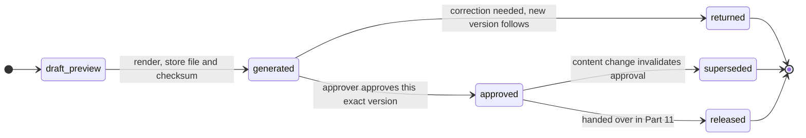

# Part 10 — Document generation, templates and approval

[Back to index](index.md) | [Previous](09-cashier-and-payment-control.md) | [Next](11-release-tracking-and-notifications.md)

| Tracking field | Value |
|---|---|
| Plan status | Draft |
| Implementation | DEV-4 isolated renderer spike complete locally; document generation/approval module not started |
| Validation | Synthetic matrix passed: 12 fixture/engine combinations, 36 renders, 19 visually reviewed pages; real-template/font/printer and workflow acceptance pending ([DEV-4](../docs/DEV-4-PDF-RENDERERS.md)) |
| Deployment | Not deployed |
| Owner | Registrar template/signatory owner with developer; names pending |
| Dependencies | Parts 03–05, 08–09 |
| Updated | 2026-10-18 |

## Features and screens

- Approved template inventory for certifications, request forms, authentication forms, CAV-related processing documents and other authorized Registrar outputs.
- Versioned template metadata: service, version, effective date, approved fields, signatory and approver.
- Document data review, draft preview, generation, approval/return and controlled printing/download.
- Generated document history with exact template version and input snapshot.

Start with a small office-approved template set, then expand to the full approved inventory. Do not represent generated forms as officially issued documents until the applicable approval and release steps are complete.

### Proposed lifecycle of one document version

Versions are immutable. Any content change creates a new version; the old one is kept as history.

Risk RK12 ([94](94-team-schedule-and-risks.md)): DEV-4 completed a preliminary synthetic comparison while offices answer. Dompdf 3.1.6 is the provisional direction for simple certificates; Chromium remains the alternative. Re-run against a real, office-supplied template on the approved fonts and campus printer before accepting production output. The technical spike does not approve D08 or implement the document lifecycle.

### DEV-4 technical record — 2026-10-18

The owner authorized the isolated comparison under C14. Separate Docker images and dependency locks live outside `src/`; rendering uses no network and only labelled synthetic inputs. A4/Legal, long accented names, local images and 60-row multipage tables passed for both candidates. All 19 pages were reviewed; the final two sample packs match the source page PNGs pixel for pixel. No application package, route, queue job, storage policy, template, numbering or signatory was added.

Dompdf's six medians were 201–426 ms; fresh-browser Chromium medians were 512–596 ms for the same body fixtures. Chromium needed a margin-header adapter, and Legal table pagination differed (three Dompdf pages versus two Chromium pages). These observations inform the technical recommendation; actual template acceptance is still required. [Method, versions, complete table, findings and limits](../docs/DEV-4-PDF-RENDERERS.md). Run `./pdf-spike.ps1` to regenerate the comparison. Future feature implementation requires its own scoped task and the D08 gates below.

## Implementation steps

1. Obtain approved source templates and sanitized sample outputs; record the campus template owner and acceptance criteria.
2. Map every template field to a verified source or an explicitly reviewed staff input. The maintained client list alone does not supply transcripts or other academic facts.
3. Choose and validate a PDF/document renderer against actual templates, Docker fonts and printing requirements. Bundle necessary assets on the campus server.
4. Implement server-controlled template rendering with escaped fields; do not allow staff-uploaded executable templates or arbitrary code.
5. Save a private generated file, checksum, source snapshot and template version. Queue heavier generation jobs with idempotency and visible failed-job recovery.
6. Mark unapproved previews as drafts. Approval references the exact generated version/hash and the authorized approver.
7. Invalidate approval when document content changes. Preserve previous versions for the authorized retention period.
8. Gate print/download by role and request status. Determine whether final authorization is a wet signature, recorded approval or a separate approved signing process.

## Operating rules

- No invented document wording, seal, signatory, signature or reference numbering policy.
- A recorded approval is not automatically a cryptographic signature or legal certification.
- Store files outside public web storage and enforce authorization on each retrieval.
- Expiring links, if used, still require the approved identity/access model; a LAN address alone is insufficient protection.
- Record regeneration/reprint reasons where needed. A newly generated file must not replace an already approved file silently.
- CAV-related processing must follow the actual campus workflow; do not infer that this app can perform external agency approval.

## Acceptance criteria / checks

- [ ] Registrar visually approves generated outputs using short/long names, multiline fields and multiple pages.
- [ ] Required fields cannot be omitted or sourced from unverified client edits.
- [ ] Exact issued version remains recoverable after a template update.
- [ ] Failed/retried jobs cannot create competing approved originals.
- [ ] Unauthorized users cannot access private document paths.
- [ ] Content changes invalidate prior approval and block release until reviewed.
- [ ] Fonts, page breaks, seals and signature spaces print correctly from the campus environment without runtime Internet access.

## Decisions / evidence

Resolve [D08](90-decisions-and-open-questions.md): approved templates, document numbering, signatories, print rules, signing authority and retention. Completion evidence includes approved reference outputs, visual comparisons, access tests and version/approval tests.
