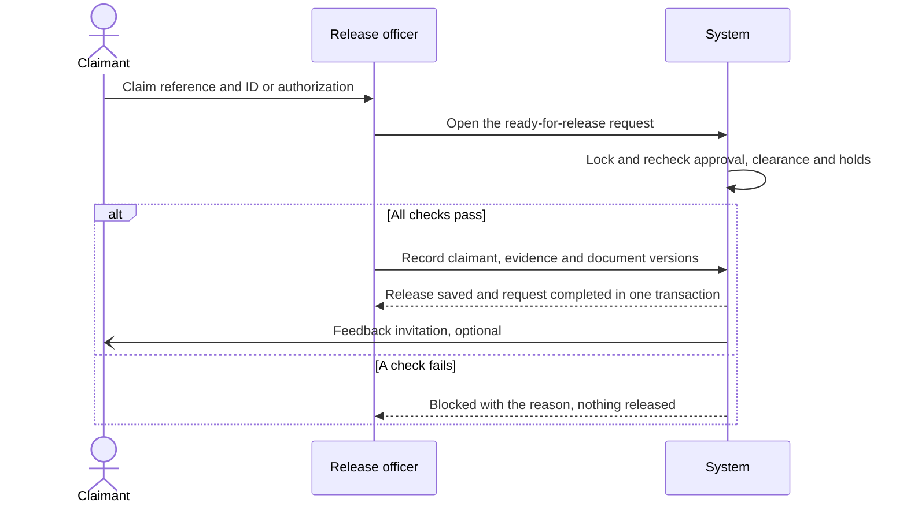

# Part 11 — Release, client tracking and notifications

[Back to index](index.md) | [Previous](10-document-generation-and-approval.md) | [Next](12-reporting-and-analytics.md)

| Tracking field | Value |
|---|---|
| Plan status | Draft |
| Implementation | Not started |
| Validation | Not started |
| Deployment | Not deployed |
| Owner | Registrar release owner with developer; names pending |
| Dependencies | Parts 06–10; audit and ownership controls from Part 03 |
| Updated | 2026-10-17 |

## Features and screens

- Client timeline showing current state, next action, approved payment summary and readiness to claim.
- Transaction history with service/date/status filters.
- Staff ready-for-release list and claimant verification form.
- Release receipt/acknowledgment record, authorized representative details where allowed, and exact document versions handed over.
- In-app notifications for returned requirements, verified payment where useful, ready-for-release and completed release.
- Delivery status and retry visibility for any later approved email/SMS channel.
- Reminders for unclaimed documents and an unclaimed-documents list for staff (D18).
- Optional client feedback after completion (D19), aligned with ARTA's Client Satisfaction Measurement if the office adopts it. A paper form stays available at the counter. Anonymous or linked is the DPO's decision; results feed Part 12.

## Release at the counter

## Campus-network behavior

Tracking and in-app notifications are available while clients are connected to the BISU LAN/Wi-Fi. They do not promise off-campus push delivery. The baseline mail driver writes to logs; actual account verification/password recovery mail requires a campus-approved relay or an approved assisted account process. External email/SMS is optional and must not be assumed available.

## Implementation steps

1. Map internal events to client-safe timeline descriptions, hiding staff-only notes and restricted record details.
2. Add configurable polling with last-updated time and visible connectivity state; define a freshness target with MIS.
3. Persist notification intent after a committed event and deduplicate deliveries using event/recipient/channel keys.
4. Add the release checklist: valid identity/representative authorization, correct documents, exact approved versions, financial clearance and no active hold.
5. Lock and revalidate the request/clearance at handover; save the release record and `completed` state atomically.
6. Record receiving person, staff actor, timestamp and approved evidence/acknowledgment. Do not retain ID scans unnecessarily.
7. Add linked reissue/correction handling according to office policy; preserve the original completed transaction.

## Operating rules

- `ready_for_release` means the output is approved and available; `completed` requires actual handover evidence.
- A notification delivery or a served queue ticket cannot mark a request completed.
- Claim reference/queue number alone is not proof of claimant identity.
- Partial release is deferred under the proposed one-service request model; if the office needs it, redesign release/item states before enabling it.
- Sensitive content stays in authenticated views; messages should carry only minimal status information.

## Acceptance criteria / checks

- [ ] Clients see only their own correct, ordered status history and notifications.
- [ ] A lost/delayed notification does not roll back or duplicate a business transaction.
- [ ] Duplicate release clicks and simultaneous release attempts result in one valid release.
- [ ] Expired approval, unpaid/disputed balance or a records hold blocks release at transaction time.
- [ ] Representative claims require the approved authority evidence.
- [ ] Offline/stale views clearly indicate that information may be outdated.
- [ ] Completed requests retain their release version and claimant history.
- [ ] Unclaimed documents get reminders and appear on the staff list after the agreed period, without being marked completed.
- [ ] Feedback can be submitted once per completed request and never changes the request.

## Decisions / evidence

Pending [D08, D11, D18 and D19](90-decisions-and-open-questions.md): claimant/representative rules, acknowledgment, notification channels, unclaimed-document handling and client feedback. Complete with a claimant walkthrough, unauthorized-release tests and delivery-retry tests.
