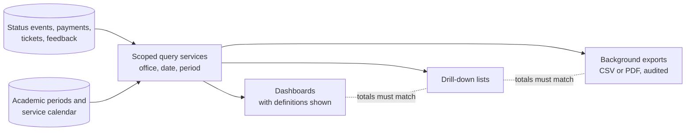

# Part 12 — Reports, dashboards and analytics

[Back to index](index.md) | [Previous](11-release-tracking-and-notifications.md) | [Next](13-testing-and-campus-acceptance.md)

| Tracking field | Value |
|---|---|
| Plan status | Draft |
| Implementation | Not started |
| Validation | Not started |
| Deployment | Not deployed |
| Owner | Registrar and Cashier report owners with developer; names pending |
| Dependencies | Parts 03, 06–11; academic-period definitions from Part 02 |
| Updated | 2026-10-17 |

## Required reports

- Daily, monthly, semester and academic-year transaction reports.
- Clients served and most requested services/documents.
- Pending, returned, rejected, cancelled, ready and completed request counts.
- Registrar volume, processing/release statistics and pending-age worklists.
- Cashier verified collections, adjustments, discrepancies and transaction history.
- Office dashboards with authorized drill-down and approved CSV/PDF exports.
- Registrar supplier performance reports, defined in [Part 16](16-supplier.md) and following the same export rules.
- Processing time against the Citizen's Charter: share of requests completed within the charter's working days, per service ([Part 05](05-services-requirements-and-fees.md)).
- Client feedback (CSM) results by period and service, if adopted (D19).
- Aging lists for lapsed requests and unclaimed documents (D18).

## Metric definitions to approve

| Metric | Proposed definition / safeguard |
|---|---|
| Requests received | Count accepted submissions by `submitted_at`; exclude drafts; show cancellations separately |
| Completed transactions | Count completed releases by `released_at`, not by last update time |
| Unique clients served | Distinct verified clients with completed releases in the selected period; label separately from queue visits |
| Counter visits served | Served queue tickets by office/service day; a person may have several visits |
| Most requested services | Submitted request counts by service snapshot; show quantities separately |
| Pending requests | Nonterminal requests as of the selected cutoff; historical reconstruction requires status events |
| Collections | Verified payments by agreed business date, with voids/refunds/adjustments separately reconciled; not billed assessments |
| Turnaround | Submission-to-release duration in working days from the service calendar, with explicit treatment of time spent awaiting the client or payment and of holds; compared with the Citizen's Charter processing time |
| Client satisfaction | Feedback responses by period and service using the adopted CSM questions; response count always shown next to scores |

Use institution-defined academic periods. Do not infer semester boundaries from month numbers. Cashier must select receipt date versus verification/posting date for official reports; display the chosen rule on the output.

## Implementation steps

1. Have each office approve report samples, formulas, filters and date/timezone rules.
2. Build scoped query services with indexed date/office/status filters and paginated drill-down.
3. Add chart/table views that expose definitions and include zero-result/loading/error states.
4. Use status events and retained snapshots for historical reporting; current status alone cannot answer an earlier cutoff.
5. Make large exports background jobs with authorization rechecked at generation and download; use expiring private files.
6. Escape spreadsheet formula-like values in CSV exports and audit sensitive export actions.
7. Reconcile Cashier totals with the approved official source and highlight exceptions.

## Acceptance criteria / checks

- [ ] All reporting periods in the brief are available and respect approved timezone boundaries.
- [ ] Fixtures spanning cancellation, rejection, free service, payment reversal and multi-visit clients produce correct totals.
- [ ] Unique clients, requests, document copies and queue visits are never mislabeled as the same metric.
- [ ] Totals agree between dashboard, drill-down and exported report.
- [ ] Registrar and Cashier access only the reports/data assigned to their roles.
- [ ] Historical cutoff reports remain correct after later status changes.
- [ ] Month/semester/year boundaries and adjustment dates have explicit tests.

## Decisions / evidence and optimization

Resolve [D12](90-decisions-and-open-questions.md): academic calendar, metric definitions, report formats and approval owners. Charter, feedback and aging reports also depend on D05, D18 and D19. Begin with indexed queries; introduce cached aggregates only after performance measurement and with a defined refresh/invalidation rule. Completion requires office-approved sample reports and reconciled synthetic totals.
