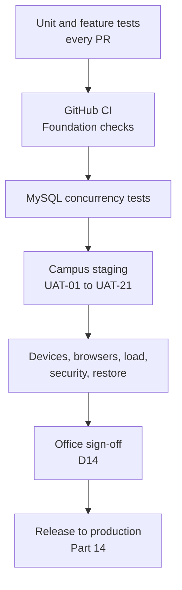

# Part 13 — Integration testing and campus acceptance

[Back to index](index.md) | [Previous](12-reporting-and-analytics.md) | [Next](14-campus-deployment-and-operations.md)

| Tracking field | Value |
|---|---|
| Plan status | Draft |
| Implementation | DEV-3 saved client-record browser regression suite implemented locally; end-to-end office workflows and acceptance remain pending |
| Validation | Latest foundation: 167 tests / 944 assertions; DEV-4 PDF matrix: 12 combinations / 36 renders / 19 reviewed pages ([record](../docs/DEV-4-PDF-RENDERERS.md)). Saved browser evidence in [DEV-3](../docs/DEV-3-BROWSER-REGRESSION.md); campus/office acceptance pending. Historical GitHub checks do not validate this unpublished branch |
| Deployment | Not deployed |
| Owner | Developer/QA with Registrar, Cashier and MIS acceptance owners; names pending |
| Dependencies | Tests accompany Parts 03–12; final acceptance requires all in-scope features |
| Updated | 2026-10-18 |

## Approach

Test each module when it is built, then validate a complete request across both offices in an isolated campus staging environment. Use synthetic records initially. Real institutional data may be used only under the approved access/process arrangement and must never enter source control or general test logs.



## End-to-end acceptance scenarios

| ID | Scenario | Required result |
|---|---|---|
| UAT-01 | Verified student submits a free request through campus portal | Ticket → review → processing → approval → identity-checked release → one completion |
| UAT-02 | Verified alumnus submits a paid request | Assessment → Cashier verification → clearance → approved output → release |
| UAT-03 | Staff-assisted submission | Same rules as portal; correct client owner and operator provenance |
| UAT-04 | Kiosk intake and next client | Valid ticket; previous client's data/session inaccessible after reset |
| UAT-05 | Unknown ID or account-link mismatch | No private data disclosed; explicit authorized review path |
| UAT-06 | Missing requirement, then client correction | Clear return reason; same request resumes with full history |
| UAT-07 | Duplicate submit/receipt and two simultaneous staff actions | One request/payment/action; no conflicting counter or release assignment |
| UAT-08 | Payment discrepancy or void before release | Financial hold blocks release; authorized resolution preserves history |
| UAT-09 | Payment discrepancy discovered after release | Historical release preserved; exception and financial adjustment are auditable |
| UAT-10 | Document template update / content correction | Historical approved copy preserved; changed content requires new approval |
| UAT-11 | Unauthorized direct URL, export or attachment access | Server rejects access across client and office boundaries |
| UAT-12 | Cancellation, rejection, no-show and requeue | Correct independent request/payment/queue histories and report counts |
| UAT-13 | Campus Internet disconnected while LAN remains available | Core portal, queues, payments, generation and release still work |
| UAT-14 | LAN/server interruption and restoration | Stale display warning, documented manual fallback, safe retries/reconciliation |
| UAT-15 | Daily/monthly/semester/academic-year reporting | Approved definitions and totals reconcile with sample transactions |
| UAT-16 | Backup restored to isolated environment | Database, files and authorized access consistent; issued outputs recoverable |
| UAT-17–21 | Registrar supplier list and performance points | Scenarios defined in [Part 16](16-supplier.md#acceptance-criteria-and-validation) |

## Development checks

Run from the project root with Docker available:

```powershell
docker compose -f docker-compose.dev.yml exec app php artisan test
docker compose -f docker-compose.dev.yml exec app composer lint:check
docker compose -f docker-compose.dev.yml exec app composer types:check
docker compose -f docker-compose.dev.yml exec app npm run types:check
docker compose -f docker-compose.dev.yml exec app npm run check
docker compose -f docker-compose.dev.yml exec app npm run build
```

For a complete check, run `./check.ps1` from the project root. If Windows blocks scripts, run `powershell -NoProfile -ExecutionPolicy Bypass -File ./check.ps1`.

Build assets before rendering tests if the test harness uses the Vite manifest. Add a separate disposable MySQL test database for unique constraints, migrations, queue claims, payment locks and release races; never point tests that reset tables at operational data. The current starter suite uses SQLite in memory.

### Saved browser regression — DEV-3

Run `./browser-tests.ps1` from the repository root (or use PowerShell's process-only execution-policy override documented in the README). The fixed `bisu-registrar-browser` project prepares allowlisted source, locked dependencies and production assets in a disposable workspace. It excludes development `.env`, credentials, runtime storage, database files and the Vite hot marker; it never joins the development network or uses its volumes. Its random credentials, TOTP secrets, application key and sessions disappear with the workspace.

There are 34 named client-record cases, each run at desktop/phone widths in both themes. Real authentication/two-factor remains enabled. Tests cover search/filtering, create/conflicts, corrections, review/verification, ID history, stale screens, permissions, audit privacy, all 51 history revisions and keyboard/layout behavior. An HTML/JSON report, failure traces and layout captures stay in ignored `.browser-artifacts/`. The CI browser job uses the same root runner and retains synthetic evidence for seven days after publication; no new GitHub run is claimed now.

The four fixture-safety guards and browser TypeScript checks join the foundation suite. Browser execution stays separate to keep PHP feedback fast. Full case mapping, commands, visual review and final results: [DEV-3 record](../docs/DEV-3-BROWSER-REGRESSION.md). This does not replace MySQL race probes, physical-device testing, screen-reader checks or office UAT.

## Nonfunctional checks

DEV-4 provides a separate `./pdf-spike.ps1` command for offline, synthetic PDF regression. Its six fixtures cover both paper sizes, accented/long names, local images, embedded fonts, repeating tables and per-page sample stamps. QA combines text/font/paper/header-position checks, Poppler rasterization and final-pack pixel comparisons; human page review is still required. It leaves application dependencies unchanged and does not replace actual-template or campus-printer acceptance. [Instructions and limits](../experiments/pdf-renderers/README.md).

- Agree on peak concurrent users, request volume, expected response time, queue-display freshness and document-generation time with MIS before assigning pass/fail thresholds.
- Measure on representative campus workstations, Wi-Fi/LAN segments, printers and kiosk equipment.
- Check keyboard navigation, readable contrast, mobile forms, validation focus and screen-reader labels.
- Check dependency vulnerabilities during implementation/release; record remediation decisions, not blanket guarantees.
- Exercise worker retry/failure, notification duplication, storage exhaustion, backup failure and audit recording.

### Supported browsers and devices (D20)

The frontend uses Tailwind CSS v4, which targets Chrome/Edge 111+, Firefox 128+ and Safari 16.4+. Older browsers show broken layouts. In iteration I0, MIS inventories office PCs, kiosks, displays and common student phones. Before M2, test on at least one of each real device type. Any required device below the baseline must be upgraded, or the team records an alternative decision.

| Device group | Browser and version | Tested on (date) | Result |
|---|---|---|---|
| Registrar office PCs | _from inventory_ | | |
| Cashier office PCs | _from inventory_ | | |
| Kiosk | _from inventory_ | | |
| Queue display | _from inventory_ | | |
| Typical student phones | _sample_ | | |

### Security checklist (per release)

- [ ] Access control: direct-URL and modified-request tests per role and office (UAT-11).
- [ ] Injection: queries use Eloquent/bindings; no raw SQL built from input.
- [ ] XSS: Vue escaping only; no `v-html` with user content; CSV formula escaping (Part 12).
- [ ] CSRF and session cookies: Laravel defaults kept; secure cookies over internal HTTPS.
- [ ] Throttling: login, ID lookup, account linking and kiosk actions.
- [ ] Uploads: type, size and count limits; private storage; authorized downloads.
- [ ] Headers via the reverse proxy (HSTS on internal HTTPS, frame and content-type options).
- [ ] `composer audit` and `npm audit` reviewed, with remediation decisions recorded.

### Thesis evaluation (if required by the IT program)

If the IT program requires a software quality evaluation, commonly based on ISO/IEC 25010 characteristics with a Likert-scale questionnaire, agree the instrument, respondent groups (office staff, students/alumni, IT experts), sample size and statistical treatment with the adviser. Run it on staging after UAT. Store only anonymous, aggregated results.

### Defense demo dataset

Maintain a synthetic demo seeder and a scripted walkthrough that resets cleanly: a free request, a paid request, a returned requirement, a release, a report and a supplier rating. Never demo with real records.

## Release exit criteria

- [ ] All required UAT cases have evidence and office acceptance.
- [ ] No unresolved defect can corrupt payments, authorize an incorrect release, expose private records or prevent core use.
- [ ] Remaining lower-impact issues have a named owner and explicit acceptance.
- [ ] Permission, audit, private-file and MySQL concurrency checks pass.
- [ ] Restore drill and rollback rehearsal are documented.
- [ ] Required manuals, support ownership and production decisions are ready.

## Evidence record template

For each case record: case ID, release revision, environment, date, tester, expected result, actual result, sanitized evidence location, defect reference, retest outcome and accepting office. Update the index only from these results; do not mark a feature tested merely because its page renders.
