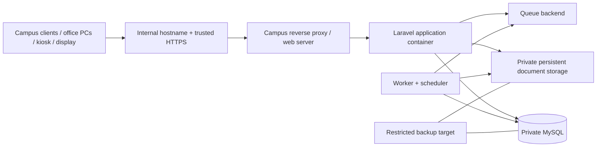
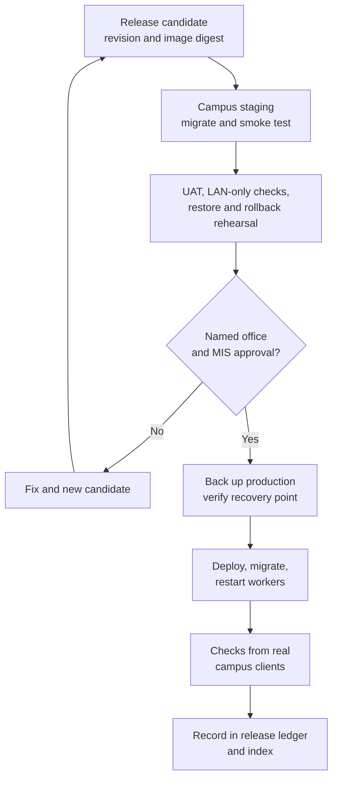
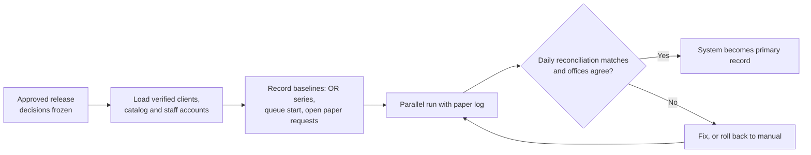

# Part 14 — BISU local-network deployment and operations

[Back to index](index.md) | [Previous](13-testing-and-campus-acceptance.md) | [Next](15-training-handover-and-roadmap.md)

| Tracking field | Value |
|---|---|
| Plan status | Draft; campus LAN hosting confirmed |
| Implementation | Development Docker includes worker/scheduler/Mailpit (DEV-2) and an optional same-network phone preview (OPS-1); operational deployment not started |
| Validation | Development service evidence in [DEV-2](../docs/DEV-2-BACKGROUND-SERVICES.md); [LAN preview checks](../docs/LAN-PHONE-PREVIEW.md#validation--2026-10-18) passed, owner confirmed physical phone login page opens; sign-in/device/browser/second-laptop evidence pending; production/restore/rollback checks not started |
| Deployment | No staging or campus-production deployment recorded |
| Owner | Campus MIS/IT deployment owner with office sponsors; names pending |
| Dependencies | Parts 03–12, Part 13 acceptance, Part 15 handover readiness |
| Updated | 2026-10-18 |

## Confirmed deployment model

Host BISU Registrar on BISU-managed local infrastructure and expose it to approved campus LAN/Wi-Fi devices. “Online” means campus browser access. Public Internet hosting, public DNS exposure and off-campus access are outside the initial scope.

Default development at `localhost:8085` is accessible only on the developer machine. For OPS-1 phone testing, double-click `start-lan.cmd` or run `./lan-preview.ps1`: the optional [LAN preview](../docs/LAN-PHONE-PREVIEW.md) detects the current private LAN IPv4 address, builds assets, pauses Vite and prints connection links. `-Links` reprints actual running bindings without a rebuild; `-Address` remains available when several adapters qualify. This changes no router/DHCP/firewall configuration and is not campus deployment. A campus system used for real transactions is **production**, even though it is private and local-network-only.

## Proposed topology

Select exact host OS, PHP runtime/web server, queue backend and Docker production layout during implementation. Existing `artisan serve`, Vite HMR and development credentials are development settings; prepare a separate operational configuration and release image.

## Environment register

| Environment | Current evidence | Planned access |
|---|---|---|
| Developer Docker | Foundation and DEV-2 background services validated locally; OPS-1 PC HTTP/assets checked and owner confirmed physical phone login page opens on 2026-10-18. Phone sign-in/navigation, device/browser details and second laptop remain pending. Historical GitHub checks do not validate this unpublished branch | Default loopback ports 8085/5178/8026; optional selected-LAN-address app 8085 with compiled assets and Vite paused; SMTP internal only |
| Campus staging | Not configured / no deployment recorded | Restricted MIS/tester LAN segment; synthetic or authorized test data |
| Campus production | Not configured / no deployment recorded | Approved BISU LAN/Wi-Fi segments through internal HTTPS |

## Development background services — DEV-2, 2026-10-18

Owner-authorized under C11 for work while office answers are pending. A single shared PHP image runs the app, Vite, one `database/default` queue worker and `schedule:work`. Worker defaults: 3 attempts, 5-second backoff, 60-second timeout, 90-second reservation expiry and 75-second shutdown grace. Mailpit captures test SMTP inside Docker; its temporary inbox is at http://localhost:8026. No relay, business schedule or record-pruning policy is enabled.

Setup pauses app/Vite/worker/scheduler before dependency replacement and recreates them against the rebuilt image. Foundation checks pause and restore running Vite/worker/scheduler. Restart background containers after PHP/config changes. Existing local environment files remain preserved by setup; the README lists the Mailpit settings for existing clones. Design, operational commands, validation and limitations: [DEV-2 report](../docs/DEV-2-BACKGROUND-SERVICES.md).

This completes only a development prerequisite for future Parts 04/10/11. The production preparation checklist below remains open, and D11/D13 still govern campus mail and workload/operations decisions.

## Preparation work

- [ ] Assign server, stable address, internal hostname, firewall rules and network/VLAN access.
- [ ] Confirm how students/alumni reach the allowed campus network; provide kiosk/assisted access if personal devices cannot join it.
- [ ] Provision HTTPS certificates trusted by managed and intended client devices using the MIS-approved method; test trust and renewal.
- [ ] Select durable database/file storage, storage capacity and server power protection/recovery arrangements.
- [ ] Build immutable release images with compiled local assets and fonts; eliminate runtime CDN dependencies, including starter externally linked fonts where applicable.
- [ ] Configure `APP_ENV=production`, debug off, exact internal `APP_URL`, proxy trust, cookies, origins and production secrets without exposing values in docs.
- [ ] Keep MySQL/Redis private; expose only the necessary application endpoint to approved campus networks.
- [ ] Configure persistent private files, worker/scheduler, logs, health checks and disk/job/backup alerts.
- [ ] Configure account verification/password recovery through an approved campus mail relay or reviewed assisted process; the log mailer is not an operational delivery channel.
- [ ] Store application key/secrets securely with controlled recovery access; preserve the key across releases.
- [ ] Synchronize server time (NTP). Queue service days, receipt dates and audit ordering depend on it.
- [ ] Confirm the supported browser/device baseline with MIS (D20, [Part 13](13-testing-and-campus-acceptance.md)).

## Release sequence

1. Record candidate revision/image digest, included modules, migrations and known issues.
2. Deploy to campus staging with separate database, keys, files and credentials.
3. Run migrations, smoke checks, UAT, LAN-only dependency checks and restore/rollback rehearsal.
4. Obtain named Registrar, Cashier and MIS acceptance required by campus process. Record approval evidence and maintenance window.
5. Back up production data/files; verify recovery points before schema/data changes.
6. Deploy the approved release, apply reviewed migrations, refresh configuration/routes as appropriate, restart workers and verify health.
7. Check authentication, one synthetic approved test path, queue display, private files and report access from actual campus clients.
8. Record deployment timestamp, internal URL, revision, deployer, approver and result in both this document and the index.
9. Observe the agreed initial support period, reconcile office activity and record incidents/rollback decisions.

## Go-live cutover (added 2026-10-17)

The first production release replaces part of a working paper process. Plan the switch explicitly so nothing is lost or counted twice.

1. **Decide in-flight work.** Paper requests open on go-live day either finish on paper, or are encoded into the system with source channel `migrated` and a reference to the paper record. Pick one rule per office.
2. **Record baselines.** Starting OR series and number in use, queue numbering start, list of open paper requests, verified client list version.
3. **Prepare people.** Staff accounts and roles created and tested, two-factor enrolled, training done (Part 15), help page and privacy notice live.
4. **Parallel run.** For an agreed period, offices keep the paper log alongside the system and reconcile daily.
5. **Switch or roll back.** Make the system the primary record only when daily reconciliation matches and both offices agree. Otherwise fall back to the manual process using the fallback log.

## Backup, recovery and continuity

- Agree recovery-point and recovery-time targets, retention, backup schedule and responsible operator before real data is entered.
- Back up MySQL, private document files and required configuration/key recovery material with controlled access; keep a copy outside the application host.
- A Docker volume is persistence, not a backup. Verify scheduled backups and restore them periodically to an isolated environment.
- Use compatible/additive migrations where possible. Code rollback and database rollback are separate decisions; irreversible migrations need a tested restore/forward-fix plan.
- Reconcile transactions written after a recovery point before returning to normal work. Preserve evidence and avoid silent financial data loss.
- Keep a manual request/queue/payment-reference log for outages and an authorized reconciliation procedure after recovery.

## Deployment acceptance

- [ ] All Part 13 release criteria met and deployment authority recorded.
- [ ] Campus clients resolve and trust the internal HTTPS endpoint.
- [ ] Core services continue with campus Internet disconnected; server/LAN outage fallback is practiced.
- [ ] Backups, restore, monitoring, worker startup and host restart recovery are tested.
- [ ] No database or debug endpoint is exposed beyond the intended network scope.
- [ ] Release ledger contains real evidence; status remains not deployed until this is completed.
- [ ] Cutover baselines are recorded and the parallel-run reconciliation is signed off by both offices.

## Release ledger

| Release / revision | Environment | Internal URL | Deployed at | Operator / approver | Validation / rollback evidence | Outcome |
|---|---|---|---|---|---|---|
| — | Campus staging | Pending | — | Pending | None | Not deployed |
| — | Campus production | Pending | — | Pending | None | Not deployed |
