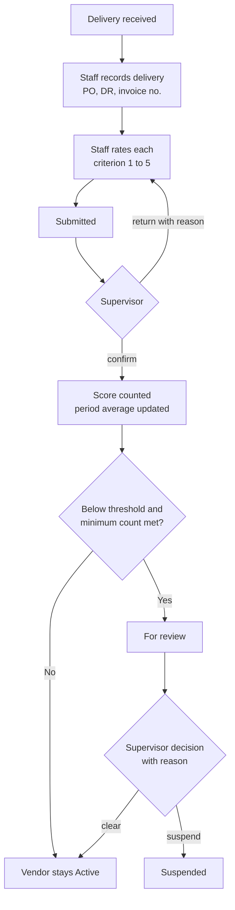
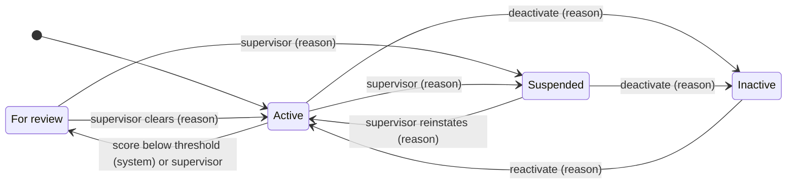

# Part 16 — Registrar vendor list and performance points

[Back to index](index.md) | [Previous](15-training-handover-and-roadmap.md)

| Tracking field | Value |
|---|---|
| Plan status | Draft; scope choices confirmed by project owner 2026-10-16 (C07) |
| Implementation | Not started |
| Validation | Not started |
| Deployment | Not deployed |
| Owner | Registrar process owner with developer; Supply/BAC contact for D17; names pending |
| Dependencies | Parts 02–03 (data conventions, roles, audit); Part 12 export rules; build after M2. Decisions D15–D17 |
| Updated | 2026-10-17 |

## Purpose and scope

The Registrar's Office keeps a list of the **suppliers** it buys from (for example security paper, forms, diploma covers, printing or ID services) and rates each delivery with a **performance point system**. This module is an addition requested by the project owner; it is not part of the original concept brief.

Confirmed scope (C07, project owner, 2026-10-16):

| Topic | Confirmed choice |
|---|---|
| Who vendors are | Suppliers to the Registrar's Office |
| Point system | Performance rating: weighted criteria, each rated 1–5, combined into a 0–100 score |
| What is rated | Each delivery, on receipt |
| Who uses it | Registrar staff only; vendors have no accounts and never log in |
| Who rates | Staff who received the delivery submit; a Registrar supervisor confirms before it counts |
| Low score | Vendor is flagged **For review**; a supervisor decides, with a recorded reason. No automatic suspension or blacklisting |
| Money | None. Store reference numbers only (PO/DR/invoice no.); no amounts, no payments, no Cashier involvement |
| Compliance documents | Document type, reference no. and expiry date with expiry warnings; no file uploads |
| Offices | Registrar only; data is office-scoped so another office can be added later without redesign |
| Timing | After the core Registrar–Cashier flow (M2) |

Out of scope: purchasing, bidding, purchase-order approval, supplier payment and inventory. Those remain with the campus procurement process (BAC/Supply/Accounting). The module does not replace an official supplier evaluation unless D17 approves it. LAN-only hosting (C04) is unaffected, since only staff use the module.

## Features and screens

Proposed pages under `src/resources/js/pages/registrar/vendors/`, using existing shadcn-vue tables, forms, badges and dialogs with loading, empty and error states.

- [ ] **Vendor list:** search, filter by status/category, current-period score badge with rating count, warning badges for "For review" and expiring/expired documents.
- [ ] **Vendor detail:** profile, status and status history, compliance documents, deliveries with ratings, per-criterion breakdown and score trend by period.
- [ ] **Vendor form:** create/edit; deactivate instead of delete once deliveries exist.
- [ ] **Record delivery:** reference numbers, summary of items, due date, received date and remarks. A suspended or inactive vendor can still be recorded (the office does not control procurement) but shows a warning and requires a reason.
- [ ] **Rate delivery:** one 1–5 control per active criterion, optional "Not applicable" per criterion where allowed, remarks required for any criterion rated 2 or lower, live score preview.
- [ ] **Confirmation queue (supervisor):** submitted ratings awaiting confirmation; confirm or return with reason.
- [ ] **Review decisions (supervisor):** vendors flagged For review; clear, suspend or reinstate with reason.
- [ ] **Settings (supervisor):** rating criteria and weights (versioned), review threshold, minimum ratings, scoring period, document types, vendor categories and expiry warning window.
- [ ] **Reports:** vendor ranking by period, per-criterion averages, late-delivery counts, vendors for review, and expiring/expired documents; CSV/PDF export per Part 12.

## Point system

### Process at a glance



### Scoring rule

Each criterion has a weight; the active criteria weights in a set must total 100. The staff member rates each criterion 1–5.

```text
delivery score = Σ(rating_i × weight_i) ÷ (5 × Σ weight_i of rated criteria) × 100
```

Example with the criteria shown during scoping (proposed only, not adopted; see D15):

| Criterion | Weight | Rating | Points |
|---|---|---|---|
| Quality / conformity of items | 40 | 4 | 32 |
| Timeliness (due vs received date) | 30 | 5 | 30 |
| Completeness of documents (DR, invoice) | 20 | 3 | 12 |
| Responsiveness / after-delivery support | 10 | 4 | 8 |
| **Delivery score** | **100** | | **82 / 100** |

- A criterion marked Not applicable is left out and the remaining weights are rescaled, so the score stays on 0–100. Whether N/A is allowed per criterion is part of D15.
- The lowest possible score is 20, because 1 is the lowest rating. The review threshold must be set with that in mind.
- Compute with integer arithmetic and store the score as integer hundredths (0–10000, e.g. 8200 = 82.00), consistent with Part 02's no-floating-point rule. Display one decimal place.
- **Vendor score for a period** = mean of the *confirmed, non-voided* delivery scores whose received date falls in the period, always shown with the rating count. Below the minimum count the vendor shows "Not enough ratings" and cannot be flagged.

### Proposed rating anchors (D15)

| Rating | Meaning |
|---|---|
| 5 | Excellent: fully met, no issues |
| 4 | Good: minor issue, no effect on office work |
| 3 | Fair: issue that needed follow-up |
| 2 | Poor: significant issue that affected office work (remark required) |
| 1 | Unacceptable: requirement not met (remark required) |

### Review flag

- On each rating confirmation or void, recompute the vendor's current-period score in the same transaction. If the count meets the minimum, the score is below the threshold and the vendor is Active, set **For review**. Record a system status event with the score, count, threshold and triggering rating.
- A recovering score never clears the flag automatically (prevents flip-flopping); a supervisor clears it with a reason.
- Changing the threshold or minimum does not silently re-flag vendors. A supervisor runs an audited "re-evaluate all" action after the change.
- The supervisor's review decision (clear, suspend) always requires a reason and is never made by the system.

## Data, rules and connections

### Proposed entities (additive migrations)

| Table | Purpose and important rules |
|---|---|
| `vendors` | Office, business name (unique per office after normalization), trade name, category, status, business address/contact, notes, deactivated_at |
| `vendor_categories` | Office-scoped list (e.g. security paper, printing, office supplies), office-configured |
| `vendor_status_events` | Ordered status history: from/to, reason, actor (null for system), triggering rating/score |
| `vendor_compliance_document_types`, `vendor_compliance_documents` | Type, reference no., optional issue date, expiry date, verified by/at. **No files** |
| `vendor_criteria_sets`, `vendor_criteria` | Versioned criteria sets (draft → active → retired) per office; name, description, weight, N/A allowed, sort order. Only one active set per office |
| `vendor_deliveries` | Vendor, office, PO/DR/invoice reference numbers (text), items summary, due date, received date, received by, remarks, optimistic version |
| `vendor_ratings` | Delivery, criteria set used, score (hundredths), status, rated by/at, confirmed by/at, return reason, void reason/by/at, replaces-rating link |
| `vendor_rating_scores` | Per-criterion snapshot: criterion name and weight **as used**, rating 1–5 or N/A, remark |
| `vendor_settings` | Per office: threshold, minimum ratings, period basis, expiry warning days; changes audited |

No amount, price or payment columns, by decision. Ratings keep the weights and criterion names they were made with, so editing the criteria never changes historical scores (same snapshot principle as Part 02).

### State rules



Rating lifecycle: `draft → submitted → confirmed`, or `submitted → returned → submitted` when a supervisor sends it back. A confirmed rating is never edited. A correction voids it with a reason and creates a replacement linked to it. Only one non-voided rating per delivery, enforced in the database (for example a nullable unique "active" key, since MySQL has no partial indexes).

### Rules

- Raters cannot confirm their own rating; the confirmer must be a different user with the supervisor permission. Whether a small office may allow self-confirmation is part of D15.
- Only confirmed, non-voided ratings count toward scores, flags and reports.
- Confirmation, void, status change and flag evaluation use row locks and status-transition checks so two supervisors cannot act on the same item twice. Audit events are written in the same transaction (Part 02 invariant).
- Expired compliance documents show a warning; they do not change vendor status automatically.
- Scoring period defaults to the campus academic semester from `academic_periods` (Part 02), pending D15. Received date (not entry date) decides the period.
- Real vendor names, contacts and references stay out of Git; factories and seeders use synthetic vendors.

### Permissions (extend the Part 03 matrix)

| Permission | Intended holder | Allows |
|---|---|---|
| `vendors.view` | Registrar staff assigned to vendor work | Vendor list, details, scores, documents |
| `vendors.manage` | Same | Create/edit vendors, categories and compliance documents |
| `vendor_deliveries.record`, `vendor_ratings.submit` | Staff receiving deliveries | Record deliveries, submit ratings |
| `vendor_ratings.confirm` | Registrar supervisor | Confirm/return/void ratings |
| `vendors.change_status` | Registrar supervisor | Review decisions, suspend, reinstate, deactivate |
| `vendor_settings.manage` | Registrar supervisor/head | Criteria sets, threshold, minimum, period, document types |
| `vendor_reports.view`, `vendor_reports.export` | Supervisor; export separately granted | Reports and exports |

System administrators get no vendor permissions implicitly, and Cashier and client accounts have none (Part 03 principle). All checks are server-side policies scoped to the user's office.

### Audit events

Vendor create/update/deactivate/reactivate; every status change with reason (system flags record the triggering score); compliance document add/update; delivery record/edit; rating submit/return/confirm/void/replace; criteria-set publish/retire; settings changes; "re-evaluate all" runs; report exports.

### Connections to other modules

- **Part 03:** adds the permissions above and reuses the shared audit writer.
- **Part 02:** office scoping, academic periods, snapshot and locking conventions.
- **Part 12:** vendor reports follow the same export rules (background jobs for large exports, formula escaping, audited downloads).
- **Part 09 (Cashier):** no connection, by decision. Supplier payables never enter client collections or Cashier reports.
- **Client-facing modules (Parts 04, 06, 07, 10, 11):** no connection.

## Implementation steps

1. Record D15–D17 with the Registrar (and Supply/BAC for D17) before building settings defaults or exports.
2. Add additive migrations and models for the tables above, with foreign keys, the unique constraints (vendor name per office, one active rating per delivery, one active criteria set per office) and indexes for office/status/period queries.
3. Add the permissions and policies; register routes under the Registrar area with stable names for Wayfinder.
4. Implement actions in `src/app/Actions/Vendors/` (record delivery, submit/return/confirm/void rating, publish criteria set, change vendor status, evaluate review flag, re-evaluate all), each transactional with its audit event.
5. Implement the score calculation as one tested service used by the preview, the confirmation and the reports, so all three always agree.
6. Build the screens listed above, then the reports and exports.
7. Add synthetic factories/seeders and the tests listed below.

## Acceptance criteria and validation

| ID | Scenario | Required result |
|---|---|---|
| UAT-17 | Create vendor and compliance documents | Duplicate business name rejected within the office; expiring/expired documents warned; no file upload offered |
| UAT-18 | Rate a delivery and confirm | Score matches the formula; unconfirmed ratings excluded; rater cannot confirm own rating; returned rating resubmits with history |
| UAT-19 | Score falls below threshold | Vendor flagged For review with system event; no automatic suspension; recovery does not auto-clear; supervisor decision requires reason |
| UAT-20 | Change criteria or weights | Weights must total 100; historical ratings keep original weights and scores; void-and-replace preserves both |
| UAT-21 | Unauthorized access | Cashier, client and admin-without-permission accounts are rejected from vendor pages, actions and exports by direct URL |

- [ ] Unit tests for the formula, including N/A rescaling, minimum score 20 and integer rounding.
- [ ] Feature tests for each permission, state transition and invalid transition.
- [ ] MySQL test for two simultaneous confirmations of the same rating producing one result.
- [ ] Report totals match the vendor detail page and the export for the same period.

## Decisions and risks

| ID | Open decision | Owner | Blocks |
|---|---|---|---|
| D15 | Rating criteria, weights and anchors; whether N/A is allowed per criterion; review threshold; minimum ratings before flagging; scoring period (semester, academic year or rolling 12 months); whether self-confirmation is allowed | Registrar head | Settings defaults, flag logic go-live |
| D16 | Vendor fields to keep (contact persons are personal data; keep minimal, see D09); whether TIN is needed; compliance document types; expiry warning window; vendor categories | Registrar + privacy/MIS owner | Vendor form and document tracking |
| D17 | Relationship to campus procurement: are ratings internal to the Registrar or shared with BAC/Supply; does this replace any existing paper supplier evaluation form; required report format | Registrar + Supply/BAC | Reports/exports and any official use |

Risks: ratings are subjective, so anchors and remarks matter more than the formula; a single low rating should not dominate, which is why a minimum count applies; official use of scores in procurement decisions needs D17 approval first.

## Implementation and deployment evidence

- Changed files / migration IDs: none yet
- Revision / release: none
- Tests run and results: none
- Office acceptance: pending
- Environment / internal URL / deployment date: not deployed
- Remaining issues and next action: resolve D15–D17 with the Registrar
- Optimization suggestions supported by evidence: compute period scores with indexed queries first; add cached summaries only if measured report times require them

## Change history

- 2026-10-16: Part created from project-owner scoping answers (C07). Plan only; no code changed.
