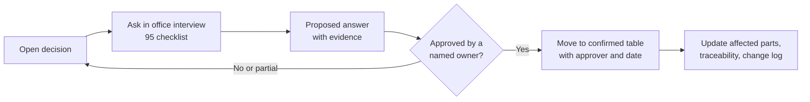

# Decisions and open questions

[Back to index](index.md)

Updated: 2026-10-18. This register distinguishes owner-confirmed scope from proposed implementation defaults and institution-specific rules. Open decisions do not prevent writing or reviewing plans; they gate only the affected implementation or rollout. Which milestone each decision gates is shown in [94](94-team-schedule-and-risks.md#iterations-and-decision-gates); the questions to ask are in [95](95-office-interview-checklist.md).



## Confirmed decisions

| ID | Decision | Confirmed by / date | Effect |
|---|---|---|---|
| C01 | Application title: BISU Registrar; use existing Laravel/Vue/shadcn-vue/Docker foundation | Project owner, initial setup request | Extend existing project |
| C02 | Support both self-service portal and on-campus intake, delivered in phases | Project owner, 2026-10-15 | Shared workflow; portal/assisted intake first, kiosk follows as proposed sequence |
| C03 | Authorized staff maintain/import a verified student/alumni list initially | Project owner, 2026-10-15 | Build imports and controlled verification; no initial external database dependency |
| C04 | Host on BISU's local campus network; “online” means campus LAN browser access | Project owner, 2026-10-15 | Internal campus production, local assets, LAN access checks; no initial public Internet hosting |
| C05 | Maintain linked part plans and implementation/deployment navigation in `System_Plan/index.md` | Project owner, 2026-10-15 | Living Markdown plan and status tracker |
| C06 | Use EnrieJohn31/BISU-Registrar for the full application root and prepare repository/development prerequisites before features | Project owner, 2026-10-16 | Source, Docker and plans published together; CI and local verification required |
| C07 | Add a Registrar supplier list with per-delivery weighted performance points: staff-only, supervisor-confirmed, flag-for-review (no auto-suspension), reference numbers only (no money), document type/expiry tracking without uploads, Registrar-only, built after M2 | Project owner, 2026-10-16 | New [Part 16](16-supplier.md); additions to Parts 02, 03, 12, 13 and 15 |
| C08 | Use Supplier/Suppliers for the Registrar module previously called Vendor/Vendors; rename the plan and proposed identifiers consistently | Project team, relayed by project owner, 2026-10-17 | Part 16 is 16-supplier.md; scope, ratings and office responsibilities are unchanged |
| C09 | Part 03 slice 1 recommendations approved: native enum-based roles (D22); remove self-service account deletion; one account per person with the rule that staff never act on their own request; staff idle timeout 30 minutes and 2FA/passkey for the roles marked in Part 03; 72-hour temporary passwords; first administrator is an MIS staff member created with `bisu:create-admin`; permission catalogue to be shown to the offices | Project owner, 2026-10-17 | Slice 1 development may proceed with these defaults; timeout, 2FA roles and expiry stay configurable until offices/MIS confirm under D03; catalogue names may change after office review. Implemented 2026-10-17 with one change: sensitive roles need confirmed TOTP two-factor; a passkey alone does not count because it does not protect password sign-in |
| C10 | Part 04 slice 1 (client records) approved for development on synthetic data, using the design's proposed safe positions: minimal fields only (display name, category, verification state, identifiers, provenance); IDs kept as text with a labelled DEMO normalization rule pending D04; no person merging, ID reuse or bulk overwrite; every correction keeps a revision with a reason and rejects stale edits; Registrar-office staff only, with Registrar supervisors receiving no general client access. Implementation details I added, each reversible: correcting a verified profile returns it to needs-review; the last current identifier cannot be retired; lists show masked IDs; audit records hold no client names | Project owner, 2026-10-17 | Slice 1 may proceed; imports (slice 2) and account linking (slice 3) stay blocked on D03/D04/D09; no real records in development |
| C11 | Proceed with DEV-2: development worker, scheduler and test inbox. Current work stays limited to the items that can proceed while offices answer, with labelled synthetic data and existing per-task design/office gates | Project owner, 2026-10-18 | Authorizes this dev-infrastructure slice. It does not authorize imports, linking, office workflows, real fees/IDs/templates or campus deployment. Record incoming answers without automatically starting a previously gated feature |
| C12 | Proceed with DEV-3, the next eligible waiting-work item: save and run the client-record browser regression suite, including the pending history paging visual check | Project owner, 2026-10-18 | Isolated synthetic fixtures and existing authentication/permissions only; C11 and all office/design gates remain in force. No business-feature or campus rollout approval |
| C13 | Proceed with DEV-8 as the next eligible waiting-work item: replace starter marks with the existing official BISU seal and remove the known stray `src/nul` | Project owner, 2026-10-18 | Local shared/sidebar and browser branding only, using a verified campus-hosted asset; no office rule, workflow or deployment approval. C11 and later slice gates remain in force |
| C14 | Proceed with DEV-4's synthetic PDF-tool comparison and update `handoff.md` with the current position and next work | Project owner, 2026-10-18 | Authorizes an isolated technical spike with labelled fake certificates and a provisional tool recommendation. D08 still gates real templates/signatories/numbering and acceptance; no document workflow or application integration is authorized |

## Proposed defaults, awaiting process review

- One service type per request, with validated copy quantity; mixed-service carts and partial release deferred.
- Reuse Laravel/Inertia; avoid a separate frontend API application initially.
- Campus portal plus staff-assisted intake before shared-device kiosk deployment.
- Poll for queue/tracking updates initially; agree refresh interval and performance target.
- Campus display/service-day timezone `Asia/Manila`, storage timestamps UTC.
- Cashier records/verifies existing approved payment channels; no initial payment gateway.
- In-app notifications first; actual email delivery/account recovery depends on campus arrangements.
- FIFO within each queue lane; priority lanes for senior citizens and PWDs are legally required, and their design and eligibility checks are part of D06.
- Stalled requests get reminders and a staff-reviewed lapse closure; requests with payments and unclaimed documents are never closed or completed automatically (D18).
- Citizen's Charter entries are the starting source for services, requirements, fees and processing times, confirmed by each office (D05).
- Two-factor authentication required for Cashier, approver, release, supervisor and administrator roles.
- Remote-from-counter campus submissions receive reserved tickets; attendance/check-in controls active queue placement.

## Open decision register

| ID | Decision required | Decision owner to assign | Blocks / affected work | Current state |
|---|---|---|---|---|
| D01 | Initial services and first-release scope; confirm phased portal/assisted/kiosk order | Project sponsor + offices | Parts 01, 05–07; release sizing | Open; proposed sequence documented |
| D02 | Hosting machine/OS, internal hostname, HTTPS trust, VLAN/Wi-Fi access, Internet-independent operation, time sync (NTP), upload malware scanning | MIS | Part 14; campus staging/production | LAN hosting confirmed; infrastructure details open |
| D03 | Proof for identity linkage, unlinked account access, account recovery and staff provisioning; staff account policies (temporary password expiry, idle timeout, roles requiring 2FA/passkey, replacement for self-service deletion with D09) | Registrar + MIS | Parts 03–04, 06; real-client access | Open; slice 1 proposals in [Part 03](03-accounts-permissions-and-audit.md#slice-1-design-staff-accounts-roles-and-audit) |
| D04 | Import format/approved columns, source custodian, ID formats, duplicates and correction authority | Registrar records custodian | Part 04; reliable identity source | Maintained/imported list confirmed; format open |
| D05 | Approved services/requirements, effective fees, waivers, assessment timing and targets; Citizen's Charter edition used and processing-time classification per service | Registrar + Cashier | Parts 05, 08–09, 12 | Open; no fee amounts invented |
| D06 | Service hours/day, reserved-ticket validity, check-in, no-show/transfer and printing; legally required priority lanes (seniors, PWDs, others), eligibility checks and lane alternation; suspension-day rollover | Both offices | Parts 06–07 | Open |
| D07 | Receipt source/numbering, payment channels, verifier duties, partial/overpayments, adjustments/refunds and reconciliation dates | Cashier | Part 09; any real financial use | Open |
| D08 | Approved templates, record sources, signatories, separation of duties, document numbering and claimant/representative/reissue rules | Registrar | Parts 03, 08, 10–11 | Open |
| D09 | Privacy Impact Assessment, privacy notice text and versions, lawful basis, permitted data, retention/deletion, data subject requests, audit access, breach contacts and incident responsibilities | BISU Data Protection Officer + MIS/office owners | Parts 03–04, 06, 10–14; real-data rollout | Open; no legal-compliance claim |
| D10 | Counter count, kiosk/display devices, printers, accessibility, shared-device identity method | Offices + MIS | Part 07 and campus equipment testing | Open |
| D11 | Campus mail relay or assisted account process, notification channels, retry/freshness expectations | MIS + offices | Parts 03, 11, 14 | In-app proposed; actual mail delivery open |
| D12 | Academic periods, report layouts/metrics, financial date basis and export access | Registrar + Cashier | Part 12 | Open |
| D13 | Peak users/load, response targets, backup frequency/retention, recovery targets and monitoring ownership | MIS + offices | Parts 13–14 release acceptance | Open; no arbitrary service-level promise |
| D14 | Named UAT/release approvers, pilot scope, deployment window, training/support/maintenance ownership | Sponsor + MIS + offices | Parts 13–15 | Open |
| D15 | Supplier rating criteria, weights and anchors, N/A use, review threshold, minimum ratings, scoring period, self-confirmation | Registrar head | Part 16 settings and flag logic | Open; example criteria documented, not adopted |
| D16 | Supplier fields (minimal contact data, TIN need), compliance document types, expiry warning window, categories | Registrar + privacy/MIS owner | Part 16 supplier form and document tracking | Open |
| D17 | Whether supplier ratings are internal or shared with BAC/Supply, whether they replace a paper supplier evaluation, report format | Registrar + Supply/BAC | Part 16 reports and any official use | Open |
| D18 | Reminder and lapse rules for requests stuck in `awaiting_client` / `awaiting_payment`; unclaimed-document period and handling | Registrar (+ Cashier for paid requests) | Parts 01, 08, 11, 12 | Open; proposed: reminders, staff-reviewed closure, never automatic for paid or unclaimed |
| D19 | Client feedback: adopt the ARTA CSM questions digitally, anonymous or linked, paper alternative, who compiles results | Registrar + Cashier, with the office that submits ARTA reports; DPO for anonymity | Parts 11, 12 | Open |
| D20 | Supported browser/device baseline for office PCs, kiosks, displays and client phones | MIS | Parts 06, 07, 13, 14; all screens | Open; Tailwind v4 needs Chrome/Edge 111+, Firefox 128+, Safari 16.4+ |
| D21 | Code and repository ownership, licensing/IP, post-thesis maintainer, transfer timing | Sponsor + MIS + IT Thesis Coordinator | Parts 14–15; handover | Open; repository currently under a personal GitHub account |
| D22 | Role/permission implementation: native enum-based roles with code-defined permission map (recommended) or spatie/laravel-permission | Project team (backend lead) | Part 03 slice 1 and every later permission | Decided: native enum-based (C09) |

## Decision entry template

```text
Decision ID:
Question / trigger:
Approved decision:
Approver and authority:
Decision date:
Evidence reference (no secrets or personal records):
Affected plan files / implementation files:
Migration or behavior impact:
Validation needed:
Supersedes decision:
```

When an assumption changes, update the workflow, data model, acceptance tests and release scope together. Keep the historical decision rather than silently rewriting its approval.
