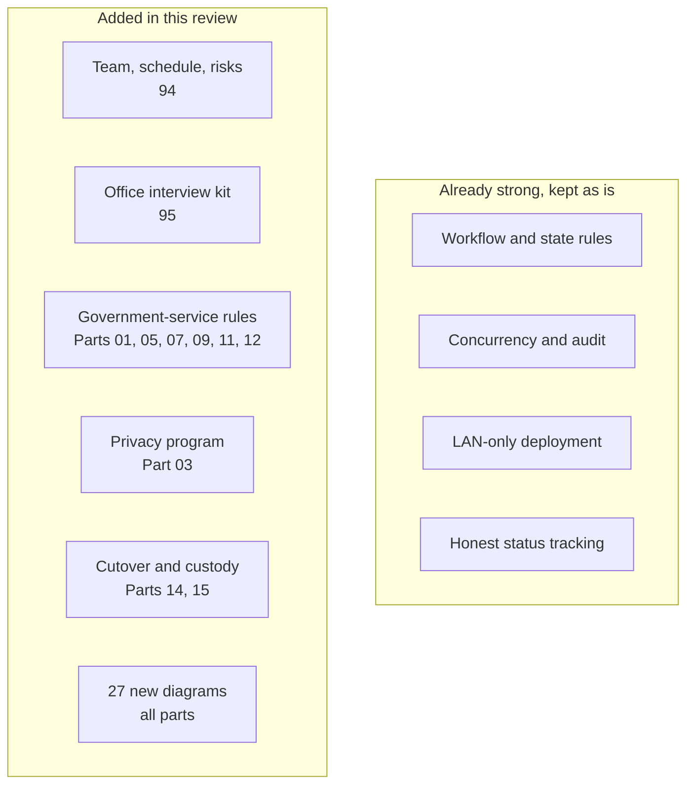

# Plan review — 2026-10-17

[Back to index](index.md) | [Change log](92-planning-change-log.md) | [Decision register](90-decisions-and-open-questions.md)

A review of the whole System_Plan against the concept brief, the workflow and what a Philippine state-university campus rollout needs. Every gap below has been written into the plan as proposed text, linked to an open decision. **None of the additions is an approved office rule.** Check each item and tell the developer what to change.

## Verdict

The plan is good enough to guide building the system itself. The state rules, the separation of request/payment/queue histories, concurrency, audit, LAN-only hosting and honest status tracking are stronger than most project plans. Before this review it was not yet complete as a project plan. It had no team, schedule or risks; no way of collecting the 17 open decisions; several Philippine government-service rules were missing; go-live and handover were thin; and there were almost no diagrams.

## Findings and where they were addressed

| ID | Gap found | Why it matters | Severity | Updated in |
|---|---|---|---|---|
| F01 | No team roles, schedule, thesis checkpoints or Definition of Done | A thesis has fixed defense dates; "names pending" everywhere means nobody owns anything | High | [94](94-team-schedule-and-risks.md) |
| F02 | No risk register | Late decisions, scope size and team turnover are the likeliest reasons this project slips | Medium | [94](94-team-schedule-and-risks.md#risk-register) |
| F03 | 17 open decisions (now 21), no named owners, no plan to collect answers | Decisions gate every milestone | High | [95](95-office-interview-checklist.md), [90](90-decisions-and-open-questions.md), gates in [94](94-team-schedule-and-risks.md#iterations-and-decision-gates) |
| F04 | Citizen's Charter (RA 11032) not used as the source of services and processing times | Offices already publish this; it is the natural, approved source and the turnaround benchmark | Medium | [01](01-requirements-and-workflow.md), [05](05-services-requirements-and-fees.md), [12](12-reporting-and-analytics.md), D05 |
| F05 | No client feedback (ARTA CSM) | Government offices measure client satisfaction; the system can collect it at completion | Medium | [11](11-release-tracking-and-notifications.md), [12](12-reporting-and-analytics.md), [02](02-architecture-and-data-model.md), D19 |
| F06 | Queue was FIFO-only | Priority lanes for senior citizens (RA 9994) and PWDs (RA 10754) are legally required; many alumni are seniors | High | [07](07-queues-counters-and-kiosk.md), D06 |
| F07 | Privacy section had no DPO, PIA, notice versioning or breach contacts | Real student data cannot be used until the DPO is satisfied | High | [03](03-accounts-permissions-and-audit.md), [06](06-portal-and-request-intake.md), [02](02-architecture-and-data-model.md), D09 |
| F08 | No service calendar for holidays and suspensions | Working-day turnaround and queue service days are wrong without it | Medium | [02](02-architecture-and-data-model.md), [07](07-queues-counters-and-kiosk.md), [12](12-reporting-and-analytics.md) |
| F09 | No rule for stalled requests or unclaimed documents | Pending counts grow forever and reports mislead | Medium | [01](01-requirements-and-workflow.md), [08](08-registrar-workspace.md), [11](11-release-tracking-and-notifications.md), [12](12-reporting-and-analytics.md), D18 |
| F10 | Office clearances (accounting, library) were not a requirement type | Common requirement for TOR and similar documents | Medium | [05](05-services-requirements-and-fees.md), [08](08-registrar-workspace.md) |
| F11 | No throttling on ID lookup and linking; no staff 2FA or idle timeout rule | Guessing IDs reveals who is in the list; shared office PCs stay signed in | Medium | [03](03-accounts-permissions-and-audit.md), [04](04-client-records-and-imports.md), [13](13-testing-and-campus-acceptance.md) |
| F12 | Browser support unknown | Tailwind v4 needs Chrome/Edge 111+, Firefox 128+, Safari 16.4+; older campus PCs would show broken pages | High | [13](13-testing-and-campus-acceptance.md), [14](14-campus-deployment-and-operations.md), D20 |
| F13 | No go-live cutover or parallel run | Open paper requests and OR series continuity must be handled on day one | High | [14](14-campus-deployment-and-operations.md#go-live-cutover-added-2026-10-17) |
| F14 | Repository lives under a personal GitHub account; no custody plan | The campus could lose access to its own system after graduation | High | [15](15-training-handover-and-roadmap.md), D21 |
| F15 | No thesis evaluation instrument or defense demo data | Manuscripts usually need an evaluation (e.g., ISO/IEC 25010); demos need safe, repeatable data | Medium | [13](13-testing-and-campus-acceptance.md) |
| F16 | Nonfunctional requirements had no IDs | They could not be traced to tests | Medium | [91](91-requirement-traceability.md) |
| F17 | Cashier reconciliation did not name the official collection report | Reconciliation must match what Cashier submits (e.g., RCD) | Low | [09](09-cashier-and-payment-control.md) |
| F18 | No help page, interface-language decision or upload scanning decision | Usability for walk-in clients; upload safety | Low | [06](06-portal-and-request-intake.md), D01, D02 |
| F19 | No server time sync | Service days, receipt dates and audit order depend on correct time | Low | [14](14-campus-deployment-and-operations.md) |
| F20 | No glossary | Panelists and new team members meet CAV, OR, RCD, SPA, PIA without definitions | Low | [96](96-glossary.md) |
| F21 | Only 4 diagrams across 16 parts | Offices and panelists understand flows faster from pictures | Medium | All parts (list below) |

## Diagrams added

| File | Diagrams |
|---|---|
| [index](index.md) | System overview; build order by milestone |
| [01](01-requirements-and-workflow.md) | End-to-end sequence across client, Registrar and Cashier |
| [02](02-architecture-and-data-model.md) | Entity-relationship overview |
| [03](03-accounts-permissions-and-audit.md) | Separation of duties; personal-data lifecycle |
| [04](04-client-records-and-imports.md) | Import pipeline; account linking |
| [05](05-services-requirements-and-fees.md) | Charter → service version → snapshot and assessment |
| [06](06-portal-and-request-intake.md) | Intake channels |
| [07](07-queues-counters-and-kiosk.md) | Ticket lifecycle |
| [08](08-registrar-workspace.md) | Worklist flow and holds |
| [09](09-cashier-and-payment-control.md) | Financial states; verification sequence |
| [10](10-document-generation-and-approval.md) | Document version lifecycle |
| [11](11-release-tracking-and-notifications.md) | Release at the counter |
| [12](12-reporting-and-analytics.md) | Report data flow |
| [13](13-testing-and-campus-acceptance.md) | Testing path to release |
| [14](14-campus-deployment-and-operations.md) | Release pipeline; go-live cutover |
| [15](15-training-handover-and-roadmap.md) | Handover flow |
| [16](16-vendor.md) | Vendor rating process |
| [90](90-decisions-and-open-questions.md) | How a decision moves through the plan |
| [94](94-team-schedule-and-risks.md) | Iteration loop; milestone decision gates |
| [95](95-office-interview-checklist.md) | From interview answer to plan change |
| This file | Review summary |

All diagrams are Mermaid, which GitHub renders directly. In VS Code, install a Mermaid preview extension to see them.

## Not changed on purpose

- No dates, names, fee amounts, periods or thresholds were invented; the 94 tables have blanks for the team.
- No office policy was decided. New rules are proposals tied to D05, D06, D09 and D18–D21.
- The legal references (RA 11032, RA 9994, RA 10754, RA 10173, NPC guidance, COA reporting) are pointers to confirm with the offices and the DPO, not legal advice.
- No application code changed.

## Team check-off

Mark each finding when the team has read the change and agrees, or note what to change.

- [ ] F01 Team roles, iterations, thesis checkpoints, Definition of Done (94)
- [ ] F02 Risk register (94)
- [ ] F03 Office interview checklist and decision gates (95, 94)
- [ ] F04 Citizen's Charter as the service source
- [ ] F05 Client feedback (CSM)
- [ ] F06 Priority lanes
- [ ] F07 Privacy program items
- [ ] F08 Service calendar
- [ ] F09 Stalled requests and unclaimed documents
- [ ] F10 Office clearances as requirements
- [ ] F11 Throttling, staff 2FA and idle timeout
- [ ] F12 Browser and device baseline
- [ ] F13 Go-live cutover
- [ ] F14 Repository custody
- [ ] F15 Thesis evaluation and demo data
- [ ] F16 Nonfunctional requirement IDs
- [ ] F17–F20 Small additions (collection report, help page, NTP, glossary)
- [ ] F21 Diagrams render and read correctly
