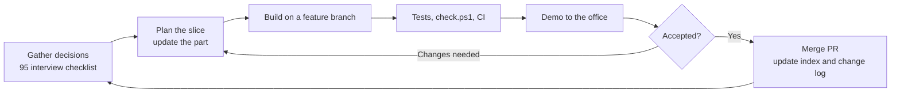
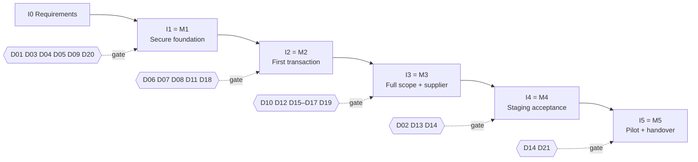

# Team, schedule and risk register

[Back to index](index.md) | [Decision register](90-decisions-and-open-questions.md) | [Office interview checklist](95-office-interview-checklist.md)

Updated: 2026-10-17. Added by the [2026-10-17 plan review](93-plan-review.md). Names, dates and durations are for the team to fill in. Nothing here is a commitment until the team and the IT Thesis Coordinator confirm it.

## Development approach

Iterative, incremental delivery. Each iteration produces a working, tested slice. The slice is demonstrated to the affected office, then decisions and plans are updated before the next slice starts. Confirm with your adviser which methodology name the manuscript should use (for example Agile/Scrum-style iterations or an iterative SDLC).

## Team roles

| Role | Responsibilities | Primary parts | Team member |
|---|---|---|---|
| Project lead | Schedule, office coordination, decision follow-up, adviser updates | Index, 90, 92, 94, 95 | _to assign_ |
| Backend lead | Schema, actions, policies, concurrency, audit | 02–05, 07–09 | _to assign_ |
| Frontend / UX lead | Inertia/Vue screens, accessibility, kiosk and display | 06, 07, 11, report screens | _to assign_ |
| Documents and reports | Templates, PDF rendering, reports and exports | 10, 12, 16 | _to assign_ |
| QA and documentation | Test plans, UAT evidence, manuals, thesis evaluation | 13, 15 | _to assign_ |
| Deployment liaison | MIS coordination, staging, backup and restore | 14 | _to assign_ |

One person may hold several roles. Each part's Owner field should name a team member as well as the office owner.

## Iterations and decision gates

A gate means the listed decisions must be recorded before that iteration's affected work goes live. Building can start earlier with proposed defaults kept configurable.

| Iteration | Scope | Exit evidence | Target start | Target end |
|---|---|---|---|---|
| I0 Requirements | Office interviews, collect documents, record gating decisions, device inventory | Decisions in 90; Part 01 workflow reviewed with both offices | _fill_ | _fill_ |
| I1 Secure foundation (M1) | Roles/audit, client records/import, service catalog, renderer spike with one real template | Tests pass; office demo of import and catalog | _fill_ | _fill_ |
| I2 First transaction (M2) | Portal and assisted intake, basic queue, Registrar, Cashier, minimal output/release | UAT-01, 02, 03 on synthetic data | _fill_ | _fill_ |
| I3 Full scope (M3) | Kiosk/display, templates, tracking/notifications, reports, feedback, supplier list | Remaining UAT on staging-like data | _fill_ | _fill_ |
| I4 Staging acceptance (M4) | Campus staging, UAT, security, devices, restore drill | Part 13 exit criteria | _fill_ | _fill_ |
| I5 Pilot and handover (M5) | Cutover, pilot, training, repository transfer | Part 14 ledger; Part 15 handover signed | _fill_ | _fill_ |

## Thesis checkpoints

Confirm the dates and required deliverables with the IT Thesis Coordinator.

| Checkpoint | Date | Proposed demonstration | Manuscript / evidence |
|---|---|---|---|
| Proposal / title defense | _fill_ | Plan, diagrams, login and home prototype | Concept, objectives, scope, methodology |
| Progress review | _fill_ | M1 slice: import, catalog, roles | Updated plans, decision register |
| Final defense | _fill_ | At minimum M2 (free and paid request end to end); ideally M3 on staging | UAT evidence, evaluation results (Part 13) |
| Implementation / handover | _fill_ | Pilot results | Part 14 ledger, Part 15 handover |

## Definition of Done (every feature)

- [ ] The affected part's checklist, evidence and decisions are updated.
- [ ] Migrations are additive, with a rollback or forward-fix note.
- [ ] Server-side validation, policies and audit events are in place.
- [ ] Feature tests cover the happy path, authorization and invalid transitions; MySQL tests where locking matters.
- [ ] `./check.ps1` passes locally and GitHub CI is green on the PR.
- [ ] Screens handle loading, empty and error states, keyboard use, mobile width, and light and dark mode.
- [ ] Index and change log updated. No real records, secrets or private files committed.
- [ ] [handoff.md](handoff.md) rewritten for the next person: what was done, decisions needed, next steps, blockers.

## Risk register

Likelihood and impact use High / Medium / Low. Review this table at each iteration boundary.

| ID | Risk | Likelihood | Impact | Mitigation | Owner |
|---|---|---|---|---|---|
| RK01 | Office decisions arrive late (21 open decisions, owners not named) | High | High | Use the 95 checklist in I0; gate by milestone; keep proposed defaults configurable; escalate through the sponsor | Project lead |
| RK02 | Scope is larger than the thesis timeline (full brief plus supplier list) | High | High | M2 is the minimum for final defense; supplier after M2; kiosk last | Project lead + adviser |
| RK03 | No maintainer after the team graduates | Medium | High | D21 decided early; MIS involved from I1; developer reference kept current | Project lead + MIS |
| RK04 | Repository sits under a personal GitHub account | Medium | High | Transfer to a BISU/MIS-controlled organization with history (D21) | Project lead |
| RK05 | Campus PCs or kiosks run browsers too old for Tailwind v4 / Vue 3 | Medium | High | Inventory devices in I0 (D20); test on real devices before M2 | Frontend lead + MIS |
| RK06 | No campus mail relay, so account verification and recovery fail | High | Medium | Staff-assisted activation/recovery process (D11) | Backend lead + MIS |
| RK07 | Privacy approval (PIA) or real-data access is delayed | Medium | High | Synthetic data throughout; start the PIA with the DPO in I1 | QA + DPO |
| RK08 | Server or network not provisioned in time | Medium | High | Raise D02 in I0; staging on a spare campus machine | Deployment liaison |
| RK09 | Power or network outages during operation | Medium | Medium | UPS, manual fallback log and reconciliation (Part 14) | MIS |
| RK10 | Government-service rules missed (Citizen's Charter, priority lanes, CSM, collection reports) | Medium | Medium | Confirm in I0 interviews; plan items in Parts 05, 07, 09, 11, 12 | Project lead |
| RK11 | Concurrency bugs produce duplicate tickets, payments or releases | Medium | High | MySQL concurrency tests (Part 13), locked actions | Backend lead |
| RK12 | Generated documents don't match approved templates (fonts, security paper, alignment) | Medium | Medium | DEV-4 synthetic comparison complete; provisional Dompdf direction. Repeat on one real approved template/fonts and campus printer under D08 before acceptance ([evidence](../docs/DEV-4-PDF-RENDERERS.md)) | Documents lead |
