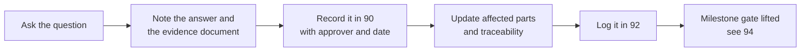

# Office interview checklist

[Back to index](index.md) | [Decision register](90-decisions-and-open-questions.md) | [Team, schedule and risks](94-team-schedule-and-risks.md)

Updated: 2026-10-17. Added by the [2026-10-17 plan review](93-plan-review.md). Print this or bring it to each office. Each question names the decision it settles. Record answers as decision entries in [90](90-decisions-and-open-questions.md), not here. Never write real student records or private details in this folder.

## How an answer becomes a plan change

## Registrar's Office

| # | Question | Decision |
|---|---|---|
| R1 | Which services/documents should the first release include? Which are requested most? | D01 |
| R2 | Can we use the current Citizen's Charter entries for Registrar services (steps, requirements, fees, processing time)? Which edition? | D05 |
| R3 | What proof links a person to a Student ID or Alumni ID? Who checks it? | D03 |
| R4 | What columns does the official student/alumni list have? Who is the custodian? What do ID formats look like? How are duplicates resolved? | D04 |
| R5 | What does each service require (form, ID, clearance from accounting/library, authorization letter/SPA)? Who verifies clearances today? | D05 |
| R6 | Office hours, service days, current queue practice, no-show handling, check-in. How are priority lanes (senior citizens, PWDs, pregnant women) handled today? | D06 |
| R7 | Approved templates, signatories, document numbering, security paper, wet signature or recorded approval? | D08 |
| R8 | Rules for representatives claiming documents: authorization letter or SPA, required IDs | D08 |
| R9 | How long can a request wait for missing information or payment before it closes? What happens to documents nobody claims, and after how many days? | D18 |
| R10 | Which reports go out today (daily, monthly, semester, academic year), in what format and to whom? | D12 |
| R11 | Where do the academic calendar, holidays and work-suspension notices come from? | D12, D06 |
| R12 | How is client feedback collected now (paper CSM form)? Who compiles ARTA reports? | D19 |
| R13 | Which language(s) should clients see: English, Filipino, Cebuano/Boholano? | D01 |
| R14 | Vendor list: rating criteria and weights, review threshold, scoring period, vendor fields, documents | D15, D16 |

## Cashier's Office

| # | Question | Decision |
|---|---|---|
| C1 | Which payment channels are accepted (cash at counter, bank deposit, e-wallet, other)? | D07 |
| C2 | How are official receipts issued (series, numbering, manual or electronic)? Which reference should the system record? | D07 |
| C3 | Who verifies payments? Does one person record and another verify? | D07 |
| C4 | Partial payments, overpayments, refunds, discounts/waivers: allowed? Who approves? | D07, D05 |
| C5 | Daily cut-off and reconciliation; which official collection report (for example the Report of Collections and Deposits) and which date basis? | D07, D12 |
| C6 | Which fee schedule or board resolution sets the amounts? Effective dates? | D05 |

## MIS / IT

| # | Question | Decision |
|---|---|---|
| M1 | Which server will host it: OS, specs, location, UPS, backup target? | D02, D13 |
| M2 | Internal hostname, HTTPS certificate approach, which VLANs/Wi-Fi students can reach | D02 |
| M3 | Inventory of office PCs, kiosks, displays, printers: OS and browser versions | D10, D20 |
| M4 | Is a mail relay available for account verification and password reset? | D11 |
| M5 | Backup schedule and retention, monitoring owner, maintenance window | D13 |
| M6 | Who owns the code and repository after the thesis? Can it move to a BISU-controlled GitHub organization? | D21 |
| M7 | Is server time synchronized (NTP)? | D02 |

## Data Protection Officer

| # | Question | Decision |
|---|---|---|
| P1 | Is a Privacy Impact Assessment required before real data is used? Is there a template? | D09 |
| P2 | Approved privacy notice text for the portal, kiosk and assisted intake | D09 |
| P3 | Retention periods for requests, payments, queue data, feedback and audit logs | D09 |
| P4 | How are data subject requests (access, correction) and breaches reported, and to whom? | D09 |
| P5 | Should feedback be anonymous or linked to the request? | D19 |

## Supply Office / BAC

| # | Question | Decision |
|---|---|---|
| S1 | Is there an existing supplier evaluation form? Should Registrar ratings be shared with you? | D17 |
| S2 | Which vendor documents matter (business permit, PhilGEPS registration, others)? | D16 |

## IT Thesis Coordinator / adviser

| # | Question | Decision |
|---|---|---|
| T1 | Defense dates and required deliverables (manuscript chapters, evaluation instrument such as ISO/IEC 25010) | 94 schedule |
| T2 | Is the added scope (vendor list, review additions) accepted for the thesis? | C07, 93 |
| T3 | Who signs UAT and acceptance for each office? | D14 |
| T4 | Code ownership and licensing expectations for a campus-deployed thesis system | D21 |

## Documents to request (blank or sanitized only)

- [ ] Citizen's Charter sections for Registrar and Cashier services
- [ ] Current request forms and sample outputs (blank or with fake data)
- [ ] Fee schedule and its approving authority
- [ ] Official receipt and daily collection process description
- [ ] Sample daily/monthly/semester reports (blank)
- [ ] Academic calendar and holiday list
- [ ] Office organization chart and signatories
- [ ] Current queue logbook or ticket format (blank)
- [ ] Device inventory from MIS
- [ ] Approved privacy notice
- [ ] Supplier evaluation form (if any)
