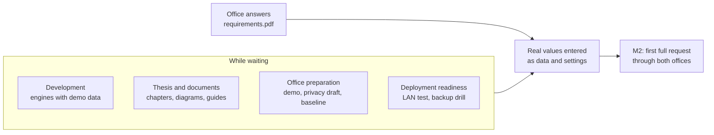

# Work while waiting for office inputs

[Back to index](index.md) | [Handoff](handoff.md) | [Requirements checklist](requirements.pdf) | [Decision register](90-decisions-and-open-questions.md)

| Tracking field | Value |
|---|---|
| Plan status | Draft for the team, 2026-10-18 |
| Purpose | Useful work while the offices answer the [requirements checklist](requirements.pdf) |
| Owner | Project lead assigns the tracks; names pending ([94](94-team-schedule-and-risks.md)) |
| Updated | 2026-10-18 |

The requirements checklist has gone out, and its answers decide fees, ID formats, services, queue rules and templates. Until they arrive, the team works on three kinds of task that cause little rework:

1. **Build mechanisms, not office rules.** If the shape of a feature is already known, build it with labelled demo data. The office's real values go in later as data or settings.
2. **Reduce later risk.** Concurrency, document rendering, testing and deployment problems are cheaper to find now.
3. **Prepare the thesis and the offices.** Members who don't code can write, draw diagrams and prepare office visits in parallel.

**Owner direction, 2026-10-18 (C11): current work is limited to items that can proceed while the offices answer.** DEV-2, DEV-3 and DEV-8 were authorized in sequence (C11–C13). Keep the separate design/approval gates for later slices. Record incoming office answers, but do not automatically start a previously gated business feature; obtain its own scoped task first. The [handoff](handoff.md) says what each answer unblocks.

Size: **S** = a few hours, **M** = a few days, **L** = a full slice. Rework risk is what happens if the office answer differs from our assumption.

## Development track

In this order. Each build slice gets a design or approval first, as for Parts 03 and 04, then a local branch, `./check.ps1`, a handoff rewrite and a change-log entry.

| # | Task | Part | Why now | Rework risk | Size | Office input that plugs in later |
|---|---|---|---|---|---|---|
| DEV-1 | Fix what you find when testing Part 04 slice 1. **Done 2026-10-18:** full-history paging and restricted audit reasons fixed; 163 tests / 936 assertions pass. DEV-3 subsequently completed the paging visual check ([QA evidence](../docs/PART-04-QA-2026-10-18.md)) | 04 | Finishes the current slice | None | S | — |
| DEV-2 | Add a queue worker, scheduler and Mailpit (a test mail inbox) to `docker-compose.dev.yml`. **Done 2026-10-18:** dev services, captured email/retry/failure probes, setup/restoration checks and 163 tests / 936 assertions passed ([design/evidence](../docs/DEV-2-BACKGROUND-SERVICES.md)) | 14, 04, 11 | Imports, document jobs and notifications all need a worker. Mailpit lets us test emails with no campus mail relay | Low | S | D11 mail relay |
| DEV-3 | Save the 34-check browser walkthrough. **Done locally 2026-10-18:** 34 named Playwright cases × four Chromium viewport/theme projects, isolated synthetic fixtures, real sign-in/TOTP, reports and CI wiring; full-history visual follow-up completed ([design/evidence](../docs/DEV-3-BROWSER-REGRESSION.md)) | 13 | Every later slice can reuse the regression suite | Low | M | D20 browser list |
| DEV-4 | Document renderer spike: compare two PDF renderers offline in Docker with bundled fonts, on a made-up certificate stamped "SAMPLE – NOT VALID" (A4 and Legal, long names, multi-page) | 10 | Addresses risk RK12 before any template work; choosing the tool doesn't depend on the real template | Low; the real template repeats the test | M | D08 templates and signatories |
| DEV-5 | Write the Part 05 design (services, requirements, fees) to match the Citizen's Charter entry format. Page 115 already shows the fields: office, classification, type of transaction, who may avail, checklist of requirements and where to secure them, client steps, agency actions, fees, processing time, person responsible | 05 | The charter format is standard across entries, so the data model can follow it now | Low | S | D05 |
| DEV-6 | Part 05 slice 1, after you approve DEV-5: a catalog with versions, effective-dated fees, staff editing with audit, and a read-only client catalog, with 3–5 services labelled "(Demo)" and obviously fake amounts | 05 | Next part in the build order; real services become data entry | Medium: unusual fee rules (per page, per copy, waivers) may need fields added | L | D05, D07 |
| DEV-7 | Part 07 slice 1: a basic queue with counters, daily ticket numbers allocated under a lock, call next, recall and no-show, and ticket history. First in, first out by default; hours and priority lanes are settings | 07 | Concurrency is the hard part, and it doesn't depend on office rules | Medium: the priority-lane alternation rule may change | L | D06, D10 |
| DEV-8 | **Done locally 2026-10-18:** campus-hosted BISU seal in the shared/sidebar mark, PNG/ICO/touch browser icons, reproducible assets and exact stray-file cleanup; 136 browser checks and desktop/collapsed/phone visual review passed; [source/design/validation](../docs/DEV-8-BISU-BRANDING.md) | 00 | Polish before any office demo | None | S | — |

## Thesis and documentation track

No coding needed. QA and documentation lead plus whoever is free.

| # | Task | Uses | Size |
|---|---|---|---|
| TH-1 | Fill in team roles and target dates in [94](94-team-schedule-and-risks.md) (every row still says "to assign" or "fill"), including the adviser's defense dates | Requirements item 11 | S |
| TH-2 | Draft manuscript chapters 1–3: background, objectives, scope and limitations, related literature, methodology (iterative milestones M0–M5) | [Concept brief](project-concept-brief.md), [94](94-team-schedule-and-risks.md), [93](93-plan-review.md) | L |
| TH-3 | Manuscript figures: context diagram, data flow diagrams, use-case diagram, ERD. The ERD for the tables already built (accounts, roles, audit, clients) can come straight from the migrations; the rest comes from Part 02's proposed entities | [Part 02](02-architecture-and-data-model.md) and the Mermaid diagrams in each part | M |
| TH-4 | Related laws and literature: RA 11032 (Citizen's Charter), ARTA Client Satisfaction Measurement, RA 10173 (Data Privacy Act), RA 9994 and RA 10754 (priority lanes), queueing systems, similar campus systems | [Glossary](96-glossary.md) | M |
| TH-5 | Draft the evaluation instrument (ISO/IEC 25010 Likert questionnaire, respondent groups, sample size, statistical treatment) for the adviser to approve | [Part 13](13-testing-and-campus-acceptance.md#thesis-evaluation-if-required-by-the-it-program) | M |
| TH-6 | User guides for what already works, with screenshots from demo data only: staff sign-in and two-factor setup, admin account management, client records | [Part 15](15-training-handover-and-roadmap.md) | M |

## Office preparation track

Project lead plus one member.

| # | Task | Why | Size |
|---|---|---|---|
| OF-1 | Send [requirements.pdf](requirements.pdf), name one contact per office, and record every answer as a decision in [90](90-decisions-and-open-questions.md) | Answers have to be traceable | S |
| OF-2 | Book a 20-minute demo with the Registrar: show client records and the demo ID rule, then ask the ID questions (D04, R3 and R4 in [95](95-office-interview-checklist.md)) | Offices answer faster and more precisely when they can see a screen | S |
| OF-3 | Draft the privacy notice and a Privacy Impact Assessment outline for the Data Protection Officer to review, listing only the fields we store now (C10) | The DPO edits a draft faster than writing from nothing (D09, risk RK07) | M |
| OF-4 | With office permission, take a "before" baseline: for a few days, tally clients per day, waiting time and processing time per document type on paper, with no names | Gives the thesis a before-and-after comparison and sets realistic report targets (Parts 12, 13, 14 cutover) | M |
| OF-5 | Device walk-through with MIS: office PCs and browser versions, printers, and how students reach campus Wi-Fi | D02, D10, D20; risk RK05 | S |

## Deployment readiness track

Deployment liaison, with development help.

| # | Task | Why | Size |
|---|---|---|---|
| OPS-1 | Open the development app from a phone and a second laptop on the same Wi-Fi, and record the browser versions | Catches old-browser and LAN access problems early (RK05, RK08) | S |
| OPS-2 | Draft a production image (compiled assets, no CDN, debug off) and a backup-and-restore script, then run one restore drill on a spare laptop | Part 14 needs a practiced restore before staging; MIS details plug in later | M |

## Not yet

These wait for office answers because building them now would mean large rework:

- Portal submission, Registrar and Cashier workflows (Parts 06, 08, 09). They need D01, D05 and D07, and the request workflow in [Part 01](01-requirements-and-workflow.md) must first be reviewed with both offices.
- Imports (Part 04 slice 2), which need D04, a sample source file and D09, and account linking (slice 3), which needs D03.
- Any real fee, ID format, template wording or signatory, even as an example. Demo data stays labelled "(Demo)".

## Suggested order

| Round | Development | Team |
|---|---|---|
| 1 | DEV-1 (after your test), DEV-2, DEV-8, DEV-3 | TH-1, OF-1, OF-2, OF-5, OPS-1 |
| 2 | DEV-4, DEV-5 (design for your approval) | TH-2, TH-3, OF-3, OF-4 |
| 3 | DEV-6, then DEV-7 | TH-4, TH-5, TH-6, OPS-2 |

Mark each task done here with its date and evidence link, and move the finished work into its part's implementation record as usual.
