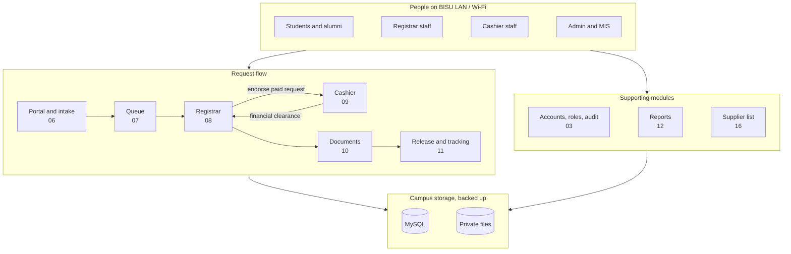
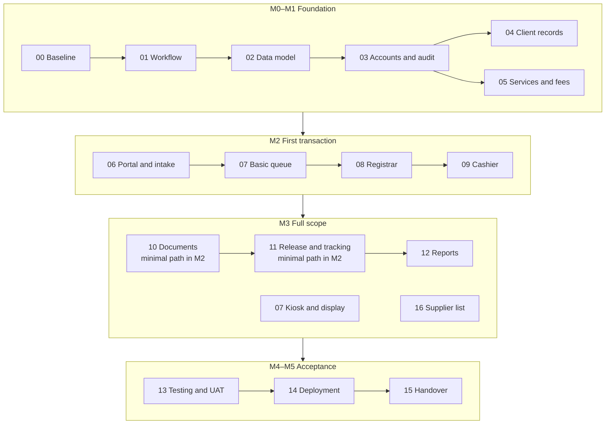

# BISU Registrar — System Plan and Progress Tracker

**Project:** Integrated Registrar–Cashier Document Request, Queuing, and Transaction Management System for Bohol Island State University – Balilihan Campus.

**Last updated:** 2026-10-18 · **Current stage:** M1 development (accounts slice merged; Part 04 and waiting-work infrastructure/tests/branding/PDF spike local) · **Current focus:** work that can proceed while office answers are pending (C11) · **Next development task:** approve the Part 05 slice 1 design (drafted 2026-10-18), then DEV-6. Later slices retain their own scoped approval and office gates · **Where to pick up:** [handoff.md](handoff.md)

This is the navigation and status source for the project. Each part contains the features to build, implementation steps, connections to other modules, acceptance criteria and evidence to collect. Drafting a plan does not mark its features implemented, tested or deployed.

## Confirmed project direction

- Extend the existing Laravel 13 + Vue 3/Inertia + TypeScript + Tailwind CSS/shadcn-vue application.
- **Host on BISU's local campus network. “Online” means browser access on approved BISU LAN/Wi-Fi.** Public Internet hosting and off-campus access are outside the initial scope.
- Support campus-network self-service and on-campus assisted/kiosk use, delivered in phases.
- Initially use a verified student/alumni list maintained/imported by authorized staff.
- Preserve the existing application foundation and document changes, checks and optimization suggestions.

## Plan at a glance

Who uses which module, and how a request moves between offices:

| Who | Uses |
|---|---|
| Students and alumni | Portal (06), queue tickets (07), tracking and claiming (11) |
| Registrar staff | Queue counters (07), Registrar workspace (08), documents (10), release (11), supplier list (16), reports (12) |
| Cashier staff | Cashier queue (07), Cashier workspace (09), collection reports (12) |
| Admin and MIS | Accounts and roles (03), deployment and backups (14) |

Every module stores data in MySQL. Generated documents and attachments go to private files.

Build order by milestone. Each row must be working before the next row goes live:

Part 16 technically needs only Parts 02–03, but is scheduled after M2 by decision C07. Iterations, decision gates and target dates are in [94](94-team-schedule-and-risks.md).

## Where we are now

| Area | Current status | Evidence |
|---|---|---|
| Laravel/Vue/Docker foundation | Implemented, repository published and verified for development | [Part 00](00-current-baseline.md), [existing setup report](../SETUP-VALIDATION.md) |
| Latest local foundation validation | DEV-4: 167 tests / 944 assertions, build, frontend/browser TypeScript and PHP checks passed on 2026-10-18; unpublished | [DEV-4 validation](../docs/DEV-4-PDF-RENDERERS.md); [historical foundation/CI report](../docs/FOUNDATION-VALIDATION.md) |
| Current local runtime | LAN phone preview active: six services running, Vite paused, compiled assets served by app. Base setup restores seven loopback dev services. Worker/scheduler/Mailpit validated | [Phone preview runtime](handoff.md#runtime-and-watch-outs); [DEV-2 validation](../docs/DEV-2-BACKGROUND-SERVICES.md); [DEV-3 isolation evidence](../docs/DEV-3-BROWSER-REGRESSION.md) |
| Optional phone preview | OPS-1: start/stop and PC HTTP/assets verified; owner confirmed login page opens on a physical phone over Wi-Fi (2026-10-18). Phone sign-in/navigation, device/browser details and second laptop pending | [Phone access instructions](../docs/LAN-PHONE-PREVIEW.md); [active runtime in handoff](handoff.md#runtime-and-watch-outs) |
| Saved browser regression | DEV-3: 34 cases × four Chromium viewport/theme projects passed; full-history visual follow-up complete; local branch `test/browser-regression-2026-10-18` | [Design, case map and validation](../docs/DEV-3-BROWSER-REGRESSION.md) |
| Shared/browser branding | DEV-8: campus-hosted BISU seal, local browser icons and exact stray-file cleanup on `feat/bisu-branding-2026-10-18`; 136 browser checks plus six navigation captures reviewed | [Source, design and validation](../docs/DEV-8-BISU-BRANDING.md) |
| PDF technical spike | DEV-4: 12 combinations / 36 renders / 19 reviewed pages; provisional Dompdf choice on `spike/pdf-renderers-2026-10-18`. No app integration or document lifecycle | [Method, results and remaining gates](../docs/DEV-4-PDF-RENDERERS.md) |
| Development background services | DEV-2 adds a database queue worker, scheduler and Mailpit test inbox on `feat/dev-background-services-2026-10-18`; local only | [Design and validation](../docs/DEV-2-BACKGROUND-SERVICES.md) |
| Accounts, roles and audit trail | Part 03 slice 1 + browser fixes merged in [PR #7](https://github.com/EnrieJohn31/BISU-Registrar/pull/7), `fa2246a`; office UAT/campus deployment pending | [Part 03 implementation record](03-accounts-permissions-and-audit.md#slice-1-implementation-record) |
| Client records | Part 04 slice 1 with follow-up QA fixes on `fix/part-04-qa-2026-10-18`; not pushed, merged or deployed | [Part 04 implementation record](04-client-records-and-imports.md#slice-1-implementation-record), [follow-up QA](../docs/PART-04-QA-2026-10-18.md) |
| Registrar/Cashier business modules | Not started | Part 03 account foundation and Part 04 client records (slice 1) implemented; services, requests, queues and payments not implemented |
| Planning documentation | Draft reviewed 2026-10-17; gaps filled and diagrams added; needs team and process-owner review | [Plan review](93-plan-review.md); [change log](92-planning-change-log.md) |
| Campus staging | Not deployed / no deployment recorded | [Deployment register](14-campus-deployment-and-operations.md) |
| Campus production | Not deployed / no deployment recorded | No internal production URL, release revision or deployment approval recorded |

The configured developer URL is `http://localhost:8085`. It is not a BISU network production address. The campus hostname and network access details remain to be assigned by MIS.

## Part-by-part navigation

| Part | Plan / feature area | Implementation | Validation | Deployment |
|---|---|---|---|---|
| 00 | [Current application baseline](00-current-baseline.md) | Foundation and repository tooling implemented/published | Local checks and GitHub CI passed: 40 tests / 138 assertions | Local verified only |
| 01 | [Requirements and shared workflow](01-requirements-and-workflow.md) | Not started; plan draft | Office review pending | Not deployed |
| 02 | [Architecture and data model](02-architecture-and-data-model.md) | Not started | Not started | Not deployed |
| 03 | [Accounts, permissions, privacy and audit](03-accounts-permissions-and-audit.md) | Slice 1 implemented and merged (PR #7, `fa2246a`) | Slice 1: 97 tests / 498 assertions, MySQL smoke, browser QA and GitHub CI passed | Not deployed |
| 04 | [Verified client records and imports](04-client-records-and-imports.md) | Slice 1 + follow-up fixes local; slices 2 (imports) and 3 (linking) design only | DEV-3: 136 saved browser checks passed, including full-history paging/audit privacy. DEV-1 MySQL: 45 tests / 394 assertions; original race evidence: 2026-10-17. Custodian acceptance pending | Not deployed |
| 05 | [Services, requirements and fees](05-services-requirements-and-fees.md) | Slice 1 design drafted 2026-10-18 (DEV-5), awaiting owner approval; not built | Not started | Not deployed |
| 06 | [Campus portal and assisted intake](06-portal-and-request-intake.md) | Not started | Not started | Not deployed |
| 07 | [Queues, counters, display and kiosk](07-queues-counters-and-kiosk.md) | Not started | Not started | Not deployed |
| 08 | [Registrar workspace](08-registrar-workspace.md) | Not started | Not started | Not deployed |
| 09 | [Cashier and payment control](09-cashier-and-payment-control.md) | Not started | Not started | Not deployed |
| 10 | [Document generation and approval](10-document-generation-and-approval.md) | Isolated DEV-4 renderer spike complete locally; document module not started | Synthetic comparison passed; D08 actual-template/font/printer and workflow acceptance pending | Not deployed |
| 11 | [Release, tracking and notifications](11-release-tracking-and-notifications.md) | Not started | Not started | Not deployed |
| 12 | [Reporting and analytics](12-reporting-and-analytics.md) | Not started | Not started | Not deployed |
| 13 | [Testing and campus acceptance](13-testing-and-campus-acceptance.md) | Saved client-record browser suite implemented locally; integrated workflows/office UAT pending | 136 Chromium checks and foundation 167 tests / 944 assertions passed; physical devices and campus acceptance pending | Not deployed |
| 14 | [Campus deployment and operations](14-campus-deployment-and-operations.md) | Dev Docker + DEV-2 worker/scheduler/test inbox local; campus operations pending | Dev service validation recorded; production/restore/rollback checks pending | Not deployed |
| 15 | [Training, handover and improvements](15-training-handover-and-roadmap.md) | Manuals/training not started | Not started | Not handed over |
| 16 | [Registrar supplier list and performance points](16-supplier.md) | Not started; scope confirmed (C07), build after M2 | Not started | Not deployed |

## Supporting references

- [Handoff](handoff.md) — the current state, next steps, blockers and open questions; rewritten after every completed part.
- [Repository foundation validation](../docs/FOUNDATION-VALIDATION.md) - repository, local checks and CI evidence.
- [Part 04 slice 1 validation](../docs/PART-04-SLICE-1-VALIDATION.md) - automated, MySQL, race and browser evidence for client records.
- [Part 04 follow-up QA](../docs/PART-04-QA-2026-10-18.md) - full-history pagination, restricted reasons and regression checks.
- [DEV-2 development background services](../docs/DEV-2-BACKGROUND-SERVICES.md) - worker/scheduler/test inbox design, checks and boundaries while office answers are pending.
- [DEV-3 saved browser regression](../docs/DEV-3-BROWSER-REGRESSION.md) - isolated fixtures, 34-case mapping, viewport/theme checks and completed history visual follow-up.
- [DEV-8 BISU branding](../docs/DEV-8-BISU-BRANDING.md) - verified seal source, local sidebar/browser icons, reproducible asset generation and cleanup evidence.
- [DEV-4 PDF renderer comparison](../docs/DEV-4-PDF-RENDERERS.md) - isolated offline fixtures, result matrix, provisional renderer choice and remaining template/printer gates.
- [Requirements checklist (PDF)](requirements.pdf) — 29 items to collect from the offices, in priority order, for the team to send out; editable source [requirements.html](requirements.html).
- [Baseline observation kit (PDF)](baseline-kit.pdf) — 7 A4 pages to measure how the offices work today (arrivals, waiting, service and turnaround), with a permission form and [CSV templates](baseline-templates/README.md); editable source [baseline-kit.html](baseline-kit.html).
- [Work while waiting](97-work-while-waiting.md) — low-rework tasks for development, thesis, office preparation and deployment readiness until the office answers arrive.

- [Original project concept brief](project-concept-brief.md) — preserved source, followed by confirmed scope clarification.
- [Decisions and open questions](90-decisions-and-open-questions.md) — confirmed choices, proposed defaults and office decisions still needed.
- [Requirement traceability](91-requirement-traceability.md) — where each objective, module and output is planned and checked.
- [Planning change log](92-planning-change-log.md) — changes to scope, assumptions and documentation.
- [Plan review 2026-10-17](93-plan-review.md) — gaps found, what changed and the team's check-off list.
- [Team, schedule and risks](94-team-schedule-and-risks.md) — roles, iterations, decision gates, thesis checkpoints, Definition of Done, risk register.
- [Office interview checklist](95-office-interview-checklist.md) — questions per office mapped to open decisions, and documents to request.
- [Glossary](96-glossary.md) — terms and abbreviations.
- [New-part template](99-part-template.md) — use when adding a future module or work package.

## Delivery sequence and milestones

Part numbers are navigation order; dependencies determine implementation order. Permissions/audit and module tests are built throughout, not postponed to the end.

| Milestone | Parts / scope | Exit condition | State |
|---|---|---|---|
| M0 — Development foundation | 00 | Starter app and setup checks | Local checks and GitHub CI passed on 2026-10-16 |
| M1 — Agreed rules and secure data foundation | 01–05 | Reviewed workflow; roles, verified client linkage/import and catalog implemented/tested | Planned |
| M2 — First integrated office transaction | 06–09; minimal approved output/release path from 10–11 | Campus portal + assisted intake; free and paid requests traverse both offices without bypasses | Planned |
| M3 — Complete functional scope | Remaining 07, 10–12; 16 | Kiosk/display, approved template set, tracking/release, notifications, all required reports and the Registrar supplier list validated | Planned |
| M4 — Campus staging acceptance | 13–14; manuals from 15 | UAT, LAN-only tests, security checks, restore/rollback and office sign-off | Planned |
| M5 — Campus production and handover | 14–15 | Actual deployment evidence, pilot reconciliation, training and support ownership | Planned |

M2 is an integration milestone, not the complete concept-brief delivery. M3 covers the remaining agreed functional scope. Training material is drafted during development. No calendar commitment is assigned until scope, staff availability and equipment are confirmed.

## Status rules

| Dimension | Allowed values / meaning |
|---|---|
| Plan | Draft → Reviewed → Approved; approval requires named owner/date/evidence |
| Implementation | Not started → In progress → Implemented; use Blocked with exact dependency, or Deferred only with a recorded decision |
| Validation | Not started → In progress → Passed / Failed; Partially passed when failures or unexecuted cases remain |
| Deployment | Not deployed → Local verified → Campus staging → Campus production; record revision, URL, date and evidence per environment |

For governance/manual work, use Reviewed/Accepted rather than inventing a code deployment. A module may be implemented and still not deployed. Never mark production deployed based on a Docker build, local test or screenshot alone.

## How to update this tracker after each work session

1. Open the relevant part and complete only the checklist items actually finished.
2. Record changed files/migrations, implementation revision, test commands/results, unresolved issues and next action in that part.
3. Update that part's metadata and the corresponding row above in the same change.
4. Add scope/rule changes to the decision register and change log; update any affected downstream plans.
5. For deployments, update Part 14's release ledger and the environment status above with the exact deployed revision and evidence.
6. Record failures honestly, including a named owner or proposed next step. Do not include passwords, real student records, private documents or secret values.

## Immediate next actions

What to do next, what is blocked, and which questions are open are kept in one place: [handoff.md](handoff.md). It is rewritten after every completed part, and the dated history is in the [change log](92-planning-change-log.md).

The original planning delivery changed documentation only. Repository preparation on 2026-10-16 adds development tooling, CI and LAN-safe font handling; business feature implementation remains a separate scoped task.

## Published baseline

Repository: https://github.com/EnrieJohn31/BISU-Registrar. Tested foundation revision: 84db53477d2fb22492b1d6789c072c7e7c87f746. [Passing clean-checkout CI](https://github.com/EnrieJohn31/BISU-Registrar/actions/runs/38878033808). Later documentation-only publication does not implement or deploy business features.
